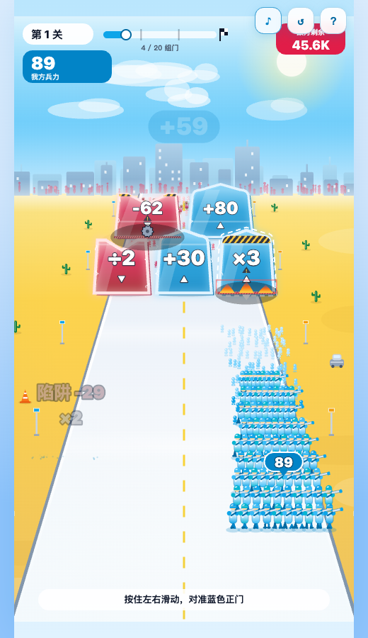
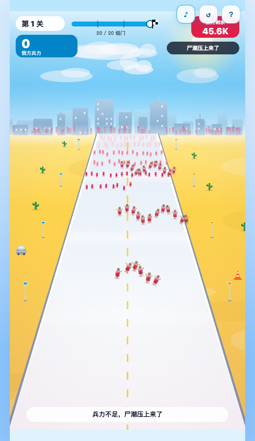

# 诚实数字门 · 打僵尸

> 每一关都是广告里那个玩法：选数字门 → 兵力增减 → 自动开火清僵尸 → 结算进下一关。
> 没有隐藏玩法，没有骗人广告。从第 1 关到无限关，玩法完全一样。

<p align="center">
  <a href="https://guyue55.github.io/honest-gate-zombies/"><b>▶ 在线试玩</b></a> ·
  <a href="#双击即玩">本地双击即玩</a> ·
  <a href="docs/DEPLOY.md">部署说明</a> ·
  <a href="docs/TEST_REPORT.md">测试报告</a> ·
  <a href="docs/V4-AUDIT.md">V4 审查清单</a>
</p>

<p align="center">
  
  
  
  
  
</p>

<p align="center">
  
  
  
</p>

<p align="center">
  
  
</p>

> 以上为 V4 最终代码的真机截图（V3 版图片仍保留在 `docs/screenshots/` 作历史对照）。
> 徽章与截图只出现在 README 里；**游戏本体 `index.html` 没有任何外链**，运行时外部请求数为 0。

## 玩法

竖屏跑道自下而上自动前进，左右移动队伍对准蓝色正门（`+` / `×`）增兵、避开红色负门（`−` / `÷`）；
每关 **20–30 组门**（第 1 关 20 组，每 2 关 +1，Boss 关 +3，第 20 关起封顶 30 组），单关净操作时长 **约 40–58 秒**。
门型每 12 组出现一次「冲刺门」，另有约 12% 的「风险门」——**乘法/加法正门上直接挂陷阱**（扣 25%），
所以「看到红门就绕开」和「看到红门就冲」都是错的，必须按当前兵力读两道门的净值。
穿完全部门组后队伍自动开火，进入 **9.5 秒三波战斗**（Boss 关 13 秒）：**战斗中可继续左右拖拽集火**，
准星偏离会掉命中率，结算按命中率与连击给出 **S / A / B / C / D 评级**（纯表现层，不影响兵力与胜负）。
**清空本关全部僵尸即过关**，每 5 关一个带独立血条的 Boss。
胜负由进入战斗时的兵力与敌方战力确定性对拼决定，数值全部在 HUD 可见、可心算、可复现；
敌方战力按「每组只走安全门」的稳妥路径的 72% 校准，**稳妥走法必定可过**（余量约 39%），冒险走法收益更高但不影响可胜性。
失败免费无限重试本关，不扣任何东西、不等待、不降难度。没有登录、内购、广告、外链与局外系统。

## 操作

- **触屏**：按住左右滑动 / 拖拽选门；战斗阶段同样拖拽可集火
- **键盘**：`A` / `D` 或 `←` / `→` 移动队伍；`空格` / `回车` 确认按钮、跳过门组预览
- **鼠标**：按住拖拽移动队伍
- **右上角**：静音、重开本关、帮助（含资源健康表）

手感层：穿门有 38–85ms 顿帧（倍率越高/踩陷阱越重）、分级震动（2 / 4 / 7 / 9 px）、
连续正门有连击计数与半音递增音高；队伍采用 88ms 时间常数的指数跟随，有重量但不拖沓。
**V4 战斗**：每 84ms 一拍错峰齐射，锥形曳光弹从士兵枪口飞向某一只僵尸；接触帧同帧触发
80ms 闪白、冲击环与火花、190ms 击退、击倒溶解与尸体留痕、命中音效；击倒数与 HUD 敌方剩余同步。
重击 / Boss 命中才叠加 45–60ms 顿帧与 5–8px 震动（带冷却），普通命中不震屏。
失败时不产生击倒、尸潮满编前压、兵力归零即停火，不再「输了还在清场」。
这些全是表现层：胜负仍由进入战斗时的入口快照一次性锁定。
`prefers-reduced-motion` 下震动、闪白、光爆、顿帧、粒子全部关闭，弹丸降级为细线，判定与数值不变。

## 画面

明亮高饱和的蓝 / 白 / 黄配色：晴朗天空与阳光、柔和城市天际线、白色立体跑道、路边油桶 / 路锥 / 废弃车 / 仙人掌；
半透明发光玻璃数字门配超大白色运算数字（按门洞宽度自适应缩字）；我方是圆润立体蓝白小人组成的人海，敌方是亮粉 / 亮红尸潮。
**挂陷阱的门在门板上直接印黄黑警示带 + `!` 三角**（地面陷阱会被近景队伍挡住，所以标识必须上移到门板）；
绘制顺序为 人海 → Boss → 我方近景 → 门 → 陷阱，门始终压住队伍、不被切断。
兵力数字气泡、顶部关卡进度条（含三段推进刻度与「已过 X / 共 N 组门」）、穿门光爆与深色胶囊底弹字、
V4 真实弹道（锥形曳光弹由枪口飞向僵尸）、接触帧枪口焰 / 冲击环 / 火花 / 闪白 / 击退、集火准星光带提供即时反馈。
首页、结算、帮助与 HUD 统一为白卡蓝字；灰阶下正负门仍可用「形状 + 运算符文字 + 明度 + 选中虚线框」四重编码区分，
`prefers-reduced-motion` 下关闭震动 / 光爆 / 粒子，低画质档自动降低人海与特效密度。
画面全部由 Canvas 2D 程序化绘制，不引用任何图片（调研用的商业游戏截图仅离线学习，未打包）。
调研依据、差距清单与二次分析确认见 `docs/VISUAL-UPGRADE.md`。

## 双击即玩

**直接双击 `index.html` 即可玩**（`file://` 协议），不需要 `npm install`、不需要构建、不需要本地服务器、不需要联网。
单文件内联了全部 CSS 与 JavaScript；所有画面由 Canvas 2D 绘制，所有音效与循环 BGM 由 Web Audio 实时合成，
字体使用系统字体栈。运行时外部网络请求数为 **0**，断网 / 飞行模式下完整可玩。
删除 `assets/`、`docs/`、`tests/` 目录后游戏功能完全不变。

## GitHub Pages 发布

已上线：**https://guyue55.github.io/honest-gate-zombies/**

配置是 `main` 分支 / `/ (root)` 的「Deploy from a branch」，不需要构建命令或 Actions。
根目录 `index.html` 就是站点入口，`.nojekyll` 防止 Jekyll 改写，所有引用均为相对路径，
因此挂在项目站点子路径 `/honest-gate-zombies/` 下也不会 404。
发布步骤、部署自检、自定义域名与故障排查见 [`docs/DEPLOY.md`](docs/DEPLOY.md)。

## 资源自愈机制（默认关闭，零请求）

所有资源都登记在 12 条内联清单中，默认 `primary` 为空、由程序化 generator 产出，因此默认态
`externalRequestCount === 0`、`summary.generated === 12`、`gameplayBlocked === false`。
机制为「主源 → 备用源（可多个）→ 程序化生成兜底」三级回退，每级带超时、重试上限 2 与失败原因记录，
**任何失败都不会阻断游玩**。三档 mode：

| mode | 开启方式 | 行为 |
|---|---|---|
| `off`（默认） | 无参数 | 零请求，全部走 generator |
| `local` | `?assets=local` 或帮助面板 | 仅 http(s) 下尝试同源相对路径 `assets/manifest.json` |
| `remote` | `?manifest=<encodeURIComponent(远程清单 URL)>` 或帮助面板输入 URL | 远程清单 + 本地缓存 + TTL 版本比对 |

`file://` 协议下所有联网分支硬短路（记 `file-protocol-skip`），不产生任何请求。
帮助面板可查看每条资源的 `status`（`generated` / `ok` / `fallback` / `degraded` / `skipped`）、
当前源、失败原因、耗时与降级次数，并可用 [刷新资源] 重跑计划。

## 调试只读接口

页面暴露 4 个只读 `window.__*` 命名空间（无写接口，不能跳关或改数值）：

- `window.__GAME_CORE__` —— 冻结的纯函数核心（严格 **26 项 API**，可被 Node `vm` 抽取断言；
  `buildScene` / 透视投影函数属 `game-render` IIFE 局部，不是 Core 导出）
- `window.__GAME_DEBUG__` —— 只读 getter，返回冻结快照：`level` / `phase` / `power` / `enemyPower` /
  `gates` / `lastGateResult` / `gateChoices` / `outcome` / `frameCount` / `phaseTrace` /
  `phaseTraceHistory` / `paused` / `inputLocked` / `entryPower` / `isBoss` 等；所有 BigInt 均为十进制字符串。
  另含 3 个只读 number 位置反馈字段：`targetX`（0–480，取输入层 `targetX`）、
  `currentLane`（由 `targetX` 与当前门组 `doorCount` 推导的 lane 索引）、
  `activeGroup`（即将判定的门组索引），供键盘闭环自动化使用。
  V3 追加的只读观测字段：`bestPath`（每组最优门的 0-based 数组下标，供 QA 稳定通关）、
  `tS1 / tS2 / tS3`（三阶段已耗时 ms）、`combo` / `bestCombo` / `grade` / `focusScore` / `focusX` /
  `battleWave` / `sector` / `groupCount` / `battleMs`，均**不参与判定**；
  `gates[]` 内每道门新增 `trapped` 只读事实位（该门是否挂陷阱），
  因为 `traps[]` 只保留渲染窗口内的陷阱，无法反推全程踩坑
- `window.__ASSET_HEALTH__` —— 只读 getter，资源健康快照（含 `externalRequestCount`、
  `gameplayBlocked`、`assets`、`summary`、`mode`、`manifestVersion`、`lastUpdated`）
- `window.__ASSET_TEST_HOOKS__` —— 冻结对象，资源故障注入专用：`simulateFailure({primary,fallbacks,timeout})`、
  `reset()`、`setMode(mode,url)`、`getLoader()`、`refresh()`；仅影响资源状态，不改兵力 / 关卡 / 胜负，
  使用 MockLoader 全程零真实网络 IO

## 接口细节（QA / 自动化依赖）

- **按钮文案**：首页 `#btn-start`「开始游戏」、`#btn-mute-home`「♪ 声音：开 / ♪ 声音：关」；
  HUD `#btn-mute` ♪ / `#btn-restart` ↺ / `#btn-help` ?；胜利 `#btn-next`「下一关」；
  失败 `#btn-retry`「重试本关」；帮助 `#btn-refresh`「刷新资源」、`#btn-close-help`「返回」。
  失败浮层标题「再来一次，不看广告」在源码中用 HTML 实体规避静态字面量检索，`inner_text` 渲染结果不变。
- **浮层类型**：首页 / 胜利 / 失败 / 帮助全部是 **DOM 覆盖层**（`div.overlay > div.card`，用 `.hidden` 切换），
  不是 Canvas 内绘制；Canvas 只负责场景（含 HUD 文字、S1 门组预览）。
- **`simulateFailure(opts)`**：参数为 `{primary, fallbacks, timeout}`；实际生效的是 `timeout`
  （`true` 走 MockLoader 定时超时、reason=`timeout`；`false` 时主源 `404`、备用源 `timeout`）。
  `primary` / `fallbacks` 被接受，但当前 MockLoader 恒失败、语义等价。`await` 注入后
  `summary.degraded === 12`、`gameplayBlocked === false`、`externalRequestCount === 0`、
  零真实网络 IO；`await reset()` 恢复默认 `off` 态 `generated === 12`。
  `simulateFailure(opts)` / `reset()` **均返回 `Promise<AssetHealthSnapshot>`**：内部对 12 条资源
  串行执行三级回退（`timeout:true` 约 360ms），**调用方必须 `await`**
  （Playwright `page.evaluate` 会自动 await 其返回的 Promise）才能读到最终健康快照；
  未 await 而「立即读」只能看到上一次已落盘的状态，不代表本次注入结果。
- **`__ASSET_TEST_HOOKS__` 方法**：`simulateFailure(opts)` / `reset()` / `setMode(mode, url)` /
  `getLoader()` / `refresh()`（冻结对象，仅影响资源状态，不改兵力 / 关卡 / 胜负）。
- **键盘步长**：按住 `A` / `D` / `←` / `→` 时按 **360 px/s** 连续积分（每帧 `step = 360 * dt/1000`），
  `targetX` 夹在 `[0,480]`；`空格` / `回车` 为确认键。
- **`outcome.powerBefore`**：穿完全部门组后、进入 S3 战斗**前**的兵力（`battleP0`），
  不是本关初始 `entryPower`；在 debug 快照里是十进制字符串。
- **`bestPath` / `applyGatePath` 语义**：`bestPath(level).path[i]` 是第 i 门组 `grp.gates` 的
  **0-based 数组下标**；`applyGatePath(power, path, level)` 的 `path` 形如 `{group, door}[]`，
  `door` 同为 `grp.gates` 的 0-based 下标。`verifySolvable().path` 与之一致；
  `gateChoices` 记录玩家实际对准的 lane 索引（因 `gates[m].lane === m`，与下标数值等价）。

## 自检

- Node 抽取 `<script id="game-core">` 后 `vm.runInNewContext` 可拿到纯函数集合，1–1000 关逐关
  `verifySolvable` 100% 通过、`tunedRounds === 0`、每组至少一正门且至少一负门、最优必胜且最差必败；
  另有 L1–L200 不变量：每组必有「正门且无陷阱」、`bestPath × 10 ≥ enemy × 11`、稳妥路径必可过关
- 静态审计：`game-core` 严格 26 项 API、7 个 script 块顺序固定、
  `game-core` / `game-session` 块内无 `ctx.*`、硬性禁用模式零命中
- 真实浏览器 `file://` / `http://` 双协议全量回归：控制台零报错、
  `performance.getEntriesByType('resource')` 无 http(s) 项、1–5 关（含 Boss）完整通关、
  三端输入各独立通关、20 次失败免费重试、断网 12 关、资源降级注入、
  首页 / S1 / S2 / S3 / S4 截图目视验收、灰阶与 `prefers-reduced-motion` 降级、
  20–30 组门满屏帧率 ≥45fps、单关实测 41–52 秒
- 可静态托管性守卫：单文件、零外链、无根绝对路径、引用文件大小写一致、体积 ≤300 KiB
- V4 战场观测：debug 快照的 `combat{shots,hits,kills,bullets,alive}` 可核对
  「子弹真的命中僵尸」；真机胜利 `kills=30 / alive=0`，失败 `kills=0 / alive=30`

## 仓库结构

```
index.html                   ← 游戏本体（唯一必需文件，双击即玩）
.nojekyll                    ← Pages 跳过 Jekyll
assets/manifest.json         ← 资源清单（默认零请求，仅 ?assets=local 时可能读取）
scripts/check-deploy.mjs     ← 可静态托管性守卫
tests/                       ← Node 三层 + Playwright 双协议回归 + 截图证据
docs/                        ← PRD / 架构 / 渲染 / 测试报告 / 视觉 / V4 审查 / 部署
docs/screenshots/            ← README 展示用精选图
.github/workflows/ci.yml     ← push / PR 跑 Node 四层自检
```

## 文档索引

| 文件 | 内容 |
|---|---|
| [`docs/DEPLOY.md`](docs/DEPLOY.md) | 在线地址、Pages 配置、发布流程、验收清单、故障排查 |
| [`docs/TEST_REPORT.md`](docs/TEST_REPORT.md) | 全量测试报告；§13 V3、§14 V4 为最新版本 |
| [`docs/V4-AUDIT.md`](docs/V4-AUDIT.md) | V4 全面审查清单、联网调研依据、硬约束复核 |
| [`docs/VISUAL-UPGRADE.md`](docs/VISUAL-UPGRADE.md) | V2/V3 视觉迭代与逐屏缺陷定位 |
| [`docs/PRD.md`](docs/PRD.md) · [`docs/ARCHITECTURE.md`](docs/ARCHITECTURE.md) | 需求与 26 项 Core API / 状态机契约 |
| [`docs/RENDERING.md`](docs/RENDERING.md) · [`docs/RESEARCH.md`](docs/RESEARCH.md) | 2.5D 透视与早期玩法调研 |
| [`CHANGELOG.md`](CHANGELOG.md) · [`CONTRIBUTING.md`](CONTRIBUTING.md) · [`SECURITY.md`](SECURITY.md) | 版本记录 / 贡献约束 / 隐私与安全 |

## 开发

零依赖、零构建：

```bash
npm test                                              # 四层 Node 自检，不需要 npm install
npm run serve                                         # http://127.0.0.1:8080
python3 tests/browser_check.py --protocol file        # 真机全量回归（约 30 分钟）
python3 tests/browser_check.py --protocol http --port 8765
```

改动前请读 [`CONTRIBUTING.md`](CONTRIBUTING.md) 的六条硬约束，尤其是
「26 项 Core API 不变」「胜负由入口快照锁定」「表现层不得写入兵力」。

## 许可

[MIT](LICENSE) © 2026 guyue55。画面、音效与关卡全部程序化生成，仓库内不含任何第三方游戏素材。
