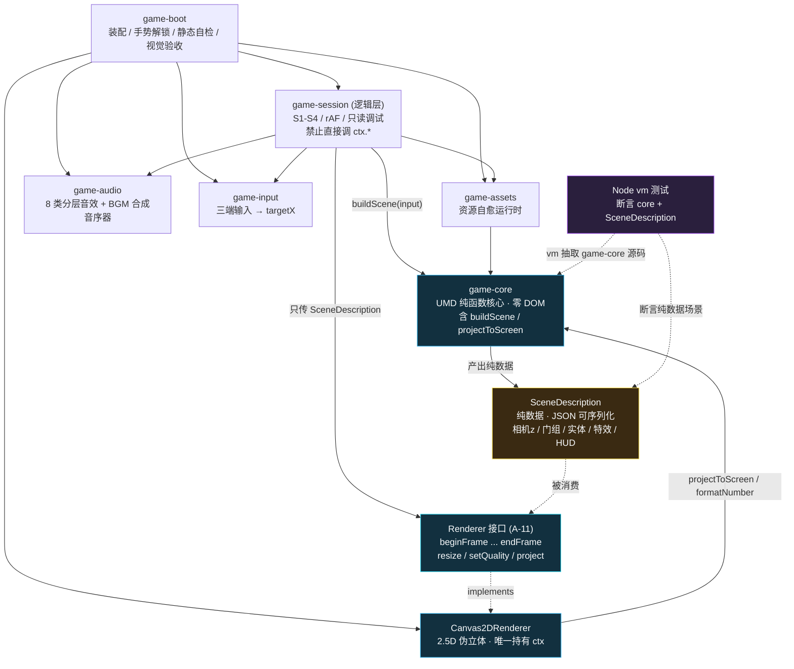
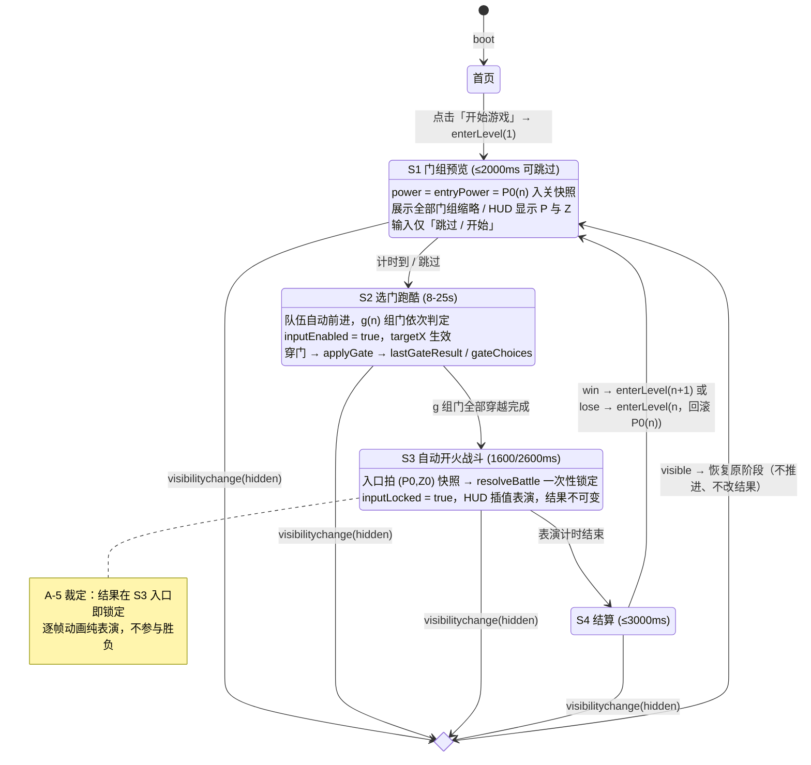
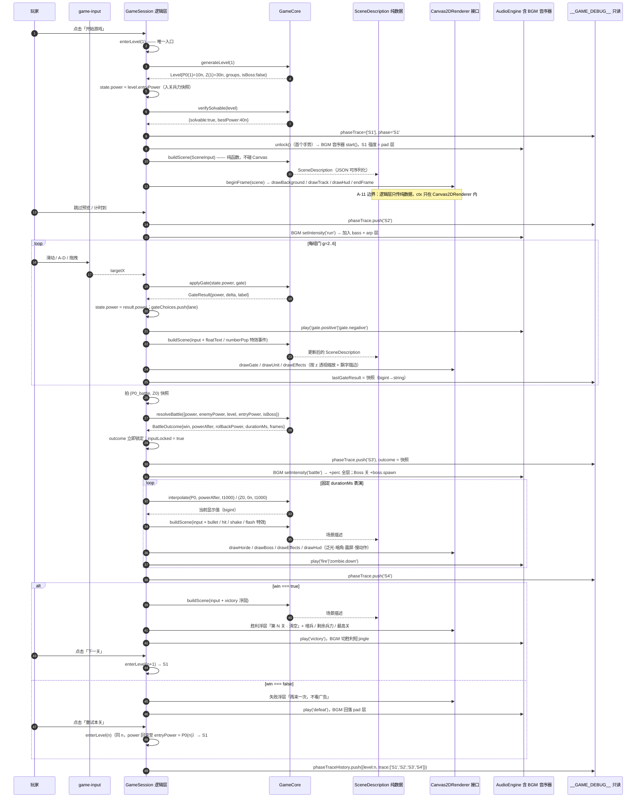
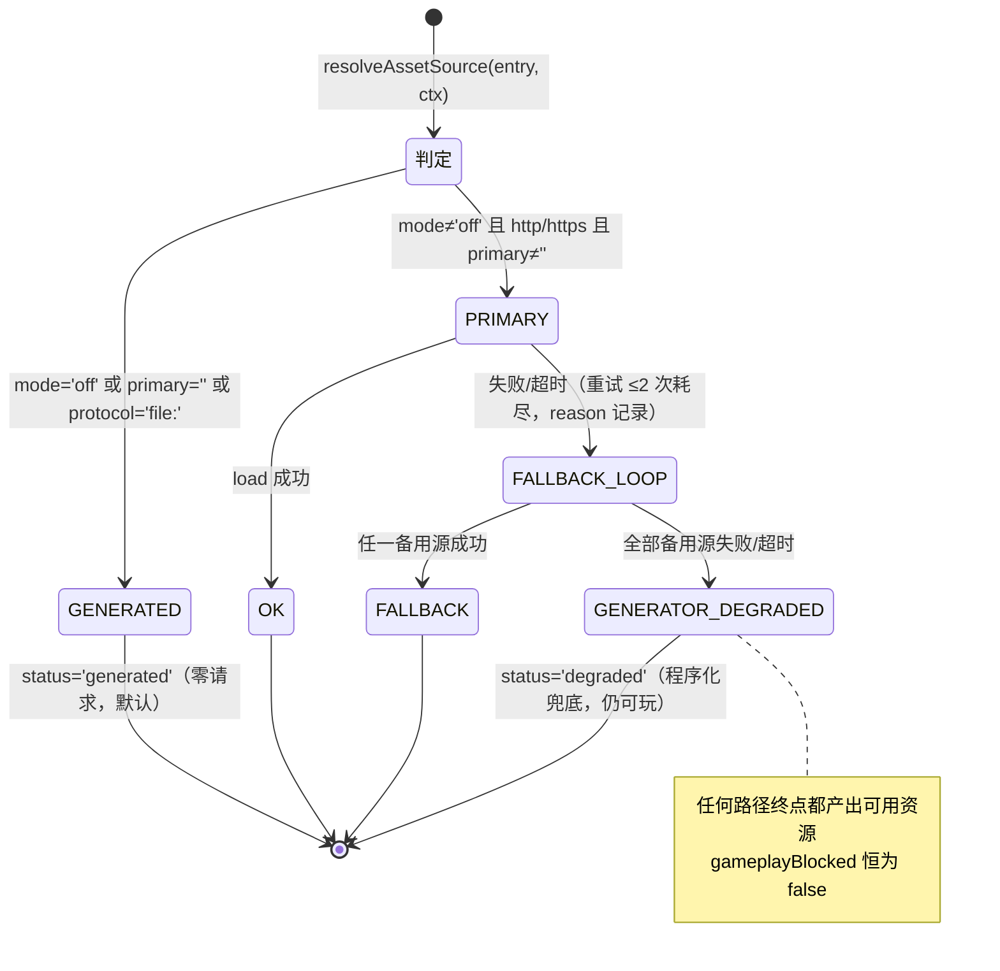
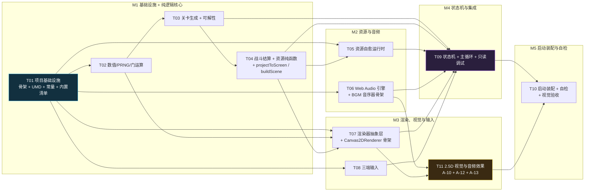

# 系统架构设计与任务分解 · 诚实数字门 · 打僵尸

> 项目代号：`honest_gate_zombies`
> 撰写人：高见远（架构师）｜任务 #2｜日期：2026-11-09（含交付总监增补 A-9 ~ A-13）
> 上游输入：`docs/PRD.md`（许清楚，任务 #1）、`docs/RESEARCH.md`（24 条来源）、交付总监齐活林派发的架构约束 **A-1 ~ A-13**（A-9~A-13 为用户「充分思考技术与效果，如 Three.js」要求触发的增补，已联网核查）
> 下游：工程师（任务 #3，照本文档一次性写完全部 `index.html`）、QA（任务 #4，照本文档写 Node 断言与浏览器验证）
> 语言：简体中文。本文所有裁定均为**最终规格**，不含「待定」，不含向用户提问（H-7）。

> **⚠️ 执行基线优先级提示（2026-11-10 补充）**：本文 A-9~A-13 为后补的视觉/音频/渲染设计增补，其**方向与结论有效**，但其中部分**可执行数字与接口归属**已由 `docs/SPEC-UNIFICATION.md`（裁决 U-1~U-10，优先级最高）覆盖，**实现与测试一律以裁决单为准**：
> - `GameCore` 严格 **26 项 API**；本文 §3.2 的 API 27 `projectToScreen` / API 28 `buildScene` **不落地为 Core 导出**，二者属 `game-render` IIFE 局部函数（U-1/U-2）。
> - 2.5D 透视公式以 `docs/RENDERING.md` §2 为准（本文 A-10 的 `256.2+529.5·z^2.2` 等数字**不执行**）；BGM 以 `RENDERING.md` §6 为准（BPM 128 / 8 小节 / 四轨）。
> - 实现任务按 **T01→T10**，不新增 T11。
> - 本文 §3.4.4 第 8 条、§13、§14 中针对 `projectToScreen` / `buildScene` 的 Node 断言与「28 项签名」描述均为**被裁决覆盖的历史设计**，不是交付验收项；交付实测口径见 `docs/TEST_REPORT.md`。

> **编号体系说明（避免混淆）**：本文存在两套 `A-x` 编号，含义不同——
> ① **架构约束 A-1 ~ A-13** = 交付总监派发的硬规格，落点见 §0.2，其中 A-9~A-13 对应文档中的「A-9 章节」「A-10 章节」……「A-13 章节」；
> ② **PRD 验收 A-1 ~ A-15** = PRD §9 的验收口径，在 §14 中一律标注为「PRD A-x」。
> R-xx 为 PRD 需求编号，D-xx 为 PRD 决策编号，H-x 为 PRD 硬约束编号，N-xx 为本文技术难点编号，Txx 为本文实现任务编号。
>
> **⚠️ V3/V4 现行参数提示**：本文正文保留 V1 时点的 `BATTLE_MS=1600` / `BOSS_BATTLE_MS=2600` /
> `inputLocked=true` 等旧值；现行 `9500` / `13000` / 可集火 / V4 确定性弹道，见 §6.2 前的
> 「V3/V4 现行口径勘误（2026-11-14）」与 `docs/V4-AUDIT.md`、`docs/TEST_REPORT.md` §13、§14。

---

## 0. 架构总览与约束继承

### 0.1 约束优先级（冲突时从上到下裁决）

```
交付总监架构约束 A-1 ~ A-13（本文 §0.2 逐条落点；A-9~A-13 为增补，不推翻 A-1~A-8）
  > 产品硬约束 H-1 ~ H-8（PRD §3）
    > PRD 决策清单 D-01 ~ D-23（PRD §8）
      > 团队默认技术栈模板（Vite + React + MUI + Tailwind）  ← 被 D-01 明确覆盖，不采用
        > 通用惯例
```

### 0.2 A-1 ~ A-13 落点索引

| 约束 | 本文落点 |
|---|---|
| **A-1** 单文件内联交付 / 相对路径 / 删 assets 与 docs 不变 | §1.3、§2.1、§2.2、§2.3、§12.8 |
| **A-2** 同源代码抽取协议 + UMD + GameCore 完整 API | §3.2、§3.4、§3.5、§10.1 |
| **A-3** 资源动态获取与自愈（真实可运行）+ 故障注入 | §7 全节、§4.4、§4.3 |
| **A-4** 数值系统 BigInt + 确定性公式 + 可解性 | §5 全节、§3.3 |
| **A-5** S3 逐帧 vs 快照判定的歧义裁定 | §6 全节、§8.1 |
| **A-6** 测试边界（禁写接口 / Node 批量断言 / 浏览器真验） | §10 全节、§8.4 |
| **A-7** 视觉与交互规格（分层渲染 / 四重编码 / 音频） | §9 全节、§12.5、§12.6 |
| **A-8** 状态机 S1–S4 + phaseTrace | §8 全节、§4.3 |
| **A-9** 渲染技术选型评估（Three.js 等 5 方案横评 + 3D 演进路径） | **A-9 章节**、§1.2、§13-15 |
| **A-10** 2.5D 伪立体视觉规格（透视公式 / 分层 / 门 / 单位 / 后处理 / 画质档） | **A-10 章节**、§9、§12.5、§12.6 |
| **A-11** 渲染器抽象层 + 纯数据场景描述 + `Renderer` 接口 | **A-11 章节**、§3.2（API 27/28）、§4.1、§4.2、§4.5、§12.10 |
| **A-12** 音频效果（合成音序器 BGM + 音效分层） | **A-12 章节**、§9.6、T06、T11 |
| **A-13** 验收补充（截图比对 / 控制台 / 五视口 / 帧率） | **A-13 章节**、§10.2、§14、T11 |

### 0.3 一句话架构

> **一个 `index.html`，内联全部 CSS 与 7 个按职责切分的 `<script>` 块；第 1 块是 UMD 包装、零 DOM 依赖的纯函数核心 `GameCore`，可被 Node 用 `vm` 直接抽取断言；其余 6 块（资源 / 音频 / 渲染 / 输入 / 会话 / 启动）只通过 `window.__GAME_CORE__` 消费纯逻辑；游戏逻辑只产出纯数据「场景描述」，经定死的 `Renderer` 接口交给当前 `Canvas2DRenderer` 做 2.5D 伪立体渲染（未来可替换实现而不动核心与关卡逻辑）；默认全部图形由 Canvas 2D 绘制、全部音效与循环 BGM 由 Web Audio 合成，运行时外部请求数恒为 0；资源自愈是「默认零请求」+「显式启用后三级回退且永不阻断」两套并存的可运行机制。**

### 0.4 为何覆盖团队默认 Vite + React + MUI + Tailwind 模板

引用 **PRD D-01**（并受 H-2 / R-01 / R-02 / R-08 / R-09 支撑）：产品硬约束要求「纯静态零构建、双击 `index.html` 即玩、零运行时外部依赖、断网可玩、GitHub Pages 根目录直接发布」。

- 任何框架（React / MUI / Tailwind）都需要 `npm install` + 构建产物 + 运行时 JS 加载，与「零构建、单文件可分享」直接冲突；
- Vite 构建产物是多文件 + 绝对路径 `/assets/...`，在 GitHub Pages 项目站点子路径下会 404（RESEARCH **E11**、PRD §7），且 `file://` 下 ES module 会被 CORS 拦截（RESEARCH **C20**）；
- MUI 组件、Tailwind 运行时、图标字体都引入外部资源或字节码，违反 R-02「运行时请求数 = 0」与 R-08「无任何外部字体 / 图标」；
- Canvas 2D + Web Audio 是浏览器原生 API，零依赖即可完成全部视觉与音效，且天然免疫 RESEARCH §7 的 9 类静态站点坑（`file://` 拦截、子路径、混合内容、字体 CORS、CDN 失效、缓存不失效、Jekyll 吞资源、自动播放策略、同屏性能）。

**结论：不引入任何第三方框架与库（§1.2 的「第三方包清单」为空），本报告同时满足团队角色模板中「Framework and library selections with justification」——选型结论就是「零第三方，原生 Web 平台」。**

---

## 1. 实现方案与框架选型

### 1.1 核心技术难点与对策

| # | 难点 | 根因 | 对策 | 落点 |
|---|---|---|---|---|
| N-1 | 单文件内联 JS 无法被 Node `require` | HTML 里的 `<script>` 不是模块 | UMD 包装的 `<script id="game-core">` + 字符串/`vm` 同源代码抽取协议 | §3.4 |
| N-2 | 兵力从第 1 关继承到 1000 关指数爆炸 → `Infinity` / 精度失真 | `Number` 上限 ≈ 1.8e308 且 > 2^53 失精 | 全部 `bigint`；门值 / Z / P 全程 BigInt，禁止混合 `number` 算术 | §5.1 |
| N-3 | `generateLevel(n)` 要纯函数可复现，又要「门值随当前兵力动态配平」 | 运行时 P 依赖玩家路径 | 门值与 Z 全部锚定 `P0(n)`（n 的闭式纯函数），运行时偏离由「失败免费重试」覆盖 | §5.4、§13-7 |
| N-4 | 「1–1000 关 100% 可解」不能靠概率 | 随机门组可能全负 / 倍率不足 | **构造式保证**：每组固定 ≥1 道「倍率 ≥2」正门 → `P_best ≥ P0·2^g` 恒 ≥ `1.1·Z`；`verifySolvable` 交叉相乘断言 + 确定性调参兜底 | §5.6 |
| N-5 | PRD 5.3 逐帧伤害与「唯一快照判定」自相矛盾 | 文案冲突 | S3 入口拍 `(P0,Z0)` 快照一次性锁定结果，动画纯表演插值，期间锁输入 | §6 |
| N-6 | 「动态获取资源」与「零运行时外部请求」冲突 | 远程清单本身就是请求 | 三档 `mode`（off / local / remote）：默认 off 零请求；启用后仍三级回退且 `gameplayBlocked` 恒 false | §7.3 |
| N-7 | 故障注入测试不能真发请求 | 真请求违反零请求验收 | `AssetLoader` 显式依赖注入 + `MockAssetLoader` 替身 | §7.6 |
| N-8 | `bigint` 无法通过 CDP / JSON 暴露给 QA | JSON.stringify(BigInt) 抛错 | 跨 `window.__*` 边界一律 `.toString()` 十进制字符串；core 内部保持 bigint | §12.2 |
| N-9 | 大兵力同屏绘制卡顿 | RESEARCH C7 公开短板 | 绘制单位上限 120，超出由 HUD 大数字表达；粒子 / DPR / 帧率自适应 | §9.3、§9.4 |
| N-10 | `file://` 下 fetch 被 CORS 拦截 | RESEARCH C20 | `file:` 协议下所有 fetch 分支直接短路，`reason='file-protocol-skip'` | §7.4 |
| N-11 | 失败重试「回滚入关兵力快照」可能因入关兵力不足而死锁 | 跨关继承 + 重试 | 每关 S1 由唯一入口 `enterLevel(n)` 规范化为 `P0(n)`，从数学上根除死锁 | §6.4、§13-2 |
| N-12 | Three.js / WebGL 方案与「单文件 + `file://` + 零构建 + 零请求」不可兼得 | r161 起仅发 ESM；`file://` 下 ESM 被 CORS 拦截；加载器依赖 fetch+ArrayBuffer | **明确排除 3D 引擎**，5 方案横评后选 Canvas 2D；未来 3D 演进走渲染抽象层替换且仅 http(s) 可选启用 | A-9 章节、§13-15 |
| N-13 | 要接近广告素材的立体爽感，又不能用真 3D | 平面 Canvas 缺乏纵深 | **2.5D 伪立体**：透视投影纯函数 `projectToScreen(z,x)` + 近宽远窄梯形 + z 缩放 + 雾化/亮度衰减 + 分层后处理 | A-10 章节 |
| N-14 | 渲染逻辑直接调 `ctx.*` 会绑死实现、且无法被 Node 断言 | 逻辑与绘制耦合 | **纯数据 `SceneDescription` + 定死 `Renderer` 接口**（A-11）；场景描述全为 JSON 可序列化数据，复用 A-2 的 `vm` 协议断言 | A-11 章节、§3.2（API 27/28） |
| N-15 | WebGL 在微信内置浏览器 / 低端安卓 / 无 GPU / headless 环境可用性不确定；同屏 120+ 单位易掉帧 | RESEARCH C7 公开短板 + 设备碎片 | 绘制上限 120 + **高/中/低画质自适应档位**（按 dpr 与实测帧率滞回切换）+ `prefers-reduced-motion` 降级 | A-10 章节、§9.1 |
| N-16 | 需要「魔性 BGM」但不能有音频文件请求 | RESEARCH 素材考据 + H-2 零请求 | **Web Audio 合成音序器**（lookahead 排程、纯振荡器/噪声/包络，8 小节循环） | A-12 章节 |

### 1.2 框架与库选型（结论：零第三方）

| 能力 | 选型 | 理由 |
|---|---|---|
| UI / 渲染 | **原生 Canvas 2D API**（2.5D 伪立体投影） | H-6 / R-08；零字节外部资源；分层可控；详见 A-9 横评 |
| 立体感 / 纵深 | **自研纯函数透视投影 `projectToScreen(z, x)`**，不引 Three.js / PixiJS / WebGL | A-9 结论：3D 引擎三条落地路径均违反硬约束；纯函数可被 Node 断言 |
| 渲染解耦 | **纯数据 `SceneDescription` + `Renderer` 接口**（当前实现 `Canvas2DRenderer`） | A-11；逻辑不碰 Canvas API，未来可替换渲染器而不动核心与关卡逻辑 |
| 音效 / BGM | **原生 Web Audio API**（`OscillatorNode` + `GainNode` + 噪声 buffer + lookahead 音序器） | H-6 / R-09 / A-12；无音频文件请求 |
| 字体 | **系统字体栈** `-apple-system, BlinkMacSystemFont, "PingFang SC", "Microsoft YaHei", sans-serif` | 规避字体 CORS（RESEARCH C19/E10） |
| 输入 | **Pointer Events** + `keydown` + 原生鼠标事件 | 三端统一，无需库 |
| 状态管理 | **单个 `GameSession` 对象 + 局部闭包**，无 Redux / 无事件总线 | 单文件、状态少，避免过度抽象 |
| 模块化 | **同文件多 `<script>` 块 + IIFE + UMD**，块间显式传参装配 | 零构建前提下唯一可行的隔离手段 |
| 测试 | **Node 内置 `fs` + `vm` + `assert`** | 零测试框架依赖，符合零构建 |
| 构建 / 打包 / CDN | **无** | H-2 / D-01 |

> **第三方包清单：`（空）`**。工程师不得在 `index.html` 引入任何 `<script src>` / `<link href>` / `@import` / CDN / npm 包，**明确包括 `three` / `three.js` / `pixi.js` / 任何 WebGL 封装与 3D 加载器**（A-9 已裁决排除）。

### 1.3 架构模式：单文件 + 分层 Script 块 + 纯函数核心

采用 **「Hexagonal / Ports-and-Adapters 的极简化」**：`GameCore` 是纯领域内核（Port 由函数签名定义），`game-assets / game-audio / game-render / game-input` 是适配器，`game-session` 是编排器，`game-boot` 是装配根。所有适配器**单向依赖**内核，内核**不反向依赖**任何适配器（依赖倒置通过显式参数注入，如 `resolveAssetSource(..., { loader })`）。

```
index.html
├─ <style> … 全部 CSS 内联（布局 / 首页 / 浮层 / 帮助面板 / 响应式 / reduced-motion） …
├─ <body> … 1 个 <canvas> + 极少量 DOM 覆盖层（首页 / 结算 / 失败 / 帮助面板 / HUD 按钮） …
├─ <script id="game-core">     ← UMD · 纯函数 · 零 DOM · 可被 Node vm 抽取   [A-2]
├─ <script id="game-assets">   ← 资源自愈运行时 / loader / hooks / 健康面板   [A-3]
├─ <script id="game-audio">    ← Web Audio 合成音效 + BGM 合成音序器          [A-12]
├─ <script id="game-render">   ← Renderer 接口 / SceneDescription / Canvas2DRenderer（2.5D）[A-10/A-11]
├─ <script id="game-input">    ← 三端输入统一映射
├─ <script id="game-session">  ← 状态机 S1–S4 / 主循环 / 只读调试快照        [A-8]
└─ <script id="game-boot">     ← 装配 / 首次手势解锁 / 静态自检 / 视觉验收自检 [A-13]
```

**关键隔离规则**：`game-core` 块内**禁止出现** `document`、`window`（作为对象访问）、`canvas`、`CanvasRenderingContext2D`、`localStorage`、`sessionStorage`、`fetch`、`XMLHttpRequest`、`AudioContext`、`Image`、`navigator`、`location`、`performance`、`Date`、`setTimeout`、`setInterval`、`requestAnimationFrame`、`console` 输出、`eval`、`Math.random`。该规则由 §3.4 的 mock 全局最小集合**自动守卫**（缺失即 `ReferenceError`）+ §12.7 静态检索双重保证。

> `window` 一词在 UMD 模板里仅以 `root` 形参形式出现（`root.__GAME_CORE__ = factory()`），`root` 由调用方注入为 `globalThis`；这是**依赖注入**而非全局访问，合法。

**第二条隔离规则（A-11，新增）**：`game-session`（游戏逻辑）**不得直接调用任何 Canvas API**（`ctx.*` / `canvas.getContext` / `createLinearGradient` 等）。逻辑层只产出**纯数据 `SceneDescription`**，由 `Renderer` 接口的 10 个绘制方法消费；`Canvas2DRenderer` 是唯一持有 `CanvasRenderingContext2D` 引用的模块。该边界在 §4.2 模块依赖图中显式画出，并由 §12.10 的静态检索守卫（`game-session` 块内出现 `ctx.` 即判失败）。

### 1.4 运行时零请求的形式化说明

- `externalRequestCount` 只统计**真正发起的** `fetch` / `XHR` / `` / `<audio>` / 字体 / 脚本加载。
- 默认态 `mode='off'`：所有资源条目 `status='generated'`，`externalRequestCount === 0`，`gameplayBlocked === false`（PRD A-11 / R-11）。
- 表现层所有图形来自 `ctx.*` 绘制，所有声音来自 `AudioContext` 振荡器，**不产生任何资源请求**。
- `assets/manifest.json`、`docs/`、`tests/`、`README.md`、`.nojekyll` 均为**开发期 / 测试期产物**，`index.html` 运行时不读取它们（除 §7.4 的显式启用路径，且失败即静默回退）。

---

## 2. 文件清单（绝对路径）

### 2.1 清单

| 绝对路径 | 类型 | 运行时是否依赖 | 说明 |
|---|---|---|---|
| `/Users/guyue/WorkBuddy/2026-11-09-23-46-11/index.html` | **主交付** | — | 单文件，内联全部 CSS + 7 个 `<script>` 块。双击 `file://` 即玩，GitHub Pages 根目录直接发布 |
| `/Users/guyue/WorkBuddy/2026-11-09-23-46-11/.nojekyll` | 部署标记 | 否 | 空文件，防止 Jekyll 忽略下划线目录（RESEARCH E10） |
| `/Users/guyue/WorkBuddy/2026-11-09-23-46-11/README.md` | 人读文档 | 否 | 玩法 / 部署 / 测试说明 / 诚实声明 |
| `/Users/guyue/WorkBuddy/2026-11-09-23-46-11/assets/manifest.json` | 可选同源清单 | 否（默认不加载） | **仅**在 `mode='local'` 且协议为 http/https 时被尝试；删除后功能完全不变 |
| `/Users/guyue/WorkBuddy/2026-11-09-23-46-11/docs/PRD.md` | 上游文档 | 否 | 已存在（任务 #1） |
| `/Users/guyue/WorkBuddy/2026-11-09-23-46-11/docs/RESEARCH.md` | 上游文档 | 否 | 已存在（任务 #1） |
| `/Users/guyue/WorkBuddy/2026-11-09-23-46-11/docs/ARCHITECTURE.md` | **本文档** | 否 | 任务 #2 交付 |
| `/Users/guyue/WorkBuddy/2026-11-09-23-46-11/docs/class-diagram.mermaid` | 图（附带） | 否 | §4.1 类图独立副本，供工具渲染 |
| `/Users/guyue/WorkBuddy/2026-11-09-23-46-11/docs/sequence-diagram.mermaid` | 图（附带） | 否 | §4.5 关卡流程时序图独立副本 |
| `/Users/guyue/WorkBuddy/2026-11-09-23-46-11/tests/core.test.js` | QA 脚本 | 否 | Node 纯函数批量断言（QA 依 §3.4 / §10.1 实现） |
| `/Users/guyue/WorkBuddy/2026-11-09-23-46-11/tests/extract-core.js` | QA 脚本 | 否 | §3.4 提取协议参考实现（QA 实现，本文给完整伪代码） |
| `/Users/guyue/WorkBuddy/2026-11-09-23-46-11/tests/static-audit.js` | QA 脚本 | 否 | 禁用词 / 无外部请求 / 无绝对路径静态自检 |

> 工程师任务 #3 **只需写 `index.html` + `.nojekyll` + `README.md` + `assets/manifest.json`**；`docs/` 与 `tests/` 由架构 / QA 产出。A-1 允许这些文件存在，但**运行时不得依赖其中任何一个**。

### 2.2 「删掉 `assets/` 与 `docs/` 后功能不变」的证明

1. `index.html` 内所有 `<script>` / `<style>` 均为内联，无 `src` / `href` 指向外部；
2. 默认 `mode='off'`，`buildAssetPlan` 直接返回「全部走 generator」的计划，**不访问** `location` 以外的任何文件；
3. `BUILTIN_MANIFEST` 是 `game-core` 内的**内联冻结常量**，与 `assets/manifest.json` 内容解耦（后者只是可选的同源更新副本）；
4. 唯一可能读取 `assets/manifest.json` 的路径在 `mode='local'` 且协议 http/https，且用 `try/catch` 包裹、404 时静默回退内置快照；
5. 因此删除两目录后，`file://` 双击、断网、Pages 发布三条路径行为完全一致（PRD A-1 / R-08 / 交付总监 A-1）。

### 2.3 相对路径规约（RESEARCH E11）

- **禁止**任何以 `/` 开头的绝对路径（如 `/assets/manifest.json`）——GitHub Pages 项目站点挂在 `/repository-name/` 下会 404。
- 唯一允许的相对路径字面量：`'assets/manifest.json'`（且仅 `mode='local'` 时用）。
- 查询参数开关 `?manifest=<encodeURIComponent(url)>` 与 `?assets=local` 使用 `URLSearchParams`，不涉及路径拼接。
- 所有 Canvas 绘制、DOM 浮层均为脚本内生成，无 `url(...)`、无 ``、无 `@font-face`。

---

## 3. GameCore 完整 API 与数据结构定义

### 3.1 数据结构（TypeScript / JSDoc 风格，工程师照此定义，QA 照此断言）

```ts
// ---------- 数值与门 ----------
type GateOp = 'add' | 'mul' | 'sub' | 'div';

interface Gate {
  id: string;            // 'g{group}d{door}'，如 'g0d1'
  op: GateOp;
  value: bigint;         // 恒 > 0n；mul/div 恒 >= 2n
  label: string;         // '+7' | '×3' | '-2' | '÷2'（core 生成字符串，不碰 DOM）
  positive: boolean;     // op==='add'||op==='mul'
  lane: number;          // 0..doorCount-1，横向门位
}

interface GateGroup {
  index: number;         // 0-based
  doorCount: number;     // 2 或 3
  gates: Gate[];         // length === doorCount
  worldY: number;        // 逻辑世界坐标（渲染层换算），core 只给相对序号
}

interface Level {
  level: number;             // n >= 1
  seed: number;              // seedFor(n)，uint32
  isBoss: boolean;           // n % 5 === 0
  groupCount: number;        // g(n) = min(6, 2 + floor(n/3))
  entryPower: bigint;        // P0(n)，本关规范起始兵力 = 入关快照
  enemyPower: bigint;        // Z(n)
  bossHp: bigint | null;     // Boss 关 = enemyPower，普通关 null
  groups: GateGroup[];       // length === groupCount
  theme: string;             // 里程碑配色标识 'default'|'lv10'|'lv20'|'lv50'|'lv100'
  milestone: string | null;  // 称号或 null
  tunedRounds: number;       // 确定性调参轮数（正常为 0）
}

interface GateResult {
  before: bigint;
  power: bigint;         // 运算后
  delta: bigint;         // power - before（可为负）
  op: GateOp;
  value: bigint;
  label: string;
}

interface Solvability {
  solvable: boolean;      // bestPower * 10n >= enemyPower * 11n 且每组有正门
  bestPower: bigint;      // 最优路径终值
  requiredPower: bigint;  // ceil(enemyPower * 11 / 10)（仅供展示）
  path: number[];         // 每组选中的门 lane
  everyGroupHasPositive: boolean;
  tunedRounds: number;
  reason: string;         // 'ok' | 'no-positive-gate' | 'insufficient-multiplier'
}

interface BattleOutcome {
  win: boolean;
  powerBefore: bigint;    // 进入 S3 的 P0（快照）
  enemyPower: bigint;     // 进入 S3 的 Z0（快照）
  powerAfter: bigint;     // 锁定结果：胜利 = max(1n, P - floor(Z*1/10))；失败 = 0n
  loss: bigint;           // 胜利时 = floor(Z * LOSS_NUM / LOSS_DEN)
  rollbackPower: bigint;  // = snapshot.entryPower（失败回滚目标）
  durationMs: number;     // 1600（普通）/ 2600（Boss），固定时长表演
  frames: number;         // ceil(durationMs / (1000/60))
  reason: string;         // 'power>=enemy' | 'power<enemy'
}

// ---------- 资源 ----------
type AssetStatus = 'generated' | 'ok' | 'fallback' | 'degraded' | 'skipped';
type AssetMode   = 'off' | 'local' | 'remote';
type AssetType   = 'visual' | 'audio' | 'font' | 'data';

interface ManifestEntry {
  id: string;             // 'bg.track' | 'sfx.gate' | 'unit.soldier' | ...
  type: AssetType;
  version: string;        // '1.0.0'
  primary: string;        // 默认 ''（无主源 → 零请求）
  fallbacks: string[];    // 默认 []
  timeoutMs: number;      // 默认 1500
  generator: string;      // 程序化生成器标识，恒有值
  required: false;        // 恒 false：任何资源都不是必需
}

interface Manifest {
  version: string;        // 内置快照版本
  ttlMs: number;          // 远程清单缓存 TTL
  updatedAt: number;      // epoch ms（常量，外部注入 now 时比对）
  entries: ManifestEntry[];
}

interface AssetLoader {   // 依赖注入点（§7.6）
  load(url: string, timeoutMs: number): Promise<{
    ok: boolean; data?: unknown; reason?: string; elapsedMs: number;
  }>;
}

interface AssetPlanItem {
  entry: ManifestEntry;
  mode: AssetMode;
  willRequest: boolean;        // false → 直接 generator，零请求
  sourceOrder: string[];       // ['primary', 'fallback:0', ...] 或 []
}

interface AssetPlan {
  manifestVersion: string;
  mode: AssetMode;
  protocol: string;
  remoteEnabled: boolean;
  items: AssetPlanItem[];
  plannedRequestCount: number; // mode='off' → 0
}

interface AssetResolution {
  id: string;
  status: AssetStatus;
  source: string;              // 'generator:<id>' | URL | ''
  reason: string;              // 'primary-404' | 'fallback-timeout' | 'disabled' | 'file-protocol-skip' | ''
  elapsedMs: number;
  attempts: number;
  downgradeCount: number;
}

interface AssetRuntimeState extends AssetResolution {
  lastUpdated: number;
}

interface AssetHealthSnapshot {
  manifestVersion: string;
  lastUpdated: number;
  externalRequestCount: number;  // 本次运行实际发起数（默认 0）
  gameplayBlocked: false;        // 恒 false
  remoteEnabled: boolean;
  mode: AssetMode;
  assets: Record<string, AssetRuntimeState>;
  summary: { generated: number; ok: number; fallback: number; degraded: number; skipped: number };
}

// ---------- 渲染场景（A-11：纯数据；全部字段 JSON 可序列化，无 bigint / 无函数 / 无 DOM 引用） ----------
// SceneDescription 由 GameCore.buildScene(input) 纯函数产出，复用 A-2 的 vm 协议即可被 Node 断言；
// 游戏逻辑（game-session）只产出它，不直接调用任何 Canvas API。完整规格见 A-11 章节。
type QualityTier = 'high' | 'mid' | 'low';
type Phase = 'HOME' | 'S1' | 'S2' | 'S3' | 'S4';

interface SceneInput {
  frame: number; level: number; phase: Phase; isBoss: boolean;
  cameraZ: number;              // 0..1，队伍所在纵深（透视原点）
  quality: QualityTier; reducedMotion: boolean; theme: string;
  powerText: string; enemyText: string; bossHpText: string | null;
  unitCount: number; hordeCount: number; gates: GateVisual[];
  effects: EffectEvent[]; muted: boolean; hintText: string;
}

interface GateVisual {
  id: string; group: number; lane: number; doorCount: number;
  z: number;                    // 0..1 纵深；0 最远（地平线），1 最近（脚下）
  op: GateOp; label: string; valueText: string; positive: boolean;
  thickness: number; glow: number; scanPhase: number;
}
interface UnitVisual {
  id: number; x: number;        // x ∈ [-1,1] 归一化横向
  z: number; scale: number; runPhase: number; shadow: number;
}
interface HordeVisual { count: number; z: number; density: number; tint: string; }
interface BossVisual { z: number; hpRatio: number; entrance: number; }
interface EffectEvent {
  kind: 'floatText'|'numberPop'|'particle'|'bullet'|'hit'|'shake'|'flash'|'slowmo'|'alarm';
  x: number; y: number; z: number; text?: string; amount?: number; t: number;
}
interface HudSnapshot {
  levelText: string; powerText: string; enemyText: string;
  bossHpText: string | null; hintText: string; muted: boolean;
}
interface PostFx {
  bloom: number; vignette: number; flash: number; shake: number;
  timeScale: number; alarm: number;
}
interface SceneDescription {
  version: 1; frame: number; level: number; phase: Phase;
  cameraZ: number; quality: QualityTier; reducedMotion: boolean;
  theme: string; isBoss: boolean;
  bg: { horizonY: number; fog: number; alert: number; lightPoles: number[] };
  track: { halfFar: number; halfNear: number; scroll: number };
  gates: GateVisual[]; units: UnitVisual[];   // units.length <= 120
  horde: HordeVisual; boss: BossVisual | null;
  effects: EffectEvent[]; hud: HudSnapshot; post: PostFx;
}
// 注意：SceneDescription 中一切数值均为 number / string / boolean，
// 兵力与战力在 buildScene 入参前已由 formatNumber / bigintToDecimal 字符串化（§12.2）。
```

### 3.2 `GameCore` 完整公开 API 签名清单（**定死，不得改名 / 改签名**）

> 所有函数均为**纯函数**（相同入参恒定返回），除 `resolveAssetSource` / `buildAssetPlan` 接收显式注入对象外不读取任何外部状态；所有 `bigint` 参数与返回值保持 BigInt，不做隐式 Number 转换。

| # | 组 | 签名 | 返回 / 语义 |
|---|---|---|---|
| 1 | PRNG | `makeRng(seed: number): () => number` | mulberry32，uint32 状态，返回 `[0,1)`。同 seed 序列完全一致 |
| 2 | PRNG | `seedFor(level: number): number` | `((level * 0x9E3779B1) >>> 0) || 1`，`generateLevel` 唯一随机源 |
| 3 | 数值 | `powInt(base: bigint, exp: number): bigint` | 快速幂（exp 为 number，仅作循环上界，**不参与 bigint 算术**）；O(log exp) |
| 4 | 数值 | `maxBig(a: bigint, b: bigint): bigint` | 替代 `Math.max`（BigInt 不可用） |
| 5 | 数值 | `formatNumber(v: bigint, opts?: { sig?: number, sciFrom?: number }): string` | 紧凑显示，见 §5.7；纯字符串操作，全程不转 Number |
| 6 | 数值 | `formatCompact(v: bigint): string` | `formatNumber(v, {sig:3, sciFrom:18})` 便捷别名 |
| 7 | 数值 | `bigintToDecimal(v: bigint): string` | `v.toString()` 包装，供跨 `window.__*` 边界使用 |
| 8 | 门 | `applyGate(power: bigint, gate: Gate): GateResult` | 见 §5.3 精确语义 |
| 9 | 门 | `applyGatePath(power: bigint, path: {group:number;door:number}[], level: Level): {power: bigint; results: GateResult[]}` | 逐组运算，返回完整结果链 |
| 10 | 门 | `bestPath(level: Level): {path: number[]; power: bigint}` | 每组选使 P 最大的门（确定性构造） |
| 11 | 关卡 | `gateCountFor(level: number): number` | **V3**：`min(30, 20 + floor(level/2) + (level%5===0 ? 3 : 0))`（旧值 `min(6, 2+floor(level/3))`，详见 `TEST_REPORT.md` §13.2） |
| 12 | 关卡 | `isBossLevel(level: number): boolean` | `level % 5 === 0` |
| 13 | 关卡 | `entryPowerFor(level: number): bigint` | `P0(n)`，见 §5.4 |
| 14 | 关卡 | `enemyPowerFor(level: number): bigint` | `Z(n)`，见 §5.4 |
| 15 | 关卡 | `milestoneFor(level: number): string \| null` | 10/20/50/100 关返回称号，其余 null |
| 16 | 关卡 | **`generateLevel(level: number): Level`** | **纯函数**，以 n 为唯一输入，含确定性调参兜底（§5.6） |
| 17 | 关卡 | **`verifySolvable(level: Level): Solvability`** | 精确定义见 §5.6（整数交叉相乘） |
| 18 | 关卡 | `tuneLevel(level: Level, round: number): Level` | 确定性调参：只依赖 level 与 round，**无 rng** |
| 19 | 战斗 | **`resolveBattle(snapshot: BattleSnapshot): BattleOutcome`** | §6.3；`BattleSnapshot = {power, enemyPower, level, entryPower, isBoss}` |
| 20 | 战斗 | `interpolate(from: bigint, to: bigint, t1000: number): bigint` | `t1000 ∈ [0,1000]` 整数千分比，纯 BigInt 线性插值（表演用） |
| 21 | 资源 | `BUILTIN_MANIFEST: Manifest` | `Object.freeze` 深冻结的内置快照常量（§7.1） |
| 22 | 资源 | **`buildAssetPlan(manifest: Manifest, opts: {mode: AssetMode; protocol: string; remoteUrl?: string; now: number}): AssetPlan`** | 纯函数；`mode='off'` → 全 `willRequest=false` |
| 23 | 资源 | **`resolveAssetSource(entry: ManifestEntry, ctx: {mode: AssetMode; protocol: string; loader: AssetLoader; maxRetries: number; now: number}): Promise<AssetResolution>`** | 三级回退状态机（§7.3）。**仅调用注入的 `loader.load()`，core 自身不 fetch** |
| 24 | 资源 | **`createHealthSnapshot(plan: AssetPlan, states: Record<string, AssetRuntimeState>, meta: {externalRequestCount: number; remoteEnabled: boolean; now: number}): AssetHealthSnapshot`** | 纯函数，`Object.freeze` 只读快照；`gameplayBlocked` 恒 `false` |
| 25 | 常量 | `CONSTANTS: Readonly<typeof CONSTANTS>` | §3.3 / §12.4 全部常量 |
| 26 | 常量 | `PHASES: readonly ['S1','S2','S3','S4']` | 阶段序列常量，供 QA 断言 |
| **27** | **渲染场景（A-10/A-11 增补）** | **`projectToScreen(z: number, x: number): {x:number; y:number; scale:number; fog:number; brightness:number}`** | 2.5D 透视投影**纯函数**，`z∈[0,1]`、`x∈[-1,1]`；公式见 A-10 章节；**纯 number 运算、不碰 Canvas**，可被 Node 断言（如 `projectToScreen(1,0) → {y:BOTTOM_Y, scale:1}`） |
| **28** | **渲染场景（A-11 增补）** | **`buildScene(input: SceneInput): SceneDescription`** | 由纯数据入参生成纯数据场景描述；**全 JSON 可序列化，无 bigint / 无函数 / 无 DOM 引用**；游戏逻辑只产出它，`Renderer` 消费它；复用 A-2 的 `vm` 协议断言 |

> API 总数 **28 项**（原 26 项签名**一个字未改**，27/28 为 A-10/A-11 的正向增补）。
> **JSDoc 约定**：工程师为每个公开函数写 `'/ @param' / '@returns'` 注释；所有 `bigint` 字面量必须带 `n` 后缀；所有门值生成中间量必须是 `bigint`；`projectToScreen` / `buildScene` 的入参与返回**不得出现 bigint**（渲染层为纯 number/string 数据）。

### 3.3 常量清单（`GameCore.CONSTANTS`，全部冻结）

```js
// bigint 数值常量
P0_BASE   = 10n;    GROW_NUM = 7n;   GROW_DEN = 6n;     // P0(n) = 10·7^(n-1)/6^(n-1) ≈ 每关 +16.7%
Z_MULT    = 3n;                                        // Z_base = 3·P0
BOSS_NUM  = 3n;     BOSS_DEN = 2n;                    // Boss 关 Z ×1.5
SOLVE_NUM = 11n;    SOLVE_DEN = 10n;                  // 可解性：P_best ≥ Z·11/10
LOSS_NUM  = 1n;     LOSS_DEN = 10n;                  // lossRatio = 0.1，固定不随 n 暗改
// number 常量（V3 2026-11-13：组数 6→30、战斗 1600/2600→9500/13000、预览 2000→1800、陷阱 1/5→1/4）
MAX_TUNE = 8; MAX_GATE_GROUPS = 30; MAX_DRAW_UNITS = 120;
PREVIEW_MS = 1800; BATTLE_MS = 9500; BOSS_BATTLE_MS = 13000; RESULT_MS = 3000;
MANIFEST_TIMEOUT_MS = 1500; MANIFEST_TTL_MS = 6 * 60 * 60 * 1000; ASSET_MAX_RETRIES = 2;
SEED_MIX = 0x9E3779B1; LOGICAL_W = 480; LOGICAL_H = 854;
// 2.5D 透视投影（A-10，全部 number；供 projectToScreen 使用）
HORIZON_Y = 256.2;      // 0.30 * 854 —— 地平线
BOTTOM_Y  = 785.7;      // 0.92 * 854 —— 队伍脚下/最近处
PERSPECTIVE_EXP = 2.2;  // screenY 非线性指数（远压缩、近拉开）
SCALE_MIN = 0.18; SCALE_MAX = 1.0; SCALE_EXP = 1.8;
HALF_FAR = 28; HALF_NEAR = 210; TRACK_EXP = 1.4;   // 跑道梯形半宽
FOG_MAX = 0.8; BRIGHT_MIN = 0.45; VIEW_DEPTH = 1200;   // worldY → z 归一化深度（A-10.1）
// 画质档位（A-10），按 dpr 与实测帧率滞回切换
QUALITY_HIGH = { dpr:2,   particles:240, units:120, bloom:1, vignette:1, scan:1, shadow:1 };
QUALITY_MID  = { dpr:1.5, particles:120, units:90,  bloom:1, vignette:1, scan:0, shadow:1 };
QUALITY_LOW  = { dpr:1,   particles:40,  units:60,  bloom:0, vignette:0, scan:0, shadow:0 };
FPS_WINDOW = 60; FPS_DOWN = 45; FPS_UP = 55; FPS_HOLD_MS = 3000;
// BGM 合成音序器（A-12）
BGM_BPM = 108; BGM_STEPS = 128; BGM_LOOKAHEAD_MS = 25; BGM_SCHEDULE_AHEAD = 0.1;
```

### 3.4 A-2 同源代码抽取协议（**给 QA 的精确规格，工程师必须配合**）

#### 3.4.1 `index.html` 内的 UMD 模板（原文，工程师不得改动结构）

```html
<script id="game-core">
(function (root, factory) {
  if (typeof module === 'object' && module.exports) module.exports = factory();
  else root.__GAME_CORE__ = factory();
})(typeof globalThis !== 'undefined' ? globalThis : this, function () {
  'use strict';
  /* ==== 纯逻辑区：禁止 DOM / Canvas / window / document / localStorage /
        AudioContext / fetch / Date / performance / Math.random / console 输出 ==== */
  var Core = { /* 所有 §3.2 API + CONSTANTS + PHASES + BUILTIN_MANIFEST */ };
  return Core;
});
</script>
```

**硬约束**：
- `<script>` 开始标签必须**恰好**为 `<script id="game-core">`（属性顺序可变，但 `id="game-core"` 必须存在且唯一），便于正则抽取；
- 块内**禁止出现字面字符串 `</script>`**（会提前截断 HTML 解析）——若需写该字符串，用 `'<\/script>'` 转义，见 §12.7；
- 块内**禁止出现 `Math.random`**（静态检索项）；
- 后续 6 个 script 块通过 `window.__GAME_CORE__` 只读消费，不修改其属性（`Object.freeze(Core)`）。

#### 3.4.2 Node 提取参考实现（`tests/extract-core.js` 伪代码，QA 实现）

```js
const fs = require('fs');
const vm = require('vm');
const path = require('path');

function extractCore(htmlPath, { browserBranch = false } = {}) {
  const html = fs.readFileSync(htmlPath, 'utf8');
  const re = /<script\s+id="game-core"[^>]*>([\s\S]*?)<\/script>/i;
  const m = html.match(re);
  if (!m) throw new Error('未找到 <script id="game-core">；请检查 A-2 模板');
  const code = m[1];

  // ---- mock 全局最小集合 ----
  const noop = () => {};
  const sandbox = {
    // 语言内置（core 合法使用）
    BigInt, Object, Array, String, Number, Boolean, Math, JSON,
    Map, Set, Promise, Error, TypeError, RangeError, Symbol, Function, RegExp,
    parseInt, parseFloat, isNaN, isFinite,
    console: { log: noop, warn: noop, error: noop, info: noop, debug: noop },
  };
  if (!browserBranch) sandbox.module = { exports: {} };   // → 命中 UMD CommonJS 分支
  // 故意不提供：window / document / localStorage / sessionStorage / fetch /
  //   XMLHttpRequest / AudioContext / Image / navigator / location / performance /
  //   Date / setTimeout / setInterval / requestAnimationFrame
  //   ⇒ core 若意外触碰，vm 抛 ReferenceError，测试自动暴露违规（A-2 守卫）

  vm.runInNewContext(code, sandbox, { timeout: 5000, filename: 'game-core.js' });

  if (!browserBranch) return sandbox.module.exports;      // CommonJS 分支
  // 浏览器分支兜底：vm 的 globalThis 即 contextified sandbox
  if (sandbox.__GAME_CORE__) return sandbox.__GAME_CORE__;
  const probe = vm.runInNewContext(
    code + '\n;globalThis.__EXPORT__ = globalThis.__GAME_CORE__;', sandbox,
    { timeout: 5000 });
  return sandbox.__EXPORT__ || probe;
}

module.exports = { extractCore };
```

#### 3.4.3 mock 全局最小集合（明确清单）

| 类别 | 提供 | 不提供（自动守卫） |
|---|---|---|
| 语言内置 | `BigInt, Object, Array, String, Number, Boolean, Math, JSON, Map, Set, Promise, Error, TypeError, RangeError, Symbol, Function, RegExp, parseInt, parseFloat, isNaN, isFinite` | — |
| 静默日志 | `console` 的 5 个 noop 方法 | — |
| UMD 分支开关 | `module: {exports:{}}`（CommonJS 分支）／省略（浏览器分支） | — |
| **浏览器 / IO** | — | `window, document, localStorage, sessionStorage, fetch, XMLHttpRequest, AudioContext, Audio, Image, navigator, location, performance, Date, setTimeout, setInterval, requestAnimationFrame, CanvasRenderingContext2D, HTMLCanvasElement` |

> `Math.random` 无法通过 mock 剔除（`Math` 对象自带），因此**必须**由 `tests/static-audit.js` 用正则 `Math\.random` 对整个 `index.html` 做静态检索并断言零命中（§12.7）。

#### 3.4.4 双向验证（QA 必做）

1. **CommonJS 分支**：`extractCore(html, {browserBranch:false})` → 断言 `typeof Core.generateLevel === 'function'` 等 §3.2 全部 **28 项**（含 A-11 增补的 `projectToScreen` / `buildScene`）；
2. **浏览器分支**：`extractCore(html, {browserBranch:true})` → 断言 `sandbox.__GAME_CORE__` 存在且与 1 的 API 键集合完全一致；
3. **零 DOM 守卫**：在 sandbox 里显式塞入一个会抛错的 `document` getter，断言 core 加载与调用期间不触发；
4. **确定性**：`deepEqual(generateLevel(200), generateLevel(200))`（BigInt 可比较）；
5. **批量可解性**：`for (n=1..1000) assert(verifySolvable(generateLevel(n)).solvable)`；
6. **BigInt 语义**：`applyGate(7n, {op:'div', value:2n}).power === 3n`；`applyGate(3n, {op:'sub', value:10n}).power === 0n`；
7. **格式化**：`formatNumber(1234n) === '1.23K'`、`formatNumber(4560000n) === '4.56M'`、`formatNumber(7890000000n) === '7.89B'`；
8. **2.5D 投影纯函数（A-10）**：`projectToScreen(1,0).y === 785.7` 且 `.scale === 1`；`projectToScreen(0,0).y === 256.2` 且 `.scale === 0.18`；`projectToScreen(0.5,1).x > projectToScreen(0.5,0).x`；`z` 从 0→1 时 `y`、`scale` 单调不减；
9. **场景描述纯数据（A-11）**：`const s = buildScene(input)` → `deepEqual(s, JSON.parse(JSON.stringify(s)))`（证明无 bigint / 无函数 / 无 DOM 引用）；`s.units.length <= 120`；`s.hud.powerText` 为十进制字符串；同一 `input` 两次 `buildScene` 结果 `deepEqual`。

#### 3.4.5 表现层消费方式

```js
// 后续任一 script 块顶部
var Core = window.__GAME_CORE__;          // 只读引用
var L = Core.generateLevel(n);            // 纯函数，无副作用
var out = Core.resolveBattle({ ... });
```

### 3.5 七个 Script 块职责与依赖

| id | 职责 | 允许触碰 | 依赖 |
|---|---|---|---|
| `game-core` | 纯领域逻辑（§3.2 全部 API） | 仅语言内置 + 注入参数 | 无 |
| `game-assets` | `HttpAssetLoader` / `MockAssetLoader` / 三档 mode / localStorage+TTL / 版本比对 / `__ASSET_HEALTH__` / `__ASSET_TEST_HOOKS__` / 帮助面板 DOM | DOM / fetch / localStorage | `game-core` |
| `game-audio` | 8 类分层合成音效 + **BGM 合成音序器（A-12）** / 懒初始化 / resume / visibilitychange / 静音持久化 | AudioContext / localStorage / `setTimeout`（音序器 lookahead，仅此块允许） | 无 |
| `game-render` | **`Renderer` 接口 + `SceneDescription` 纯数据 + `Canvas2DRenderer` 实现（A-11）**；2.5D 透视投影、11 层绘制、门立体质感、单位/僵尸/Boss、后处理、画质档位、reduced-motion（A-10） | Canvas / DOM（**唯一持有 `ctx` 的模块**） | `game-core`（`buildScene` / `projectToScreen` / `formatNumber`） |
| `game-input` | Pointer Events / `A D ← →` / 鼠标拖拽 → `targetX` | DOM 事件 | 无 |
| `game-session` | S1–S4 状态机 / rAF 主循环 / 输入锁 / 后台暂停 / `phaseTrace` / `__GAME_DEBUG__` / 胜负浮层 / 回滚 | DOM / rAF | 全部 |
| `game-boot` | 模块装配 / 首次手势音频解锁 / 首页按钮绑定 / 静态自检 | DOM | 全部 |

**装配方式（`game-boot`）**：不引入事件总线、不新增全局变量，显式传参：

```js
GameSession.start({
  core: window.__GAME_CORE__,
  assets: AssetRuntime.create(),
  audio: AudioEngine.create(),
  render: Canvas2DRenderer.create(canvas),   // 实现可替换，Renderer 接口不变（A-11）
  input: InputController.create(canvas),
});
```

---

## 4. Mermaid 图集

### 4.1 类图（`docs/class-diagram.mermaid`）

```mermaid
classDiagram
    class GameCore {
        <<UMD pure module>>
        +CONSTANTS : Readonly~Object~
        +PHASES : string[]
        +BUILTIN_MANIFEST : Manifest
        +makeRng(seed) Function
        +seedFor(level) number
        +powInt(base, exp) bigint
        +maxBig(a, b) bigint
        +formatNumber(v, opts) string
        +formatCompact(v) string
        +bigintToDecimal(v) string
        +applyGate(power, gate) GateResult
        +applyGatePath(power, path, level) PathResult
        +bestPath(level) BestPath
        +gateCountFor(level) number
        +isBossLevel(level) boolean
        +entryPowerFor(level) bigint
        +enemyPowerFor(level) bigint
        +milestoneFor(level) string
        +generateLevel(level) Level
        +verifySolvable(level) Solvability
        +tuneLevel(level, round) Level
        +resolveBattle(snapshot) BattleOutcome
        +interpolate(from, to, t1000) bigint
        +buildAssetPlan(manifest, opts) AssetPlan
        +resolveAssetSource(entry, ctx) Promise~AssetResolution~
        +createHealthSnapshot(plan, states, meta) AssetHealthSnapshot
        +projectToScreen(z, x) Projection
        +buildScene(input) SceneDescription
    }

    class Level {
        +level : number
        +seed : number
        +isBoss : boolean
        +groupCount : number
        +entryPower : bigint
        +enemyPower : bigint
        +bossHp : bigint
        +groups : GateGroup[]
        +theme : string
        +milestone : string
        +tunedRounds : number
    }
    class GateGroup {
        +index : number
        +doorCount : number
        +gates : Gate[]
        +worldY : number
    }
    class Gate {
        +id : string
        +op : GateOp
        +value : bigint
        +label : string
        +positive : boolean
        +lane : number
    }
    class GateResult {
        +before : bigint
        +power : bigint
        +delta : bigint
        +op : GateOp
        +value : bigint
        +label : string
    }
    class Solvability {
        +solvable : boolean
        +bestPower : bigint
        +requiredPower : bigint
        +path : number[]
        +everyGroupHasPositive : boolean
        +reason : string
    }
    class BattleOutcome {
        +win : boolean
        +powerBefore : bigint
        +enemyPower : bigint
        +powerAfter : bigint
        +loss : bigint
        +rollbackPower : bigint
        +durationMs : number
        +frames : number
    }
    class Manifest {
        +version : string
        +ttlMs : number
        +updatedAt : number
        +entries : ManifestEntry[]
    }
    class ManifestEntry {
        +id : string
        +type : AssetType
        +version : string
        +primary : string
        +fallbacks : string[]
        +timeoutMs : number
        +generator : string
        +required : false
    }
    class AssetLoader {
        <<interface / injection point>>
        +load(url, timeoutMs) Promise~LoadResult~
    }
    class HttpAssetLoader
    class MockAssetLoader
    class AssetPlan {
        +manifestVersion : string
        +mode : AssetMode
        +items : AssetPlanItem[]
        +plannedRequestCount : number
    }
    class AssetResolution {
        +id : string
        +status : AssetStatus
        +source : string
        +reason : string
        +elapsedMs : number
        +downgradeCount : number
    }
    class AssetHealthSnapshot {
        +externalRequestCount : number
        +gameplayBlocked : false
        +assets : Record
        +summary : Object
    }

    class GameSession {
        <<orchestrator>>
        +enterLevel(n) void
        +tick(dt) void
        +onVisibility(visible) void
        +getDebugSnapshot() Object
        -state : SessionState
        -phaseTrace : string[]
    }
    class Renderer {
        <<interface / A-11 port>>
        +beginFrame(scene) void
        +drawBackground(scene) void
        +drawTrack(scene) void
        +drawGate(gate, scene) void
        +drawUnit(unit, scene) void
        +drawHorde(horde, scene) void
        +drawBoss(boss, scene) void
        +drawEffects(effects, scene) void
        +drawHud(hud, scene) void
        +endFrame(scene) void
        +resize(dpr, cssW, cssH) void
        +setQuality(tier) void
        +project(z, x) Projection
    }
    class Canvas2DRenderer {
        <<current implementation>>
        -ctx : CanvasRenderingContext2D
        -quality : QualityTier
        +create(canvas) Renderer
    }
    class SceneDescription {
        <<pure data / JSON serializable>>
        +cameraZ : number
        +gates : GateVisual[]
        +units : UnitVisual[]
        +horde : HordeVisual
        +boss : BossVisual
        +effects : EffectEvent[]
        +hud : HudSnapshot
        +post : PostFx
    }
    class SceneInput {
        <<pure data>>
        +frame : number
        +powerText : string
        +unitCount : number
    }
    class QualityTier {
        <<enum high|mid|low>>
    }
    class AudioSequencer {
        <<webaudio / A-12>>
        +start() void
        +stop() void
        +setIntensity(tier) void
        +setMuted(b) void
        -scheduleStep(step, when) void
    }
    class AudioEngine {
        <<webaudio adapter>>
        +unlock() void
        +play(id) void
        +setMuted(b) void
    }
    class InputController {
        +targetX : number
        +attach() void
    }
    class AssetRuntime {
        +setMode(mode, url) void
        +refresh() void
        +getHealth() AssetHealthSnapshot
    }
    class AssetTestHooks {
        +simulateFailure(opts) void
        +reset() void
        +setMode(mode, url) void
    }

    GameCore ..> Level : creates
    GameCore ..> GateResult : creates
    GameCore ..> Solvability : creates
    GameCore ..> BattleOutcome : creates
    GameCore ..> AssetPlan : creates
    GameCore ..> AssetResolution : creates
    GameCore ..> AssetHealthSnapshot : creates
    GameCore ..> Manifest : owns BUILTIN_MANIFEST
    Level *-- GateGroup : contains 2..6
    GateGroup *-- Gate : contains 2..3
    Manifest *-- ManifestEntry : contains
    AssetPlan o-- ManifestEntry : references
    AssetLoader <|.. HttpAssetLoader : implements
    AssetLoader <|.. MockAssetLoader : implements (test double)
    GameCore ..> AssetLoader : injected via ctx.loader
    AssetRuntime ..> GameCore : consumes
    AssetRuntime ..> AssetLoader : injects
    AssetRuntime ..> AssetHealthSnapshot : exposes
    AssetTestHooks ..> AssetRuntime : injects MockAssetLoader
    GameSession ..> GameCore : consumes (incl. buildScene)
    GameSession ..> SceneDescription : produces pure data, never ctx
    GameSession ..> Renderer : drives via SceneDescription only
    GameSession ..> AudioEngine : drives
    GameSession ..> InputController : reads targetX
    GameSession ..> AssetRuntime : reads health
    GameCore ..> SceneDescription : creates (buildScene)
    SceneInput ..> SceneDescription : buildScene input
    Renderer <|.. Canvas2DRenderer : implements (current)
    Renderer ..> SceneDescription : consumes
    Canvas2DRenderer ..> QualityTier : setQuality
    SceneDescription o-- GateVisual : contains
    SceneDescription o-- UnitVisual : contains <=120
    SceneDescription o-- EffectEvent : contains
    AudioEngine *-- AudioSequencer : owns BGM sequencer
    GameSession ..> AudioSequencer : setIntensity by phase
    Renderer ..> Level : reads
    Renderer ..> GameCore : formatNumber
```



### 4.2 模块依赖图



> **A-11 边界（图中虚线框语义）**：`game-session` 与 `game-core` 之间只流动 **JSON 可序列化的纯数据**；`CanvasRenderingContext2D` 只存在于 `Canvas2DRenderer` 内部。因此 ① Node 可直接断言 `buildScene(input)` 的输出（复用 A-2 的 `vm` 协议）；② 未来替换为 WebGL / Three.js 渲染器时，只需实现同一个 `Renderer` 接口，**核心与关卡逻辑零改动**（A-9 演进路径）。静态守卫见 §12.10。

### 4.3 状态机图（S1–S4，A-8）



> **后台暂停实现说明**：`paused` 是 `GameSession` 的一个布尔标志，`visibilitychange` 只切换该标志与音频 resume，**不改变 phase**；`tick(dt)` 在 `paused===true` 时直接 return，不推进 `frameCount` / 计时器 / 插值。图中 `后台暂停 → S1` 表示「恢复到原阶段」的语义（Mermaid stateDiagram 不便表达自环恢复，工程师以 `paused` 标志实现，恢复时 phase 保持不变）。

### 4.4 资源加载时序图（A-3，两条路径）

```mermaid
sequenceDiagram
    autonumber
    participant B as game-boot
    participant A as game-assets (AssetRuntime)
    participant C as GameCore (纯函数)
    participant L as AssetLoader (注入)
    participant H as window.__ASSET_HEALTH__
    participant Q as QA / __ASSET_TEST_HOOKS__

    rect rgb(18, 40, 55)
    note over B,H: 路径① 默认 mode='off' —— 零外部请求
    B->>A: create({mode:'off'})
    A->>C: buildAssetPlan(BUILTIN_MANIFEST, {mode:'off', protocol})
    C-->>A: AssetPlan(plannedRequestCount=0, 全 willRequest=false)
    loop 每个 entry
        A->>C: resolveAssetSource(entry, {mode:'off', loader})
        C-->>A: {status:'generated', source:'generator:<id>', reason:''}
    end
    A->>C: createHealthSnapshot(plan, states, {externalRequestCount:0})
    C-->>A: {gameplayBlocked:false, externalRequestCount:0, all generated}
    A->>H: Object.freeze 快照挂载（只读）
    end

    rect rgb(45, 25, 55)
    note over B,Q: 路径② 显式启用（?manifest= / ?assets=local / 帮助面板）
    Q->>A: setMode('remote', url) 或「刷新资源」按钮
    A->>A: 协议判定：file: → 直接 skip 所有 fetch
    A->>L: fetch 清单（仅 http/https），带 timeout+TTL
    L-->>A: 成功 → 版本比对 / localStorage 缓存；失败 → try/catch 回退内置快照
    loop 每个 entry（按 plan.sourceOrder）
        A->>C: resolveAssetSource(entry, {mode, protocol, loader, maxRetries})
        C->>L: 主源 load(url, timeoutMs) × retries
        L-->>C: ok → {status:'ok'}
        C->>L: 主源失败 → 依次备用源 load()
        L-->>C: 任一成功 → {status:'fallback', reason:'primary-404'}
        C->>C: 全失败 → generator 兜底 {status:'degraded', downgradeCount++}
        C-->>A: AssetResolution（任何路径都产出可用资源）
    end
    A->>C: createHealthSnapshot(plan, states, {externalRequestCount:N})
    C-->>A: {gameplayBlocked:false, degraded:N}
    A->>H: 更新只读快照（帮助面板可视化）
    end

    rect rgb(55, 25, 25)
    note over Q,A: 路径③ 故障注入（不发真实请求）
    Q->>A: simulateFailure({primary:true, fallbacks:true, timeout:true})
    A->>A: 将 loader 替换为 MockAssetLoader（立即返回预设失败）
    A->>C: refresh() → resolveAssetSource(..., {loader: mock})
    C-->>A: 全部 degraded，externalRequestCount 不增加
    A->>H: gameplayBlocked 仍为 false，游戏可完整通关
    Q->>A: reset() → 恢复内置快照 + 默认 loader + 全 generated
    end
```



### 4.5 关卡流程时序图（`docs/sequence-diagram.mermaid`）



### 4.6 任务依赖图

见 §11.3。

---

## 5. 数值系统规格（A-4，可直接实现，无「待定」）

### 5.1 类型纪律（**硬性，违反即判定失败**）

| 量 | 类型 | 说明 |
|---|---|---|
| `P`（兵力）、`Z`（敌方战力）、`bossHp`、门 `value`、增量、损失 | **`bigint`** | 全程精确整数，永不 `Infinity`，永不失精 |
| PRNG 内部状态 / 输出 | `number`（uint32 / `[0,1)`） | **只用于选择、索引、分支、门位**；绝不参与 P/Z 算术 |
| Canvas 坐标 / 时间 / 插值 t / DPR / frameCount | `number` | 表现层，不在 `game-core` 里 |
| 显示字符串 | `string` | `formatNumber` 输出 |

**禁止模式**（`tests/static-audit.js` 检索）：
- `bigint` 与 `number` 混用算术（`P * 1.2`、`P + 1`、`Z / 2`）——JS 会直接抛 `TypeError`，天然防线；
- 用 `Number(v)` / `parseInt(v)` 把大兵力转成浮点参与判定；
- `Math.random()` 出现在 `index.html` 任何位置（含表现层）→ 表现层粒子 / 抖动改用 `makeRng(frameCount ^ seed)` 派生或基于 `frameCount` 的确定性哈希；
- `Math.max` 用于 BigInt → 统一用 `Core.maxBig`。

### 5.2 PRNG：mulberry32（确定性、以 n 为种子）

```js
makeRng(seed) {
  let a = seed >>> 0;
  return function () {
    a = (a + 0x6D2B79F5) >>> 0;
    let t = a;
    t = Math.imul(t ^ (t >>> 15), t | 1);
    t ^= t + Math.imul(t ^ (t >>> 7), t | 61);
    return ((t ^ (t >>> 14)) >>> 0) / 4294967296;   // [0,1)
  };
}
seedFor(level) = ((Math.imul(level, 0x9E3779B1) >>> 0) || 1);
```

- `generateLevel(n)` 内部唯一随机源是 `makeRng(seedFor(n))`，**同 n 两次生成逐字段完全一致**（BigInt 可 `===` 比较）；
- 门位、门类型候选下标、加法门分数值由 `rng()` 决定；**门值本身是 bigint**，由候选表索引取得，不做浮点运算；
- 胜负判定、可解性校验**完全不使用 rng**（PRD H-8）。

### 5.3 门运算精确语义（`applyGate`）

| op | 公式（`P`, `value` 均为 bigint） | 约束 |
|---|---|---|
| `add` | `P + value` | `value ≥ 1n` |
| `mul` | `P * value` | `value ≥ 2n` |
| `sub` | `P - value < 0n ? 0n : P - value` | 下限 0；`value ≥ 1n` |
| `div` | `P / value` | `value ≥ 2n`；BigInt 整除对正数即 **floor**（`7n/2n === 3n`），满足 PRD R-05「÷2 对奇数向下取整」 |

- 返回 `GateResult { before, power, delta = power - before, op, value, label }`；
- **整队统一生效一次**（离散事件，以队伍中心横向坐标落在哪道门区间为准），无「部分单位擦边」（RESEARCH E6 坑）；
- 每组 2–3 道门，`everyGroupHasPositive === true`（至少 1 道 `add`/`mul`）；
- 每组至多 1 道 `div` 负门（避免「高倍率除门 + 高值减门」叠加，PRD 5.2）；
- 负门收益永不超过当前组最优正门收益（由 §5.6 生成不变量 + 校验保证）。

### 5.4 确定性公式（**全部闭式、O(log n)、纯函数**）

```js
// 门组数
g(n) = Math.min(6, 2 + Math.floor(n / 3));            // n=1,2→2; 3,4,5→3; 6..8→4; 9..11→5; ≥12→6

// Boss / 里程碑
isBoss(n)   = (n % 5 === 0);
milestone(n)= n===10?'十里坡':n===20?'二十关':n===50?'半百':n===100?'百关':null;  // 仅换配色与称号，不改玩法

// 起始兵力（入关兵力快照）—— 有理增长率的闭式，先乘后除，只在末尾 floor 一次
P0(n) = (10n * powInt(7n, n-1)) / powInt(6n, n-1);
//   n=1 → 10n；每关 ×7/6 ≈ +16.67%（落在 PRD 5.5「+12%~18%」区间）
//   powInt 为 BigInt 快速幂，exp 为 number 但仅作循环上界

// 敌方战力（独立难度曲线，与门值解耦，保证 generateLevel 纯函数）
Z_base(n) = P0(n) * 3n;
Z(n) = isBoss(n) ? (Z_base(n) * 3n / 2n) : Z_base(n);   // Boss 关 ×1.5 跃升（floor）
bossHp(n) = isBoss(n) ? Z(n) : null;                    // Boss 独立血条 = Z

// 战损（固定常量，不随 n 暗改，PRD 5.3）
lossRatio = 1/10；loss = (Z * 1n) / 10n;                // 纯 BigInt 有理数，无浮点
```

> **Z(n) 一句话**：`Z(n) = ⌊P0(n)·3⌋`，Boss 关再 `⌊·3/2⌋`；`P0(n) = ⌊10·7^(n−1) / 6^(n−1)⌋`，全程 BigInt。

**1–1000 关规模论证**：`(7/6)^999 ≈ 10^66`，故 `P0(1000) ≈ 10^67`、`Z(1000) ≈ 3·10^67`。BigInt 精确承载（无 `Infinity`、无 2^53 失精）；`powInt` 快速幂每关约 10 次大数乘法，1000 关批量断言在 Node 内 < 1 秒（可在 core 内做 `powCache` 记忆化，纯缓存不改输出）。HUD 用 §5.7 科学计数法显示。**门值保持为 `P0(n)` 的简单整数倍 / 分数倍**，玩家只需心算「×2 还是 +半个队伍」，Z 与 P 的大小关系由 HUD 明确并排显示（PRD H-8 数值透明）。

### 5.5 门值生成规则（`generateLevel(n)` 内部）

```
rng = makeRng(seedFor(n))
for i in 0..g(n)-1:
  doorCount = 2 + Math.floor(rng() * 2)            // 2 或 3
  保底正门（结构性不变量，见 §5.6）:
    laneBest 置一道 mul 门，value ∈ {2n, 3n}
      · isBoss(n) 或 milestone(n) 时该组候选扩到 {2n, 3n, 5n}（「解法级倍率」，PRD 5.5）
      · 其余组以 {2n, 3n} 为主
  其余 lane 由 rng 从下列候选填充（保证每组至少 1 正门、至多 1 道 div 负门）:
    正门 add : value = P0(n) * addNum / addDen
               候选 (addNum,addDen) ∈ {(1,2),(1,1),(2,1),(3,1)}（bigint 分子分母）
               当 P 尚小时 +value 可能优于 ×2 → 落实「小队伍加法更优」
    正门 mul : value ∈ {2n, 3n}
    负门 sub : value = P0(n) * subNum / subDen，候选 {(1,3),(1,2),(1,1)}（温和增长）
    负门 div : value = 2n（固定）
  门 lane 打散：用 rng 做一次 Fisher-Yates（索引操作，不涉 bigint 算术）
  label = op 符号 + formatCompact(value)（如 '+7' '×3' '÷2' '-2'）
```

**不变量 I-1**：每组至少一道 `mul` 且 `value ≥ 2n` 的正门（保底门）→ `bestPath` 每组倍率 ≥ 2。
**不变量 I-2**：每组 `everyGroupHasPositive === true`。
**不变量 I-3**：门值全部为 bigint，由 `P0(n)` 的有理数倍或整数常量取得，无浮点参与。

### 5.6 可解性校验精确定义 + 确定性调参

```js
verifySolvable(level):
  const bp = bestPath(level);                       // 从 level.entryPower 出发，每组选 P 最大门
  // 精确定义（整数交叉相乘，避免 ceil/除法取整歧义）：
  const ok = (bp.power * 10n >= level.enemyPower * 11n)
          && everyGroupHasPositive(level);
  return {
    solvable: ok,
    bestPower: bp.power,
    requiredPower: (level.enemyPower * 11n + 9n) / 10n,   // ceil(Z·11/10)，仅供展示
    path: bp.path,
    everyGroupHasPositive,
    tunedRounds: level.tunedRounds,
    reason: ok ? 'ok' : (everyGroupHasPositive ? 'insufficient-multiplier' : 'no-positive-gate')
  };
```

**构造式可解证明**（不依赖概率，1–1000 关 100% 成立）：

| 关卡 | g(n) 最小 | `P_best ≥ P0·2^g` | 要求 `P_best·10 ≥ Z·11` | 结论 |
|---|---|---|---|---|
| 普通关 | 2（n=1,2） | `P0·2² = 4·P0` | `Z=3P0 → 需 ≥ 3.3·P0` | `4 > 3.3` ✓ |
| Boss 关 | 3（n=5） | `P0·2³ = 8·P0` | `Z=4.5P0 → 需 ≥ 4.95·P0` | `8 > 4.95` ✓ |
| Boss 关 n≥10 | ≥5 | `≥ 32·P0` | 同上 | ✓ |

因此 **`verifySolvable` 在正确实现 I-1/I-2 时恒为 `true`**，`generateLevel(n)` 无需随机重生成，`tunedRounds` 正常为 0。

**确定性调参兜底**（A-4 要求「生成失败如何重生成 / 调参，无随机漂移」）：

```js
generateLevel(n):
  level = buildGroups(n, makeRng(seedFor(n)))        // 纯函数
  for (round = 0; round < 8; round++):              // MAX_TUNE
    if (verifySolvable(level).solvable) break;
    level = tuneLevel(level, round);                // 无 rng，只依赖 level 与 round
  if (!verifySolvable(level).solvable):             // 理论不可达的防御兜底
    level = forceMultiplier(level);                 // 把第 0 组保底门强制设为 ×2（确定性）
  level.tunedRounds = round;
  return level;

tuneLevel(level, round):
  找到 bestPath 中「贡献最小」的组 k（确定性遍历）
  将该组保底 mul 门 value 按 2n→3n→5n 递增（round 决定档位）
  或将该组 add 门 value 分子 ×2
  返回新 Level（不改其它组、不引入 rng）
```

> 「随关卡增长」这类模糊描述一律不允许出现在实现中；上述公式为唯一规格。

### 5.7 `formatNumber` 紧凑显示格式（保留可心算精度）

```
v = 0n                        → '0'
|v| < 1000                    → 原样十进制（如 '999'、'-42'）
1000 ≤ |v| < 10^18           → 3 位有效数字 + 单位后缀
    10^3  K  / 10^6  M  / 10^9  B  / 10^12 T  / 10^15 Qa
    例：1234n → '1.23K'；4560000n → '4.56M'；7890000000n → '7.89B'
|v| ≥ 10^18（sciFrom=18）    → 科学计数法 'a.bceN'
    例：10n**18n → '1.00e18'；3·10^67 → '3.00e67'
```

**实现要点（严谨性关键）**：**全程字符串操作，绝不 `Number(v)`**。

```js
formatNumber(v, opts={sig:3, sciFrom:18}):
  s = v.toString();                    // BigInt 精确十进制字符串
  sign = s[0]==='-' ? '-' : ''; digits = 去掉符号与前导 0 的 s
  d = digits.length; exp = d - 1
  head = digits[0] + (sig>1 ? '.' + digits.slice(1, sig).padEnd(sig-1,'0') : '')
  if (exp >= sciFrom) return sign + head + 'e' + exp
  unit = 按 exp 选 {3:'K',6:'M',9:'B',12:'T',15:'Qa'}[Math.floor(exp/3)*3]
  base = Math.floor(exp/3)*3
  shift = exp - base
  mantissa = digits[0] + '.' + digits.slice(1, sig).padEnd(sig-1,'0')  // 再按 shift 调整
  return sign + 调整后的 mantissa + unit
```

> 工程师实现时以 §3.4.4 的 3 个断言为验收基准；核心保证：**大数不转 Number，故 1–1000 关显示永不出现 `Infinity` / `NaN` / 精度丢位**。

---

## 6. 战斗结算歧义裁定（A-5，**最终，消除 PRD 5.3 冲突**）

### 6.1 冲突原文

PRD 5.3 同时写了：
- (a)「逐帧每秒我方造成 `P×k` 伤害 → Z 递减；同时敌方每秒削减我方 `d` 点兵力 → P 递减」；
- (b)「胜负由进入 S3 时的 `P ≥ Z` **唯一决定**，逐帧动画只做表现不改变结果」。

若 (a) 参与判定，则 (b) 不成立；若 (b) 成立，则 (a) 的 `k/d` 是纯装饰。

### 6.2 裁定（采纳交付总监方向，写死）

> **S3 入口对 `(P0_battle, Z0)` 拍快照，调用 `Core.resolveBattle` 一次性算出唯一结果（`win` + `powerAfter` + `rollbackPower`），结果立即锁定并写入 `state.outcome`。战斗动画为固定时长（`BATTLE_MS=1600` / `BOSS_BATTLE_MS=2600`）的表演：HUD 数值用 `Core.interpolate` 从 `(P0,Z0)` 线性插值到 `(powerAfter, 0n)`（胜利）或 `(0n, Z0-P0)`（失败）。表演期间 `inputLocked=true`，不接受任何输入、不重算结果、不修改 `powerAfter`。PRD 5.3 的 `k / d` 逐帧消耗**降级为纯视觉插值参数**，不参与任何判定，也不出现在 `GameCore` 的胜负逻辑里。**

> **V3/V4 现行口径勘误（2026-11-14）**：本节保留的是 V1 架构裁定原文，其中
> `BATTLE_MS=1600` / `BOSS_BATTLE_MS=2600` / `inputLocked=true` / 「纯表演」均为**已被替换的旧值**。
> 现行实现：`BATTLE_MS=9500`、`BOSS_BATTLE_MS=13000`、`PREVIEW_MS=1800`、`RESULT_MS=3000`；
> S3 期间 `inputLocked=false`，玩家可拖拽集火，命中率只影响 S/A/B/C/D 评级；
> V4 另加了确定性弹道模拟（子弹 / 接触帧冲击 / 逐只受击击倒 / 胜负分叉），全部为表现层。
> **不变且仍为最高约束**：S3 入口对 `(P0_battle, Z0)` 拍快照并调用 `Core.resolveBattle`
> 一次性锁定唯一结果，之后不重算胜负、不修改 `powerAfter`。
> 现行常量以 `index.html` 的 `CONSTANTS` 与 `docs/TEST_REPORT.md` §13、§14 的实测值为准。


理由：① 与 PRD D-05 / R-07「确定性战力对拼 + 逐帧可视化」一致；② QA 可对 `resolveBattle` 做纯函数断言（A-2）；③ 彻底杜绝「差一点就过关」伪随机操控（H-8）；④ 消除 `k/d/lossRatio` 三常量语义含混。

### 6.3 `resolveBattle` 精确规格

```js
resolveBattle(snapshot):
  P = snapshot.power; Z = snapshot.enemyPower; E = snapshot.entryPower;
  win = (P >= Z);
  loss = (Z * 1n) / 10n;                                  // LOSS_NUM/LOSS_DEN = 1/10
  powerAfter = win ? maxBig(1n, P - loss) : 0n;
  return {
    win, powerBefore: P, enemyPower: Z, powerAfter, loss,
    rollbackPower: E,                                    // = P0(n) 入关快照
    durationMs: snapshot.isBoss ? 2600 : 1600,
    frames: Math.ceil(durationMs / (1000/60)),
    reason: win ? 'power>=enemy' : 'power<enemy'
  };
```

`interpolate(from, to, t1000)`：`t1000 ∈ [0,1000]` 整数千分比（由 `frameCount / frames` 计算并 `Math.floor(*1000)` 得到），返回 `from + (to - from) * BigInt(t1000) / 1000n`。**BigInt 算术，边界处唯一一次 number→BigInt 显式转换**，不参与判定。

### 6.4 失败回滚到「入关兵力快照」的实现位置

- **唯一入口**：`GameSession.enterLevel(n)` 是进入任意关卡（首次 / 下一关 / 失败重试）的**唯一**函数；
- 其内部第一步固定为 `state.power = Core.generateLevel(n).entryPower`（`= P0(n)`），随后 `state.level = n`、`state.outcome = null`、`phaseTrace = []`、`inputLocked = false`；
- 失败分支（S4）只调用 `enterLevel(n)`（**同 n**），不传任何「剩余兵力」，因此**天然回滚到入关快照**，且连续失败 20 次初始兵力完全一致（PRD R-12 / A-8）；
- **死锁根除**：因每关起始兵力是 `P0(n)` 的纯函数而非上一关剩余兵力，不存在「入关兵力本身不足导致无限重试」的死锁（§13-2 已决事项）。

### 6.5 结算浮层与「剩余兵力」

- 胜利浮层显示「本关增兵 / 剩余兵力（`powerAfter`）/ 最高关」，`powerAfter` **仅用于展示与本关成绩**；下一关由 `enterLevel(n+1)` 重新规范化为 `P0(n+1)`；
- `P0(n+1) = ⌊P0(n)·7/6⌋` 在设计上 ≥ 上一关典型通关剩余兵力（`≈ P0(n)·2^g − 0.1·Z` 的下界远大于 `P0(n+1)`，故玩家观感上数字持续变大），保留「兵力膨胀、跨关递进」的爽感而不牺牲纯函数可断言性；
- 失败浮层文案固定「再来一次，不看广告」+ [重试本关]，**无**任何复活 / 广告 / 跳过 / 续命按钮（PRD 6.2 / R-15）。

---

## 7. 资源动态获取与自愈机制（A-3，真实可运行规格）

### 7.1 内置 manifest 快照（`BUILTIN_MANIFEST`，内联常量）

```js
BUILTIN_MANIFEST = Object.freeze({
  version: '1.0.0-builtin',
  ttlMs: 21600000,
  updatedAt: 1731196800000,        // 固定常量；比对时用外部注入的 now
  entries: Object.freeze([
    // 默认 primary='' / fallbacks=[] → 零请求；generator 恒有值
    { id:'bg.track',      type:'visual', version:'1.0.0', primary:'',  fallbacks:[], timeoutMs:1500, generator:'canvas.track',      required:false },
    { id:'gate.frame',    type:'visual', version:'1.0.0', primary:'',  fallbacks:[], timeoutMs:1500, generator:'canvas.gate',       required:false },
    { id:'unit.soldier',  type:'visual', version:'1.0.0', primary:'',  fallbacks:[], timeoutMs:1500, generator:'canvas.soldier',    required:false },
    { id:'unit.zombie',   type:'visual', version:'1.0.0', primary:'',  fallbacks:[], timeoutMs:1500, generator:'canvas.zombie',     required:false },
    { id:'unit.boss',     type:'visual', version:'1.0.0', primary:'',  fallbacks:[], timeoutMs:1500, generator:'canvas.boss',       required:false },
    { id:'fx.particle',   type:'visual', version:'1.0.0', primary:'',  fallbacks:[], timeoutMs:1500, generator:'canvas.particle',   required:false },
    { id:'hud.icons',     type:'visual', version:'1.0.0', primary:'',  fallbacks:[], timeoutMs:1500, generator:'canvas.icons',      required:false },
    { id:'sfx.gate',      type:'audio',  version:'1.0.0', primary:'',  fallbacks:[], timeoutMs:1500, generator:'webaudio.gate',     required:false },
    { id:'sfx.fire',      type:'audio',  version:'1.0.0', primary:'',  fallbacks:[], timeoutMs:1500, generator:'webaudio.fire',     required:false },
    { id:'sfx.win',       type:'audio',  version:'1.0.0', primary:'',  fallbacks:[], timeoutMs:1500, generator:'webaudio.win',      required:false },
    { id:'sfx.boss',      type:'audio',  version:'1.0.0', primary:'',  fallbacks:[], timeoutMs:1500, generator:'webaudio.boss',     required:false },
    { id:'font.system',   type:'font',   version:'1.0.0', primary:'',  fallbacks:[], timeoutMs:1500, generator:'system-font-stack', required:false },
  ])
});
```

> **条目粒度说明**：manifest 条目按「资源族」登记（共 12 条），一个 `generator` 标识可映射多个具体音效 / 图形 id。例如 `sfx.gate` 覆盖 `gate.positive` 与 `gate.negative`，`sfx.fire` 覆盖 `fire` 与 `zombie.down`，`sfx.win` 覆盖 `victory` 与 `ui.click`，`sfx.boss` 覆盖 `boss.spawn` 与 `defeat`（§9.6 的 8 类音效即由此分发）。因此 QA 的固定断言是 **`summary.generated === 12`**，而非按音效类别计数。
>
> **默认 `externalRequestCount === 0` 的根本原因**：所有 `primary` 为空、`fallbacks` 为空，`buildAssetPlan` 对每个条目直接标记 `willRequest=false`，`resolveAssetSource` 直接返回 `status:'generated'`。

### 7.2 三档 `mode`（解决 A-3 ① 与 P0 零请求的张力）

| mode | 触发方式 | 默认 | 行为 | `externalRequestCount` |
|---|---|---|---|---|
| `off` | 无参数 / 默认 | ✅ | **不发起任何 fetch**；全 generator；内置快照直接生效 | **0** |
| `local` | `?assets=local` 或帮助面板选择「检查更新」 | 否 | **仅** `http:`/`https:` 下尝试同源相对路径 `assets/manifest.json`；`file:` 下直接 skip | 0 或 1 |
| `remote` | `?manifest=<encodeURIComponent(url)>` 或帮助面板输入 URL | 否 | 远程清单 + `localStorage` 缓存 + TTL；`file:` 下跳过 fetch、只读缓存 | 0..N |

**启用前不得发起任何请求**：`mode` 只在 `game-boot` 解析到显式开关 / 用户点击后才从 `off` 切换；`AssetRuntime.create()` 默认 `off`，构造期间**零 IO**。

### 7.3 三级回退状态机（完整状态定义）



| 状态 | 含义 | `source` | `reason` 示例 | 是否阻断游玩 |
|---|---|---|---|---|
| `generated` | 程序化生成器产出（默认） | `generator:<id>` | `''` | 否 |
| `ok` | 主源成功 | URL | `''` | 否 |
| `fallback` | 主源失败、备用源成功 | 备用 URL | `'primary-404'` / `'primary-timeout'` | 否 |
| `degraded` | 主源 + 备用源全失败 → generator 兜底 | `generator:<id>` | `'primary-404;fallback-timeout'` | **否** |
| `skipped` | 该环境下不需尝试（file: 跳过、未启用项、缓存命中未过期） | `''` | `'file-protocol-skip'` / `'disabled'` / `'cache-hit'` | 否 |

**每级规则**：
- `load(url, timeoutMs)` 由注入的 `AssetLoader` 执行，带 `timeoutMs`（默认 1500）与 `ASSET_MAX_RETRIES=2` 重试上限；
- 每级记录 `elapsedMs`、`attempts`、`reason`；每发生一次降级 `downgradeCount++`；
- **任何一级全失败都不得阻断游玩**：`generator` 恒成功（Canvas 绘制 / Web Audio 合成 / 系统字体），`createHealthSnapshot` 恒返回 `gameplayBlocked: false`；
- 全部逻辑用 `try/catch` 包裹，`catch` 内不得 `throw`（PRD R-10 / A-11）。

### 7.4 动态更新（三条真实可运行路径）

```
① 内置快照（默认，零请求）
   BUILTIN_MANIFEST 内联常量 → buildAssetPlan(mode='off') → 全 generated

② 同源清单 assets/manifest.json（mode='local'，条件触发）
   前置：protocol ∈ {http:, https:}（file: 绝不 fetch，规避 RESEARCH C20）
   动作：fetch('assets/manifest.json')  ← 相对路径，规避 RESEARCH E11
   成功 → 版本比对（manifest.version 与缓存/内置比对，取较新者，校验 entries 完整性）
   失败/404/超时 → try/catch 静默回退 BUILTIN_MANIFEST，reason='local-manifest-miss'

③ 远程清单（mode='remote'，显式启用）
   前置：URL 来自 ?manifest= 或帮助面板输入；protocol 非 file:（file: 下跳过 fetch，只读缓存）
   动作：fetch(url, {timeout}) → 版本比对 → localStorage 缓存（key='hgz.manifest'）
        → TTL = MANIFEST_TTL_MS (6h)；未过期直接命中 'skipped/cache-hit'
   失败 → 依次尝试 localStorage 缓存（未过期）→ BUILTIN_MANIFEST
   全部 try/catch；任何失败都记 degraded/skipped，不阻断
```

**版本比对规则**（确定性、纯函数可测）：比较 `version` 字符串（语义化版本分段转 `number` 比对，**仅用于版本号，不涉兵力算术**），并校验 `entries` 为数组、每项 `id/generator` 非空；不合法则判为失败并回退内置快照。

**`localStorage` 降级**：所有读写用 `try/catch` 包裹，失败则退化为内存变量 `memCache`，游戏功能完全不变（PRD R-18 / D-19）。

**`file://` 硬规则**：`protocol === 'file:'` 时，`AssetRuntime` 在**所有**路径（含 ②③）直接短路，不调用任何 `fetch`；记 `reason='file-protocol-skip'`；`externalRequestCount` 保持 0。

### 7.5 只读可观测快照 `window.__ASSET_HEALTH__`

```js
Object.defineProperty(window, '__ASSET_HEALTH__', {
  get() { return Object.freeze(createHealthSnapshot(plan, states, meta)); },
  configurable: false, enumerable: true
});
```

字段（与 §3.1 `AssetHealthSnapshot` 一致）：`manifestVersion / lastUpdated / externalRequestCount / gameplayBlocked(恒 false) / remoteEnabled / mode / assets{ [id]: {status, source, reason, elapsedMs, attempts, downgradeCount, lastUpdated} } / summary{generated, ok, fallback, degraded, skipped}`。

**帮助面板可视化**：表格列出每个资源的状态徽标、当前源、失败原因、耗时、降级次数；顶部显示 `externalRequestCount` 与 `gameplayBlocked`；底部 [刷新资源] 按钮（触发 `AssetRuntime.refresh()`，等价于切到当前 mode 重跑一次计划）。帮助面板是**信息面板，不构成第五个玩法界面**（PRD 6.2）。

### 7.6 故障注入钩子与依赖注入点

```js
window.__ASSET_TEST_HOOKS__ = Object.freeze({
  simulateFailure(opts) { /* opts: {primary?:boolean, fallbacks?:boolean, timeout?:boolean, all?:boolean} */ },
  reset()          { /* 恢复 BUILTIN_MANIFEST + 默认 loader + 全 generated + externalRequestCount=0 */ },
  setMode(mode, url) { /* 'off'|'local'|'remote' */ },
  getLoader()      { /* 只读，返回当前 AssetLoader 供 QA 检查是否为 Mock */ },
  refresh()        { /* 重跑计划 */ }
});
```

**依赖注入点（关键，保证注入测试不发真实请求）**：
- `GameCore.resolveAssetSource(entry, ctx)` 的 `ctx.loader: AssetLoader` 是**显式参数**；core 只调用 `loader.load(url, timeoutMs)`，**自身不含任何 `fetch`**；
- 生产实现 `HttpAssetLoader.load()`（位于 `game-assets`）才真正 `fetch`，且仅在 `mode≠'off'` 且协议允许时；
- `simulateFailure()` 把 `AssetRuntime` 的 `loader` **替换为 `MockAssetLoader`**：其 `load()` 立刻 `return Promise.resolve({ok:false, reason:'primary-404'})` 或按 `timeout` 返回一个在 `timeoutMs` 后 reject 的 Promise，**全程零网络 IO**；
- QA 验证 A-11：注入 `{primary:true, fallbacks:true, timeout:true}` → 断言 `assets[*].status==='degraded'`、`gameplayBlocked===false`、`externalRequestCount` 不增加、游戏仍可完整通关；
- Node 纯函数测试同样可注入 mock loader 断言 `resolveAssetSource` 的三级回退分支（§3.4 mock 集合已提供 `Promise`）。

### 7.7 两条核心路径总结

| | 默认零请求路径 | 显式启用后仍可降级路径 |
|---|---|---|
| 入口 | 无任何参数，直接双击 `index.html` | `?manifest=<url>` / `?assets=local` / 帮助面板 [刷新资源] |
| 清单来源 | 内联 `BUILTIN_MANIFEST` | 同源清单 → 远程清单 → 缓存 → 内置快照（逐级回退） |
| 资源来源 | 全部 `generator`（Canvas / Web Audio / 系统字体） | 主源 → 备用源（多个）→ generator 兜底 |
| 请求数 | **0** | 0..N（如实计入 `externalRequestCount`） |
| 全失败时 | 不适用 | `degraded` + generator 兜底，`gameplayBlocked` 恒 false，仍可完整通关 |
| `file://` | 完全可玩 | 跳过所有 fetch，只读缓存 / 内置快照，完全可玩 |

---

## 8. 状态机规格（A-8）

### 8.1 S1–S4 定义表

| 阶段 | 名称 | 进入条件 | 进入动作 | 退出条件 | 时长 | 输入可用性 | 后台处理 |
|---|---|---|---|---|---|---|---|
| **S1** | 门组预览 | `enterLevel(n)`（首次 / 下一关 / 重试） | `power = P0(n)`；`generateLevel(n)`；`verifySolvable` 断言；`phaseTrace=['S1']`；展示全部门组缩略 + HUD 的 P 与 Z | 计时到 或 玩家跳过 / 空格 / 回车 | ≤2000ms（可跳过） | 仅「跳过 / 开始」 | `paused` 时不推进计时 |
| **S2** | 选门跑酷 | S1 退出 | `phaseTrace.push('S2')`；`inputEnabled=true`；队伍自动前进 | `g(n)` 组门全部穿越完成 | 8–25s（由前进速度决定） | **三端输入全部可用**（`targetX`） | `paused` 时不推进 `frameCount` / 门位置 |
| **S3** | 自动开火战斗 | S2 完成 | 拍 `(P0,Z0)` 快照 → `resolveBattle` **一次性锁定** `outcome`；`phaseTrace.push('S3')`；`inputLocked=true` | 表演计时结束 | 固定 1600ms（Boss 2600ms） | **全部锁定**（含键盘 / 指针） | `paused` 时不推进插值；恢复后继续，不改结果 |
| **S4** | 结算 | S3 结束 | `phaseTrace.push('S4')`；胜利 / 失败浮层 | 玩家点击 [下一关] / [重试本关] 或自动计时到 | ≤3000ms | 仅浮层按钮 / 空格回车 | `paused` 时不推进计时 |

**转移**：`S1→S2→S3→S4→S1(n+1)`；失败 `S4→S1(同 n，回滚 P0(n))`。**无任何分支跳转到别的界面 / 玩法**（H-1 / R-03）。

### 8.2 后台暂停处理

- `visibilitychange` → `hidden` 时 `state.paused = true`，rAF 循环 `tick()` 直接 `return`（不推进 `frameCount`、计时器、插值、门位置）；
- `visible` 时 `state.paused = false`、**阶段与已锁定结果保持不变**，并检查 `AudioContext.state === 'suspended'` → `resume()`（PRD R-09 / RESEARCH C20）；
- 暂停**不改变** `outcome` / `powerAfter` / `phaseTrace`。

### 8.3 「任意关卡阶段序列一致」的可断言记录

```js
state.phaseTrace = [];              // 当前关，进入 S1 时清空
state.phaseTraceHistory = [];       // [{level:number, trace:string[]}]
// 每次进入阶段 push；S4 结束时 push 到 history
```

QA 断言：对第 1 / 5 / 50 / 200 关，`history` 中对应 `trace` 深度相等且均为 `['S1','S2','S3','S4']`（PRD A-5 / R-03）。Node 侧亦可断言 `Core.PHASES` 常量等于该序列。

### 8.4 `window.__GAME_DEBUG__`（**只读**，A-6 / R-23）

```js
Object.defineProperty(window, '__GAME_DEBUG__', {
  get() { return Object.freeze(buildDebugSnapshot(state)); },
  configurable: false, enumerable: true
});
```

字段（`bigint` 一律十进制字符串，§12.2）：

| 字段 | 类型 | 说明 |
|---|---|---|
| `level` | number | 当前关卡号 |
| `phase` | `'S1'\|'S2'\|'S3'\|'S4'\|'HOME'` | 当前阶段 |
| `power` | string | 当前兵力 `state.power.toString()` |
| `enemyPower` | string | 本关 Z |
| `gates` | Array | 本关全部门组（门值转字符串） |
| `lastGateResult` | object\|null | 最近一次 `applyGate` 结果快照 |
| `gateChoices` | number[] | 本关已选门 lane 序列 |
| `outcome` | object\|null | S3 锁定的 `BattleOutcome` 快照（bigint→string） |
| `frameCount` | number | 当前帧计数 |
| `phaseTrace` | string[] | 当前关阶段序列 |
| `phaseTraceHistory` | Array | 跨关记录 |
| `paused` / `inputLocked` | boolean | 状态标志 |
| `entryPower` | string | 入关兵力快照 `P0(n)` |
| `isBoss` | boolean | 是否 Boss 关 |

**无任何 setter / 跳关 / 改数值接口**。`Object.freeze` + 每次 getter 返回新快照，QA 无法写回。

---

## A-9 章节 · 渲染技术选型评估（用户「充分思考技术与效果，如 Three.js」要求）

> 本节为交付总监增补的架构约束 A-9。**结论先行且不再摇摆**：主渲染坚持 **Canvas 2D 零依赖单文件**，升级为 **2.5D 伪立体**，并引入 **渲染器抽象层**（A-11）。以下事实由交付总监**已联网核查**给出，本文直接采信，不再重复检索、不向用户提问（H-7）。

### A-9.1 已核查事实（采信）

| # | 事实 | 后果 |
|---|---|---|
| F-1 | Three.js 官方 Migration Guide：r150 起弃用 `build/three.js` / `build/three.min.js`，**r160/r161 正式移除，只发布 ES Modules**；官方论坛 Mugen87 明确「have been removed with r161 since they are unusable with addons」 | 无法再用经典 `<script>` 全局脚本方式引入 Three.js |
| F-2 | `file://` 下 ES Modules 被 CORS 拦截（origin 为 `null`，本地文件无法设置 `Access-Control-Allow-Origin`），Stack Overflow 与 CSDN 均有明确复现；模块脚本还要求正确 MIME 类型 | 双击 `index.html` 时 ESM 直接断裂 |
| F-3 | Three.js 的 `GLTFLoader` / `TextureLoader` / `DRACOLoader` 依赖 `fetch` + `ArrayBuffer`，在 `file://` 下全部断裂 | 3D 资产链路在离线双击场景不可用 |
| F-4 | 硬约束「单文件 + 双击 `file://` 可玩 + 零构建 + 零运行时外部请求」下，Three.js 只剩三条路：**① 锁死 r149 之前的 UMD 老版本**（停止维护、有已知缺陷）、**② 自行用 Rollup 把 ESM 打成全局经典脚本**（引入构建步骤，违反零构建）、**③ 强制用户起 HTTP 服务器**（违反纯静态直开）。**三条均不可接受** | 3D 引擎方案在 P0 硬约束下无可行落地路径 |
| F-5 | WebGL 在微信内置浏览器、低端安卓、无 GPU / 禁用硬件加速、headless 验证环境下可用性不确定；RESEARCH **C7** 记录同类产品公开短板正是「多怪物同屏 + 特效叠加导致卡顿掉帧闪屏」；3D 场景 / 光照 / 材质 / 拾取会显著放大实现与验证面 | 与「全部稳定通过」的交付目标冲突 |

### A-9.2 五方案横向对比（9 个必评维度）

图例：✅ 满足 / ⚠️ 有条件满足或有明显代价 / ❌ 不满足或违反硬约束。

| 评分维度 | ① Three.js（WebGL / ESM） | ② PixiJS 或原生 WebGL | ③ CSS / SVG 3D | ④ Canvas 2D 平面 | ⑤ **Canvas 2D 2.5D 伪立体（选定）** |
|---|---|---|---|---|---|
| **`file://` 双击可玩** | ❌ ESM 被 CORS 拦截（F-2）；UMD 老版本已移除（F-1） | ❌ 同样需 ESM/模块或打包；原生 WebGL 虽可用但需自行实现全部渲染管线 | ⚠️ CSS 3D 可用但拾取/性能差、无法承载 120+ 动态实体 | ✅ 经典脚本内联即可 | ✅ 经典脚本内联，零模块 |
| **零外部请求 / 离线** | ❌ 库本体需内联（体积巨大）或外链；加载器依赖 fetch（F-3） | ❌ 库需内联或外链；自研 WebGL 虽零请求但成本极高 | ✅ 纯内联 | ✅ 零请求 | ✅ 零请求，全部 `ctx.*` 绘制 |
| **GitHub Pages 子路径** | ❌ 构建产物绝对路径易 404（RESEARCH E11） | ⚠️ 同上，须自行处理 base path | ✅ | ✅ 全部相对 / 内联 | ✅ 全部相对 / 内联 |
| **单文件体积** | ❌ 引擎 ≥ 数百 KB，内联进 HTML 仍巨大，且 r161 后只能 ESM | ❌ PixiJS ≈ 数百 KB；自研 WebGL 代码量最大 | ✅ 极小 | ✅ 极小 | ✅ 极小（仅自研投影函数 + 绘制代码，数十 KB 级） |
| **移动端 / 微信内置浏览器兼容** | ❌ WebGL 可用性不确定（F-5） | ❌ 同左 | ⚠️ CSS 3D 合成层在低端机易掉帧 | ✅ Canvas 2D 全平台可用 | ✅ Canvas 2D 全平台可用，且画质档位可降级 |
| **同屏 120+ 单位帧率** | ⚠️ 理论 GPU 快，但 draw call / 材质 / 上下文丢失风险高，C7 短板 | ⚠️ 批处理需自行优化 | ❌ DOM/SVG 节点数爆炸 | ✅ 绘制上限 120 + 简单图元 | ✅ 绘制上限 120 + 按 z 缩放 + 画质档位自适应（A-10） |
| **自动化视觉验证可行性** | ❌ WebGL 截图在 headless / 无 GPU 环境不稳定，像素比对不可靠 | ❌ 同左 | ⚠️ 截图可行但布局抖动大 | ✅ 2D 截图像素稳定 | ✅ 2D 截图像素稳定；且 `SceneDescription` 纯数据可被 Node 断言（A-11/A-13） |
| **实现与调试复杂度** | ❌ 场景图 / 光照 / 材质 / 相机 / 拾取，调试面最大 | ❌ 自研管线最复杂 | ⚠️ 中等 | ✅ 最低 | ✅ 低～中（仅增加纯函数投影 + 分层绘制，无新依赖） |
| **资源失效风险** | ❌ CDN / 版本下线 / 加载器 / MIME / 混合内容（F-1~F-4、RESEARCH §7） | ❌ 同左 | ✅ 低 | ✅ 无外部资源 | ✅ 无外部资源；A-3 自愈机制仍覆盖 |

### A-9.3 明确结论与理由

> **选定方案 ⑤「Canvas 2D 2.5D 伪立体 + 渲染器抽象层」。**
>
> 1. ①③④ 三条 Three.js 落地路径分别违反「零构建」「单文件可分享」「双击 `file://` 即玩」，且 r161 后官方只发 ESM（F-1/F-2/F-4）——**不是取舍问题，是硬约束下无解**。
> 2. WebGL 在微信内置浏览器、低端安卓、无 GPU / headless 环境的不确定性（F-5），与 RESEARCH C7「同屏卡顿闪屏」的公开短板叠加，会把「稳定通过全部验收」变成赌运气；Canvas 2D 是唯一在这些环境都确定可用的渲染 API。
> 3. 用户要的是「广告素材质感」，本质是**纵深 + 光效 + 数量感**，不是真 3D 几何：2.5D 透视投影（A-10）能以纯函数 + 分层绘制复现近宽远窄跑道、按 z 缩放的单位群、雾化与泛光，视觉收益接近而成本与风险极低。
> 4. 引入渲染器抽象层（A-11）后，**本次不做 3D 不等于永远不能做 3D**——见 A-9.4 演进路径。
> 5. 该结论**不推翻** A-1~A-8：仍是单文件、零请求、UMD 纯核心、BigInt 数值、S3 快照判定、状态机与只读调试全部不变；A-9~A-13 只是把「渲染质感」与「验证覆盖」做厚。

### A-9.4 未来若确需 3D 的演进路径（**唯一合法路径，写死**）

```
前提：只有当项目硬约束被正式放宽（允许 http(s) 服务 / 允许构建 / 允许内联 ESM）时才能启动。
路径：
  1. 不改 GameCore、不改 generateLevel / verifySolvable / resolveBattle、不改状态机与数值；
  2. 只新增一个实现同一 Renderer 接口的 WebGLRenderer / ThreeRenderer（A-11 的 10 个方法 + 3 个增补）；
  3. 它消费的是同一份纯数据 SceneDescription（含 z 纵深），因此可直接把 z 映射到真实 3D 相机；
  4. 由 game-boot 按「显式开关」选择渲染器：仅当 location.protocol ∈ {http:, https:} 且用户显式启用
     （如 ?renderer=webgl / 帮助面板开关）时才加载；file:// 下永远走 Canvas2DRenderer；
  5. 引擎代码若需外部获取，必须走 A-3 的清单化 + 三级回退 + 失败降级，且 gameplayBlocked 恒 false；
  6. 默认态（无任何参数）仍然 100% 是 Canvas 2D、externalRequestCount === 0、零外部请求。
```

> 即：**3D 是可选增强，不是默认依赖；默认零请求与双击可玩永远不被牺牲**（与 §7.2 三档 `mode` 同构）。

---

## A-10 章节 · 2.5D 伪立体视觉规格（可直接实现）

> 本节为架构约束 A-10。所有公式为**确定性纯函数**，落在 `GameCore.projectToScreen(z, x)`（§3.2 API 27）；所有绘制由 `Canvas2DRenderer` 按 `Renderer` 接口完成（A-11）。逻辑坐标固定 `480 × 854`（§12.5）。

### A-10.1 透视投影公式（**定死**）

```
z ∈ [0,1]：z = 0 → 最远（地平线）；z = 1 → 最近（队伍脚下）
x ∈ [-1,1]：归一化横向坐标，0 为跑道中线

screenY(z)   = HORIZON_Y + (BOTTOM_Y - HORIZON_Y) * z^PERSPECTIVE_EXP
             = 256.2 + 529.5 * z^2.2
                 z=0 → 256.2；z=1 → 785.7（远处压缩、近处拉开）

scale(z)     = SCALE_MIN + (SCALE_MAX - SCALE_MIN) * z^SCALE_EXP
             = 0.18 + 0.82 * z^1.8
                 z=0 → 0.18；z=1 → 1.0

halfWidth(z) = HALF_FAR + (HALF_NEAR - HALF_FAR) * z^TRACK_EXP
             = 28 + 182 * z^1.4
                 z=0 → 28（远窄）；z=1 → 210（近宽），跑道总宽 420 ≤ 480

screenX(x,z) = LOGICAL_W/2 + x * halfWidth(z) = 240 + x * halfWidth(z)

fog(z)       = clamp((1 - z) * 0.75, 0, FOG_MAX)          // FOG_MAX = 0.8
brightness(z)= BRIGHT_MIN + (1 - BRIGHT_MIN) * z^1.2      // = 0.45 + 0.55 * z^1.2

worldY → z : z = clamp(1 - (worldY - cameraY) / VIEW_DEPTH, 0, 1)   // VIEW_DEPTH = 1200
                 由 GameCore.buildScene 用 SceneInput.cameraZ 计算，渲染层只消费结果

绘制尺寸   : w = BASE_W * scale(z)，h = BASE_H * scale(z)
             BASE_W / BASE_H 为各实体在 z=1 处的基准像素尺寸（渲染层常量）
远处处理   : 先按 brightness(z) 调 globalAlpha / 叠色，再叠 fog(z) 比例的 BG_TOP 半透明雾层
```

**验收锚点**（与 §3.4.4 第 8 条一致）：`projectToScreen(1,0) → {y:785.7, scale:1}`、`projectToScreen(0,0) → {y:256.2, scale:0.18}`、`projectToScreen(0.5,1).x > projectToScreen(0.5,0).x`（近宽远窄成立）。

### A-10.2 分层渲染顺序（**11 层，定死**）

| # | 层 | 内容 | 关键处理 |
|---|---|---|---|
| 1 | 天空渐变 | `BG_TOP → BG_BOTTOM` 竖向渐变 + 里程碑配色（10/20/50/100 关只换色不改规则，R-20） | 预生成离屏渐变或直接 `createLinearGradient` |
| 2 | 远景废墟剪影 + 地平线雾 | 深灰多边形楼群剪影、移动路灯；`HORIZON_Y=256.2` 处叠横向雾带 | 视差：`cameraZ` 驱动慢速横移；`fog` 衰减 |
| 3 | 地面透视网格 | 按 `z` 采样的横向线 + 向灭点收敛的纵向线 | 线宽与 alpha 按 `scale(z)` 衰减 |
| 4 | 跑道梯形 | 近宽远窄梯形路面（`halfWidth(z)`）+ 车道虚线 + 边缘发光 | 滚动偏移 `track.scroll` 由 `frameCount` 驱动 |
| 5 | 门 | 立体厚度 + 玻璃质感 + 扫描线（见 A-10.3）+ 四重编码 | 按 `z` 缩放，前后遮挡由层序保证 |
| 6 | 我方单位 | 带椭圆地面阴影的小人（A-10.4），≤120 个 | 按 `z` 从远到近排序绘制 |
| 7 | 敌方僵尸群 / Boss | 紫红分级蹒跚群 + Boss 独立血条与登场演出（A-10.5） | 同按 `z` 排序 |
| 8 | 弹幕 / 粒子 / 特效 | 自动开火弹幕、命中粒子、增益/减益粒子 | `globalCompositeOperation='lighter'` 泛光 |
| 9 | 飘字 / 数字弹跳 | 穿门 `+7` `×3` 飘字、HUD 数字弹跳 | `strokeText` 深色描边 + `fillText` 亮黄；弹性 scale 曲线 |
| 10 | HUD | 第 N 关 · 兵力大数字 · 敌方剩余 · Boss 血条 · 静音/重开/? · 极简提示 | 固定屏幕坐标（不受透视影响） |
| 11 | 浮层 + 后处理 | 首页 / 胜利 / 失败 / 帮助面板 DOM 覆盖层；暗角、命中闪白、屏幕震动、警报边缘泛红 | 后处理在 `endFrame` 统一施加（A-10.6） |

> 每层对应 `Renderer` 接口的一个绘制方法（A-11）；层序即调用顺序，**不得在层间插入逻辑判断**（场景描述已把该画什么算好）。

### A-10.3 门的立体规格

- **立体厚度**：门框画正面矩形 + 向 `-y` 偏移 `8*scale(z)` 的顶面/侧面多边形，形成 2.5D 挤出感；厚度随 `scale(z)` 缩放；
- **内外发光描边**：外描边 `POS/NEG` 主色 + `shadowBlur=12*scale(z)`，内描边半透明白；负门用 `NEG` 红；
- **半透明玻璃质感**：门面 `globalAlpha≈0.28` 的斜向渐变（左上→右下高光带）+ 一条 `rgba(255,255,255,0.18)` 高光斜线；
- **扫描线动画**：门面内每 `6*scale(z)` px 一条半透明横线，`scanPhase = (frameCount * 0.06) % 1` 驱动纵向滚动；低画质档关闭；
- **四重编码**（PRD D-10 / R-05，灰阶可辨）：① 颜色（蓝青 `#38bdf8`/`#22d3ee` 正 vs 红 `#ef4444`/`#f87171` 负）；② `+ − × ÷` 符号；③ 上扬 ↑ / 下压 ↓ 箭头；④ 门框形状（正门圆角上扬 / 负门折角下压）。label 由 `GameCore.applyGate` 生成，渲染层只绘制。

### A-10.4 我方单位与阵型

- 小人结构：**椭圆地面阴影**（`rgba(0,0,0,0.35)`，宽 `14*scale` 高 `5*scale`）+ 头（圆）+ 躯干（圆角矩形）+ **摆臂**（两条线段）+ **跑动腿部动画**（`runPhase = frameCount*0.22 + id*0.7`，两腿反相摆动）；
- 配色蓝青 `POS/POS2`，头部高光 `rgba(255,255,255,0.35)`；
- **阵型随兵力变化**：`drawCount = min(powerNum, QUALITY.units)`，按楔形/矩形网格排布，`z` 由 `0.55 + 0.4 * (row/rows)` 给出（近排大、远排小）；兵力 > 绘制上限时**只画上限个数**，真实值由 HUD `formatNumber` 大数字表达（PRD D-08 / R-06）；
- 阵型整体横移由 `targetX` 缓动（§9.5），每个单位的 `x` 为 `clamp(centerX + colOffset, -1, 1)` 归一化值。

### A-10.5 僵尸、Boss 与登场演出

- **僵尸分级**：普通 `#f87171` 浅红、强化 `#ef4444` 正红、精英 `#a855f7` 紫；密度随 `n` 增长但绘制上限同 `QUALITY.units`；
- **蹒跚姿态**：躯干前倾 `8°~15°`、`runPhase` 相位错开，左右晃动 `sin(runPhase)*2*scale`，成群自 `z≈0.15` 向 `z≈0.6` 压来；
- **Boss**（`n%5===0`）：深紫 `#a855f7`，尺寸 `3.2*BASE`，独立血条置于 HUD 层（血量 = `bossHp`，表演期间按 `interpolate(Z0→0n)` 递减，**纯视觉不改结果**）；
- **登场演出**：S3 起始 400ms 内 Boss `z` 从 0.2 → 0.55、`scale` 放大、屏幕震动 + 边缘泛红 + 专属 `boss.spawn` 音效（呼应 RESEARCH C8/C17「紧急通知 / 小心，他们过来了」的危机氛围，文案保持事实陈述不说教）。

### A-10.6 后处理（`endFrame` 统一施加，按 `PostFx` 强度）

| 效果 | 实现 | 触发 |
|---|---|---|
| 泛光 | 特效层用 `globalCompositeOperation='lighter'` 叠加发光图元；`post.bloom` 控制强度 | 高/中画质常开 |
| 屏幕暗角 | 全屏径向渐变（中心透明 → 边缘 `rgba(0,0,0,0.45)`），`post.vignette` | 高/中画质常开 |
| 命中闪白 | 全屏 `rgba(255,255,255,post.flash)` 单层，指数衰减 | 命中 / 穿门 / 胜利 |
| 屏幕震动 | `ctx.translate(shakeX, shakeY)`，偏移由 `makeRng(frameCount^seed)` 派生（**禁 `Math.random`**） | Boss 登场 / 胜利 / 大增益 |
| 慢动作 | `post.timeScale` 缩放表演插值步进（**只改动画速度，不改已锁定结果**，A-5） | 穿 ×3/×5 大倍率门瞬间 |
| 数字弹跳 | `textScale = 1 + 0.35*sin(t*π)*exp(-3t)` 弹性曲线 | 穿门飘字 / HUD 兵力 |
| 飘字描边 | `strokeText`（深色 3px）+ `fillText`（`NUM #fde047`） | 全部飘字 |

### A-10.7 背景氛围

- **地平线雾**：`HORIZON_Y` 处叠横向渐变雾带，强度 `fog(z)`；远景剪影随 `cameraZ` 视差慢移；
- **移动路灯 / 废墟**：第 2 层按 `frameCount` 缓慢横移，灯柱发光用 `lighter` 叠一个小径向渐变；
- **紧急警报边缘泛红**：Boss 关 / 尸潮压来时，屏幕四边叠 `rgba(239,68,68, 0.18*post.alarm)` 的向心渐变 + 轻微脉冲（呼应 RESEARCH C8/C17）；`prefers-reduced-motion` 时改为静态低强度，不闪烁。

### A-10.8 画质自适应档位（高 / 中 / 低）

| 档位 | dpr 上限 | 粒子上限 | 单位绘制上限 | 泛光 | 暗角 | 扫描线 | 地面阴影 |
|---|---|---|---|---|---|---|---|
| **HIGH** | 2 | 240 | 120 | ✅ | ✅ | ✅ | ✅ |
| **MID** | 1.5 | 120 | 90 | ✅ | ✅ | ❌ | ✅ |
| **LOW** | 1 | 40 | 60 | ❌ | ❌ | ❌ | ❌ |

- **初始档**：由 `devicePixelRatio` 与 `cssW` 估算（`dpr≥2 且宽度≥375` → HIGH；`dpr≥1.5` → MID；否则 LOW）；
- **动态调整**：滑动窗口 `FPS_WINDOW=60` 帧平均帧率 `< FPS_DOWN=45` → 降一档；`> FPS_UP=55` 且持续 `FPS_HOLD_MS=3000` → 升一档（**滞回避免抖动**）；
- **`prefers-reduced-motion`**：强制关闭屏幕震动、命中闪烁、慢动作与警报脉冲，粒子数减半，飘字改静态淡入（PRD R-16 / A-14）；
- 档位切换只影响 `SceneDescription.post` / `quality` 与绘制数量，**不改任何玩法数值与胜负**（H-8）。

---

## A-11 章节 · 渲染器抽象层（游戏逻辑不得直接调 Canvas API）

> 本节为架构约束 A-11。核心原则：**逻辑层只产出纯数据，绘制层只消费纯数据**。`GameCore.buildScene`（§3.2 API 28）与 `projectToScreen`（API 27）是纯函数；`Renderer` 是唯一绘制入口；`Canvas2DRenderer` 是唯一持有 `CanvasRenderingContext2D` 的模块。

### A-11.1 纯数据场景描述

`SceneDescription` / `SceneInput` / `GateVisual` / `UnitVisual` / `HordeVisual` / `BossVisual` / `EffectEvent` / `HudSnapshot` / `PostFx` 的完整字段定义见 **§3.1 渲染场景段**。硬性约束：

- **全部字段为 `number | string | boolean | 数组 | 普通对象`**，JSON 可序列化；
- **不含 `bigint`**（兵力 / 战力在入参前已由 `formatNumber` / `bigintToDecimal` 字符串化，§12.2）；
- **不含函数、不含 DOM/Canvas 引用、不含 `Math.random`**；
- `units.length <= QUALITY.units <= 120`；`effects` 为离散事件数组，由 `GameSession` 在穿门 / 命中 / 胜负时压入；
- 同一 `SceneInput` 两次 `buildScene` 结果 `deepEqual`（确定性，可 Node 断言）。

### A-11.2 `Renderer` 接口签名（**定死，不得改名 / 改签名**）

```ts
interface Renderer {
  // —— A-9 要求的 10 个方法（按顺序调用，层序见 A-10.2） ——
  beginFrame(scene: SceneDescription): void;
  drawBackground(scene: SceneDescription): void;   // 层 1~3：天空 / 远景 / 地面网格
  drawTrack(scene: SceneDescription): void;        // 层 4：跑道梯形
  drawGate(gate: GateVisual, scene: SceneDescription): void;      // 层 5
  drawUnit(unit: UnitVisual, scene: SceneDescription): void;      // 层 6
  drawHorde(horde: HordeVisual, scene: SceneDescription): void;   // 层 7（含普通僵尸）
  drawBoss(boss: BossVisual | null, scene: SceneDescription): void; // 层 7（Boss + 血条）
  drawEffects(effects: EffectEvent[], scene: SceneDescription): void; // 层 8~9
  drawHud(hud: HudSnapshot, scene: SceneDescription): void;      // 层 10
  endFrame(scene: SceneDescription): void;         // 层 11：浮层 + 后处理 + 呈现

  // —— 增补 3 个（定死） ——
  resize(dpr: number, cssW: number, cssH: number): void;  // DPR / letterbox / setTransform
  setQuality(tier: QualityTier): void;                    // 高/中/低档位切换
  project(z: number, x: number): Projection;              // 委托 GameCore.projectToScreen
}
type Projection = { x: number; y: number; scale: number; fog: number; brightness: number };

// 工厂（当前实现）
Canvas2DRenderer.create(canvas: HTMLCanvasElement): Renderer;
```

**调用契约**（`game-session` 每帧）：

```js
const scene = Core.buildScene(sceneInput);   // 纯数据，不碰 Canvas
renderer.beginFrame(scene);
renderer.drawBackground(scene);
renderer.drawTrack(scene);
scene.gates.forEach(g => renderer.drawGate(g, scene));
scene.units.forEach(u => renderer.drawUnit(u, scene));
renderer.drawHorde(scene.horde, scene);
renderer.drawBoss(scene.boss, scene);
renderer.drawEffects(scene.effects, scene);
renderer.drawHud(scene.hud, scene);
renderer.endFrame(scene);
```

### A-11.3 边界守卫（三条，QA 可自动化）

| # | 守卫 | 检查方式 |
|---|---|---|
| B-1 | `game-session` / `game-core` 块内**不得出现** `ctx.` / `getContext(` / `createLinearGradient` / `CanvasRenderingContext2D` | `tests/static-audit.js` 按 script 块分段正则检索 |
| B-2 | `SceneDescription` 纯数据可序列化 | Node 断言 `deepEqual(s, JSON.parse(JSON.stringify(s)))`（§3.4.4 第 9 条） |
| B-3 | 未来替换渲染器不动核心 | 只实现同一 `Renderer` 接口；`GameCore` 与 `Level` / `GateResult` / `BattleOutcome` 零改动（A-9.4） |

> §4.2 模块依赖图已用 `SceneDescription` 纯数据节点 + `Renderer 接口` 节点显式画出这条边界；§12.10 列出静态检索规则。

---

## A-12 章节 · 音频效果：合成音序器 BGM 与音效分层

> 本节为架构约束 A-12。**零音频文件、零请求**：全部由 `OscillatorNode` / `GainNode` / 噪声 `AudioBuffer` / 包络实时合成；首次用户手势才启动；受静音开关与切后台恢复逻辑控制。

### A-12.1 轻量合成音序器（循环 BGM，呼应 RESEARCH「魔性 BGM」素材考据）

```
节拍/网格：BGM_BPM = 108，4/4，16 分音符网格，BGM_STEPS = 128 步（= 8 小节循环）
音阶     ：A 小调五声 [A3, C4, D4, E4, G4, A4]；频率由纯函数
           freq(midi) = 440 * 2^((midi - 69)/12) 计算（无查表、无文件）
调度     ：lookahead 定时器每 BGM_LOOKAHEAD_MS = 25ms 检查一次，
           用 audioCtx.currentTime 提前 BGM_SCHEDULE_AHEAD = 0.1s 精确排程；
           绝不用 setInterval 直接发声（避免抖动）；定时器仅存在于 game-audio 块
四层音轨（按阶段叠加，setIntensity）：
  L1 Bass ：每小节根音，三角波 + 低通 + 短包络（0.18s）
  L2 Arp  ：16 分音符琶音，方波/锯齿，staccato（0.09s），五声音阶循环
  L3 Perc ：噪声 buffer 合成 hi-hat（高通 6kHz，0.04s）+ kick（正弦 120→50Hz 扫频，0.12s）
  L4 Pad  ：长包络三角波和弦（2.0s），低音量铺底
阶段强度：
  HOME / S1 预览 → 仅 L4（安静）
  S2 选门跑酷   → L1 + L2 + L4
  S3 战斗       → L1 + L2 + L3 + L4（全开）；Boss 关 L4 叠半音上行 + boss.spawn 警报音
  S4 胜利       → 切 4 音上行胜利短 jingle；失败 → 2 音下行，随后回落 L4
音量     ：masterGain 下再分 bgmGain（0.18）与 sfxGain（0.6），避免盖过音效
```

### A-12.2 音效分层（8 类，与 §9.6 一致，此处定死音色）

| 层 | id | 音色 | 触发 |
|---|---|---|---|
| 1 选门 | `ui.click` / `gate.select` | 短方波「滴」+ 轻微上滑 | 预览跳过 / 按钮 / 对准门 |
| 2 正增益 | `gate.positive` | 上行三音琶音（五声音阶）+ 亮三角波 | 穿 `+n` / `×n` 门 |
| 3 负增益 | `gate.negative` | 下行两音 + 低通噪声 | 穿 `-n` / `÷n` 门 |
| 4 开火 | `fire` | 周期短噪声 burst + 高通（低音量，避免连发刺耳） | S3 自动开火 |
| 5 命中 | `hit` | 极短噪声 + 正弦击打 | 弹幕命中僵尸 |
| 6 僵尸倒下 | `zombie.down` | 下滑正弦 + 噪声尾巴 | 敌方战力递减 |
| 7 Boss 登场 | `boss.spawn` | 低频扫频 + 双音警报 | Boss 关 S3 起始 400ms |
| 8 胜负 | `victory` / `defeat` | 4 音上行 / 2 音下行 + 包络 | S4 |

### A-12.3 生命周期（与 §9.6 原有约定叠加，不推翻）

- **首次用户手势**：首个 `pointerdown` / `keydown` 中 `new AudioContext()` + `resume()`，随后 `AudioSequencer.start()`；未解锁前不抛错、不发声；
- **静音**：`masterGain.gain = 0`（不销毁 context），偏好持久化 `localStorage`（`try/catch` 降级内存态，PRD R-18）；BGM 与 SFX 同时静音；
- **切后台**：`visibilitychange` → `hidden` 时 `AudioSequencer.stop()`（停止排程，不推进 BGM 步号）；`visible` 时检查 `AudioContext.state === 'suspended'` → `resume()` 再 `start()`，BGM 从原步号续播；
- **零请求**：无 `<audio src>`、无音频 URL、无 `fetch` 音频；源码静态检索守卫同 §12.7。

---

## A-13 章节 · 验收补充：浏览器视觉验证（不只断言逻辑）

> 本节为架构约束 A-13，是 §10.2「浏览器真实操作验证」与 PRD §9 验收表的**增补**，不替代逻辑断言；A-1~A-8 的全部验收口径保持不变。

### A-13.1 七屏截图比对检查项（人工目视 + 自动像素比对双轨）

| # | 画面 | 必须可见的检查点 | 通过标准 |
|---|---|---|---|
| V-1 | **首页** | 标题、一句诚实声明「没有隐藏玩法，没有骗人广告」、副标题、[开始游戏]、三行操作图示、[静音] | 无登录/礼包/广告位/下载 App/行业批判长文；文案为事实陈述 |
| V-2 | **选门跑酷（S2）** | 近宽远窄梯形跑道、2~3 道并排门（四重编码可辨）、我方蓝青阵型、HUD 兵力与敌方战力 | 灰阶模拟下正负门仍可辨；门/单位有明显近大远小透视与雾化 |
| V-3 | **穿门飘字** | `+7` / `×3` 飘字带深色描边、HUD 数字弹跳、粒子、门玻璃高光与扫描线 | 飘字不遮挡 HUD；数字与 `applyGate` 结果一致（可对照 `__GAME_DEBUG__.lastGateResult`） |
| V-4 | **Boss 战（S3，n=5）** | 深紫大型 Boss、独立血条、弹幕/命中粒子、边缘泛红、屏幕暗角 | 血条递减为纯视觉；胜负仍由 `__GAME_DEBUG__.outcome` 锁定值决定 |
| V-5 | **胜利浮层** | 「第 N 关 · 清空」+ 增兵 / 剩余兵力 / 最高关 + [下一关] | 无签到/分享诱导/内购入口 |
| V-6 | **失败浮层** | 「再来一次，不看广告」+ [重试本关] | **无**复活/看广告/跳过/续命/分享得命等任何按钮或文案 |
| V-7 | **帮助面板资源健康** | 每资源状态徽标（generated/degraded…）、当前源、失败原因、耗时、降级次数、`externalRequestCount`、`gameplayBlocked`、[刷新资源] | 默认全 `generated` 且 `externalRequestCount===0`；注入双失败后显示 `degraded` 且 `gameplayBlocked===false` |

**比对方式**：QA 用浏览器 DevTools Protocol `Page.captureScreenshot` 或任意截图工具取图（**测试期工具不进 `index.html`、不影响零请求**）；基线截图存 `tests/visual-baseline/`（仅测试期产物，运行时不依赖）；自动比对用像素差阈值 ≤2%（排除动画帧与文字抗锯齿区域），差异片段再人工目视确认。2.5D 纯 Canvas 2D 绘制保证截图在 headless / 无 GPU 环境**像素稳定**（A-9.2 第 7 维度）。

### A-13.2 其余必查项

| 项 | 通过标准 |
|---|---|
| 控制台零报错 | 全流程 `console.error` / `uncaught exception` / 资源 404 均为 0；`file://` 下无 CORS / MIME 报错 |
| 五种视口 | 320 / 375 / 430 / 1280 / 1920 无横向滚动、无元素重叠；宽屏 canvas 居中 ≤480px；`devicePixelRatio=2` 不模糊 |
| 帧率 | **连续 6 组门 + 满屏僵尸**场景下中端设备 ≥45fps；兵力 10 万不卡顿；低画质档自动降档生效 |
| 画质降级 | 手动切 LOW 档后泛光/暗角/扫描线/阴影关闭且仍可完整通关；`prefers-reduced-motion` 下无震动与闪烁 |
| 音频 | 首次手势后 BGM 与音效有声；切后台返回续播；静音刷新后保持；Network 无音频文件请求 |
| 无外部请求 | `performance.getEntriesByType('resource')` 无 `http(s)://` 项；`__ASSET_HEALTH__.externalRequestCount===0` |
| 纯数据边界 | `__GAME_DEBUG__` 只读；静态审计确认 `game-session` 块内无 `ctx.`；Node 断言 `buildScene` 可 JSON 序列化 |

> 责任分工：**T11「2.5D 视觉与音频效果」**负责产出可供上述检查的画面与声音；**QA（任务 #4）**执行 A-13 全表并留截图证据；**T10** 在 `game-boot` 内置控制台/请求自检。

---

## 9. 视觉与交互规格（A-7，模块职责划分，工程师一次写完）

> **本节已由 A-9 ~ A-13 升级**：渲染方案经 A-9 横评确定为 **Canvas 2D 2.5D 伪立体**；§9.1 的「七层」为**基础层序**，完整 11 层与透视公式以 **A-10.2 / A-10.1** 为准；渲染器抽象层以 **A-11** 为准（逻辑层不碰 `ctx`）；音频以 **A-12** 为准（BGM 音序器 + 8 类分层音效）；视觉验收以 **A-13** 为准。**冲突处以 A-9~A-13 为准，其余 A-1~A-8 规格一字未改。**

### 9.1 Canvas 2D 分层渲染（`game-render`）

| 层 | 顺序 | 内容 |
|---|---|---|
| L0 背景 | 1 | 深蓝灰渐变 + 里程碑配色（10/20/50/100 关，**只改视觉不改规则**，R-20） |
| L1 跑道 | 2 | 自下而上滚动的透视跑道 / 车道线；`cameraY` 跟随队伍 |
| L2 门 | 3 | 门框 + 四重编码（§9.2）；按 `worldY - cameraY` 换算 `screenY` |
| L3 单位 | 4 | 我方蓝青小兵阵型（≤120）、僵尸红/紫、Boss 深紫 + 独立血条 |
| L4 特效 | 5 | 穿门飘字 / 数字跳动 / 粒子 / 自动开火弹幕 / 命中粒子 / 屏幕震动 |
| L5 HUD | 6 | 第 N 关 · 兵力大数字 · 敌方剩余 · Boss 血条 · 静音/重开/? 按钮 · 极简提示 |
| L6 浮层 | 7 | 首页 / 胜利结算 / 失败浮层 / 帮助面板（DOM 覆盖层优先，Canvas 内也可画） |

**坐标系与适配**：
- 逻辑坐标系固定 `LOGICAL_W=480 × LOGICAL_H=854`（9:16）；所有绘制用逻辑坐标；
- `ctx.setTransform(dpr * scale, 0, 0, dpr * scale, offsetX, offsetY)`，`dpr = Math.min(devicePixelRatio||1, 2)`，`scale = min(cssW/480, cssH/854)`；宽屏时 canvas CSS 宽度 ≤480px 居中、两侧 letterbox 用背景色填充；
- 前进方向：`y` 从 854（下）→ 0（上）；`screenY = worldY - cameraY`；队伍固定在屏幕下方约 `y=700`，`cameraY` 随门组推进递增；
- `prefers-reduced-motion` 时关闭震屏 / 粒子减半 / 飘字改为静态淡入（PRD R-16 / A-14）；
- 帧率自适应（R-22）：连续低帧时下调粒子上限与 `MAX_DRAW_UNITS`（下限 60）。

### 9.2 门的四重编码（PRD D-10 / R-05）

| 维度 | 正增益门 | 负增益门 |
|---|---|---|
| 颜色 | `#38bdf8` / `#22d3ee` 蓝青 | `#ef4444` / `#f87171` 红 |
| 符号 | `+` / `×` | `−` / `÷` |
| 箭头 | 上扬 ↑ | 下压 ↓ |
| 门框形状 | 圆角上扬 | 折角下压 |

灰阶 / 色盲模拟下仍可分辨；`label` 由 `GameCore.applyGate` 生成字符串，渲染层只绘制。

### 9.3 单位与 Boss

- 我方小兵：蓝青圆头 + 简笔身体，按 `min(power, 120)` 个绘制成楔形阵型；`power > 120` 时**只画 120 个**，HUD 用 `formatNumber` 显示真实大数字（PRD D-08 / R-06）；
- 僵尸：红 / 紫，密度随 `n` 增长但同样有绘制上限；
- Boss（`n%5===0`）：深紫 `#a855f7` 大体型 + 独立血条（血量 = `bossHp`，表演期间按 `interpolate(Z0→0n)` 递减，**纯视觉**）。

### 9.4 特效清单

穿门飘字（`label` + `delta`）、HUD 数字跳动、增益/减益粒子、自动开火弹幕（我方→敌方射线 / 弹丸）、命中粒子、屏幕震动（胜利 / Boss 出现轻微）、胜负浮层淡入。所有随机抖动用 `makeRng(frameCount ^ seed)` 派生，**禁用 `Math.random`**。

### 9.5 输入统一映射（`game-input`）

| 来源 | 事件 | 映射 |
|---|---|---|
| 触屏 | `pointerdown` / `pointermove` / `pointerup`（Pointer Events，`touch-action:none`） | `targetX = clamp(pointerX 逻辑坐标, 0, 480)` |
| 键盘 | `keydown` `A`/`D`/`←`/`→` | `targetX += ±STEP`（按住连续，帧循环内积分） |
| 鼠标 | `mousedown` / `mousemove` / `mouseup` 拖拽 | 同 pointer |
| 确认 | `Space` / `Enter` | 触发当前浮层按钮（跳过预览 / 下一关 / 重试） |

- **三者统一输出 `targetX`（队伍目标横向位置）**，`GameSession` 每帧把队伍中心 `x` 缓动到 `targetX`；
- 无「点击射击」按钮、无技能键（RESEARCH §4.1 单一自由度）；
- S3 期间 `inputLocked === true` 时 `targetX` 不更新。

### 9.6 音频（`game-audio`）

> **A-12 增补**：本节 8 类音效的**音色与分层**以 A-12.2 为准；另增 **BGM 合成音序器**（A-12.1，128 步 / 8 小节循环、四层音轨按阶段叠加）与生命周期约定（A-12.3）。以下基础约定继续有效、未被推翻。

- 8 类合成音效：`gate.positive` / `gate.negative` / `fire` / `zombie.down` / `victory` / `defeat` / `boss.spawn` / `ui.click`；全部由 `OscillatorNode` + `GainNode` + 短噪声 buffer 实时合成，无 `<audio src>`；
- **首次用户手势懒初始化**：在首个 `pointerdown` / `keydown` 里 `new AudioContext()` 并 `resume()`（RESEARCH C20/C21）；
- `visibilitychange` 返回时检查 `state === 'suspended'` → `resume()`；
- 静音开关持久化到 `localStorage`（`try/catch`，失败降级内存态），刷新后保持（PRD R-18 / A-12）；
- 静音时 `masterGain.gain = 0`，不销毁 context。

---

## 10. 测试边界分工（A-6）

### 10.1 Node 纯函数断言（QA，`tests/core.test.js`）

依 §3.4 提取 `GameCore` 后，直接批量断言（**不需要浏览器、不需要跳关接口**）：

| 断言 | 口径 |
|---|---|
| 第 1–1000 关可解性 | `for n=1..1000: assert(verifySolvable(generateLevel(n)).solvable === true)`，通过率 100% |
| 无全负门组 | 每关每组 `everyGroupHasPositive === true` |
| 确定性 / 可复现 | `deepEqual(generateLevel(200), generateLevel(200))`；`generateLevel(1..1000)` 跑两遍逐字段一致 |
| 门语义 | `÷2` 奇数向下取整、减门下限 0、BigInt 精确（`applyGate(7n, div2)==='3n'`） |
| 战斗结果可断言 | `resolveBattle({power:40n, enemyPower:30n,...}).win===true` 且 `powerAfter===37n`；`power:20n` → `win:false, rollbackPower===entryPower` |
| 相同输入 100 次一致 | `(n, path)` 重复 100 次结果完全一致（PRD A-7） |
| 格式化 | §3.4.4 的三条 `formatNumber` 断言 |
| 资源三级回退 | 注入 `MockAssetLoader` → `resolveAssetSource` 返回 `degraded` 且 `createHealthSnapshot().gameplayBlocked === false` |
| 阶段常量 | `Core.PHASES === ['S1','S2','S3','S4']` |

### 10.2 浏览器真实操作验证（QA，任务 #4）

只用**真实操作**，不提供跳关 / 改数值写接口（R-23）：
- `file://` 打开 → 首页 → 第 1..5 关（含 1 个 Boss 关，n=5）→ 故意选负门失败 → 免费重试 → 资源降级注入后仍通关；
- Network 面板 / `performance.getEntriesByType('resource')` 断言外部请求数 0；
- 断网 / 飞行模式通关 ≥10 关含 2 个 Boss 关；
- 三端输入各独立通关一关；320/375/430/1280/1920 五种视口；纯键盘；灰阶；`prefers-reduced-motion`；
- 只读校验 `__GAME_DEBUG__` / `__ASSET_HEALTH__` / `phaseTraceHistory`；
- **A-13 增补（必做）**：按 A-13.1 的 **七屏截图比对表**（首页 / 选门跑酷 / 穿门飘字 / Boss 战 / 胜利浮层 / 失败浮层 / 帮助面板资源健康）逐屏截图 + 目视/像素比对；按 A-13.2 检查控制台零报错、五视口无横向滚动与重叠、**连续 6 组门 + 满屏僵尸帧率 ≥45fps**、画质降级、`prefers-reduced-motion`、BGM 与音效生命周期、无外部请求、纯数据边界（`game-session` 块内无 `ctx.`）。

### 10.3 禁止项

- `window.__GAME_DEBUG__` / `__ASSET_HEALTH__` **只读**（`Object.freeze` + getter，无 setter）；
- **不存在** `jumpToLevel` / `setPower` / `addPower` / `skipLevel` / `forceWin` 等任何写接口（会变成作弊玩法，R-23）；
- `__ASSET_TEST_HOOKS__` 是**资源故障注入**专用调试钩子，只影响资源状态，**不改兵力 / 关卡 / 胜负**，且仅在显式调用时生效。

---

## 11. 有序任务列表（工程师任务 #3 照此一次性写完全部代码）

> **组织方式**：顶层按 **5 个里程碑（M1–M5）** 分组（满足「按功能模块 / 层次分组、顶层不超过 5 组」），组内共 **11 个实现任务 T01–T11**（按 script 块 / 模块切分，满足交付总监「8–12 个、足够具体」）。**T11 是 A-13 要求的「视觉与音频效果」独立任务**，其余 T01–T10 的编号与名称保持不变（A-1~A-8 规格不回退）。
> **T01 为项目基础设施**：配置 / 入口 / 依赖声明全部集中在一个任务（本项目无构建依赖，对应 `.nojekyll` + `README.md` + `assets/manifest.json` + `index.html` 骨架 + 全部 script 块声明 + 常量与内置清单）。
> 工程师**按 T01 → T11 顺序**实现，全部代码落在同一个 `index.html` 内。T07/T06 先定死 `Renderer` / `AudioEngine` 接口与骨架，T11 在其上填充 2.5D 视觉细节与 BGM 编排，**不改任何接口签名**；因此 T09（状态机）只需依赖接口（T06/T07），无需等待 T11。

### 11.1 里程碑与任务总览

| 里程碑 | 任务 | 名称 | 依赖 | 优先级 |
|---|---|---|---|---|
| **M1 基础设施 + 纯逻辑核心** | T01 | 项目基础设施与单文件骨架 | — | P0 |
| | T02 | `GameCore` 数值 / PRNG / 门运算层 | T01 | P0 |
| | T03 | `GameCore` 关卡生成与可解性 | T02 | P0 |
| | T04 | `GameCore` 战斗结算与资源纯函数 | T02, T03 | P0 |
| **M2 资源与音频** | T05 | 资源自愈运行时（含故障注入） | T01, T04 | P0 |
| | T06 | Web Audio 合成引擎 + BGM 音序器骨架（A-12） | T01 | P0 |
| **M3 渲染、视觉与输入** | T07 | 渲染器抽象层 + Canvas2DRenderer 骨架（A-11） | T01, T02, T04 | P0 |
| | T08 | 三端统一输入控制器 | T01 | P0 |
| | **T11** | **2.5D 视觉与音频效果（独立任务，A-10 + A-12 + A-13）** | **T06, T07** | **P0** |
| **M4 状态机与集成** | T09 | 关卡状态机 + 主循环 + 只读调试 | T03,T04,T05,T06,T07,T08 | P0 |
| **M5 启动装配与自检** | T10 | 启动装配 + 全链路自检 + 视觉验收（A-13） | T09, T11 | P0 |

### 11.2 任务详表

---

#### T01 · 项目基础设施与单文件骨架

- **源文件**：`index.html`（`<head>` / `<style>` / `<body>` / 7 个 `<script>` 空壳 / UMD 模板 / `CONSTANTS` / `BUILTIN_MANIFEST`）、`.nojekyll`、`README.md`、`assets/manifest.json`
- **依赖**：无
- **要写的具体模块 / 函数**：
  1. `<!DOCTYPE html>` + `<meta charset="utf-8">` + `<meta name="viewport" content="width=device-width,initial-scale=1,maximum-scale=1,user-scalable=no,viewport-fit=cover">` + 中文 `<title>`；
  2. 全部 CSS 内联：全屏布局、`.stage` 居中最大宽度 480px、`canvas` 竖屏 9:16、首页 / 结算 / 失败 / 帮助面板 DOM 覆盖层、HUD 按钮、响应式 320–1920px、`prefers-reduced-motion` 降级、`touch-action:none`、系统字体栈（无 `@font-face` / 无 `url(http`）；
  3. 恰好 7 个 `<script id="game-core|game-assets|game-audio|game-render|game-input|game-session|game-boot">` 标签，`game-core` 用 §3.4.1 **原样 UMD 模板**；
  4. `game-core` 内先落地 `CONSTANTS`（§3.3 全部）、`PHASES`、`BUILTIN_MANIFEST`（§7.1 全部 12 条，`Object.freeze` 深冻结）、§3.1 全部 JSDoc `typedef` 注释；
  5. `Core` 对象先声明为空壳（后续任务填充），末尾 `return Core`；
  6. `README.md`：玩法一句话、双击 / Pages 部署、三端操作、`?manifest=` 说明、测试命令；`.nojekyll` 空文件；`assets/manifest.json` 与 `BUILTIN_MANIFEST` 同结构（默认字段为空源）。
- **完成判据**：`file://` 打开 `index.html` 无控制台报错；页面显示首页骨架；`vm` 抽取 `<script id="game-core">` 成功且 `Core` 为对象、`CONSTANTS.P0_BASE===10n`、`BUILTIN_MANIFEST.entries.length===12`；`static-audit.js` 检索无 `<script src=http` / 无 `/assets/` 绝对路径 / 无 `@font-face`；删除 `assets/`、`docs/` 后页面仍正常显示。

---

#### T02 · `GameCore` 数值 / PRNG / 门运算层

- **源文件**：`index.html` → `game-core` 块
- **依赖**：T01
- **要写的具体函数**：`makeRng` / `seedFor` / `powInt`（BigInt 快速幂）/ `maxBig` / `formatNumber` / `formatCompact` / `bigintToDecimal` / `applyGate` / `applyGatePath` / `bestPath`（依赖 T03 的 `Level` 结构，先按 §3.1 接口实现）
- **完成判据（Node 断言）**：`makeRng(1)` 与 `makeRng(1)` 前 100 个输出完全一致；`powInt(7n, 999)` 为精确 bigint 且 `powInt(7n,0)===1n`；`applyGate(7n,{op:'div',value:2n}).power===3n`；`applyGate(3n,{op:'sub',value:10n}).power===0n`；`applyGate(10n,{op:'mul',value:3n}).power===30n`；`formatNumber(1234n)==='1.23K'`、`formatNumber(4560000n)==='4.56M'`、`formatNumber(7890000000n)==='7.89B'`、`formatNumber(10n**18n)==='1.00e18'`；静态检索无 `Math.random`、无 bigint/number 混算。

---

#### T03 · `GameCore` 关卡生成与可解性

- **源文件**：`index.html` → `game-core` 块
- **依赖**：T02
- **要写的具体函数**：`gateCountFor` / `isBossLevel` / `entryPowerFor` / `enemyPowerFor` / `milestoneFor` / `generateLevel` / `verifySolvable` / `tuneLevel` / `forceMultiplier`（内部）/ `buildGroups`（内部，§5.5 门值生成）
- **完成判据（Node 断言）**：`generateLevel(200)` 连续调用两次逐字段 `deepEqual`；`g(1)=2, g(5)=3, g(12)=6`；`isBossLevel(5/10/15)===true`；`entryPowerFor(1)===10n`、`enemyPowerFor(1)===30n`、`entryPowerFor(5)===18n`、`enemyPowerFor(5)===81n`（`⌊⌊10·7⁴/6⁴⌋·3·3/2⌋`）；**`for n=1..1000: verifySolvable(generateLevel(n)).solvable===true`（100%）**；每关每组 `everyGroupHasPositive===true`；所有 `tunedRounds===0`（构造式保证生效）；无 `Math.random` 参与。

---

#### T04 · `GameCore` 战斗结算与资源纯函数

- **源文件**：`index.html` → `game-core` 块
- **依赖**：T02, T03
- **要写的具体函数**：`resolveBattle` / `interpolate` / `buildAssetPlan` / `resolveAssetSource`（`loader` 显式注入，core 不 fetch）/ `createHealthSnapshot`；**A-10/A-11 增补纯函数 `projectToScreen`（2.5D 透视）与 `buildScene`（纯数据场景描述）**；`Object.freeze(Core)` 收口（**冻结前必须已包含 §3.2 全部 28 项 API**）
- **完成判据（Node 断言）**：`resolveBattle({power:40n,enemyPower:30n,level:1,entryPower:10n,isBoss:false})` → `win===true, loss===3n, powerAfter===37n, durationMs===1600`；`resolveBattle({power:20n,enemyPower:30n,...})` → `win===false, powerAfter===0n, rollbackPower===10n`；`interpolate(0n,100n,500)===50n`；`buildAssetPlan(BUILTIN_MANIFEST,{mode:'off',protocol:'file:',now:0}).plannedRequestCount===0` 且所有 `items[i].willRequest===false`；注入 mock loader 全失败 → `resolveAssetSource` 返回 `status:'degraded'`；`createHealthSnapshot(...).gameplayBlocked===false` 恒真；**`projectToScreen(1,0).y===785.7 && .scale===1`、`projectToScreen(0,0).y===256.2 && .scale===0.18`、`z` 单调性成立；`buildScene(input)` 输出 `deepEqual(s, JSON.parse(JSON.stringify(s)))`、`units.length<=120`、同 input 两次 `deepEqual`**；`Core` 已冻结（尝试赋值在严格模式抛 `TypeError`）。

---

#### T05 · 资源自愈运行时（含故障注入与健康面板）

- **源文件**：`index.html` → `game-assets` 块
- **依赖**：T01, T04
- **要写的具体模块 / 函数**：`HttpAssetLoader.load`（唯一真 `fetch` 点，带 timeout + `mode`/协议前置判定）、`MockAssetLoader.load`、`AssetRuntime.create()/setMode()/refresh()/getHealth()`、三档 mode 解析（含 `URLSearchParams` 读 `?manifest=` / `?assets=local`）、`localStorage` 缓存 + TTL + `try/catch` 降级 `memCache`、版本比对、`window.__ASSET_HEALTH__` 只读 getter、`window.__ASSET_TEST_HOOKS__`（`simulateFailure/reset/setMode/getLoader/refresh`）、帮助面板 DOM 表格 + [刷新资源] 按钮绑定
- **完成判据**：默认（`?` 无参数、`file://`）下 `__ASSET_HEALTH__.externalRequestCount===0`、`summary.generated===12`、`gameplayBlocked===false`；`file:` 下调用 `setMode('remote', url)` 后 `externalRequestCount` 仍 0 且 `reason` 含 `file-protocol-skip`；`simulateFailure({primary:true,fallbacks:true,timeout:true})` 后所有条目 `degraded`、`externalRequestCount` 不增加、`gameplayBlocked===false`、游戏可完整通关；`reset()` 后恢复全 `generated`；同源清单 404 时静默回退内置快照、控制台无报错；删除 `assets/manifest.json` 后功能不变。

---

#### T06 · Web Audio 合成引擎 + BGM 音序器骨架（A-12）

- **源文件**：`index.html` → `game-audio` 块
- **依赖**：T01
- **要写的具体模块 / 函数**：`AudioEngine.create()` / `unlock()`（首个 `pointerdown`/`keydown` 内 `new AudioContext()` + `resume()`）/ `play(id)`（8 类合成音效，振荡器 + 增益包络 + 噪声 buffer）/ `setMuted(bool)`（`masterGain`）/ `onVisibility()`（suspended 检查 + resume）/ 静音偏好 `localStorage` `try/catch`；**A-12 增补**：`AudioSequencer.create()/start()/stop()/setIntensity(tier)/setMuted(b)` 与 `scheduleStep(step, when)` 的 lookahead 排程骨架（108 BPM / 128 步 / 0.1s 提前量）、`bgmGain` 与 `sfxGain` 分层、`freq(midi)` 纯函数；**音色与四层音轨的具体编排由 T11 填充，本任务只定接口与骨架**
- **完成判据**：`file://` 下首次点击后有声；切后台返回仍有声；静音开关生效且刷新后保持；Network 面板无音频文件请求；源码无 `<audio src>` / 无音频 URL；`AudioContext` 未解锁前不抛错；`AudioSequencer` 接口 5 个方法齐备、`setIntensity('home'|'run'|'battle'|'win'|'lose')` 可安全调用（T09 依赖此接口，无需等 T11）。

---

#### T07 · 渲染器抽象层 + Canvas2DRenderer 骨架（A-11）

- **源文件**：`index.html` → `game-render` 块（消费 T04 已落地的 `GameCore.projectToScreen` / `buildScene`）
- **依赖**：T01, T02, T04
- **要写的具体模块 / 函数**：**`Renderer` 接口 13 个方法签名定死**（A-11.2：`beginFrame` / `drawBackground` / `drawTrack` / `drawGate` / `drawUnit` / `drawHorde` / `drawBoss` / `drawEffects` / `drawHud` / `endFrame` + `resize(dpr,cssW,cssH)` / `setQuality(tier)` / `project(z,x)`）/ `Canvas2DRenderer.create(canvas)`（**唯一持有 `ctx`**）/ A-11.2 的 11 步调用契约循环 / `resize`（480×854 + `setTransform` + letterbox + DPR≤2）/ **11 层骨架绘制**（基础图元，2.5D 立体质感与后处理细节由 T11 填充）/ 门四重编码基础绘制 / 我方阵型 `min(power,120)` + HUD 大数字 / 僵尸与 Boss 血条 / 画质档位 `setQuality` 接口 / `prefers-reduced-motion` 开关
- **完成判据**：`Renderer` 13 个方法齐备且签名与 A-11.2 逐字一致；静态检索确认 `game-session` 块内无 `ctx.`（B-1 边界）；`Canvas2DRenderer` 用 `buildScene` 的纯数据可完整跑通一关（骨架画面）；`project(z,x)` 委托 `GameCore.projectToScreen` 且结果一致；320 / 375 / 430 / 1280 / 1920 五种视口无横向滚动、无重叠、宽屏居中 ≤480px；`devicePixelRatio=2` 下不模糊；灰阶模拟下正负门可辨（符号 + 箭头 + 门框形状）；兵力 10 万时 HUD 显示完整真实数值；同屏绘制单位 ≤120；`prefers-reduced-motion` 生效。

---

#### T08 · 三端统一输入控制器

- **源文件**：`index.html` → `game-input` 块
- **依赖**：T01
- **要写的具体模块 / 函数**：`InputController.create(canvas)` / `attach()`（Pointer Events `pointerdown/move/up` + `keydown A D ← →` + 鼠标 `mousedown/move/up`）/ `targetX` 统一输出与 clamp / `confirm` 回调（Space / Enter）/ `setLocked(bool)`（S3 期间忽略输入）
- **完成判据**：触屏滑动、键盘、鼠标拖拽**各自独立**可完成一次选门并通关；三套输入映射为同一 `targetX`；S3 期间 `targetX` 不变；无「点击射击」按钮；仅键盘（含 Space/Enter 确认）可完整通关一关。

---

#### T09 · 关卡状态机 + 主循环 + 只读调试

- **源文件**：`index.html` → `game-session` 块
- **依赖**：T03, T04, T05, T06, T07, T08
- **要写的具体模块 / 函数**：`GameSession.start(deps)`（显式装配，无事件总线）/ **`enterLevel(n)` 唯一入口**（`power = level.entryPower` 规范化、清空 `phaseTrace`、重置 `outcome`）/ S1–S4 状态转移（§8.1）/ `tick(dt)` rAF 主循环 / S3 入口拍 `(P0,Z0)` 调 `resolveBattle` **一次性锁定** `outcome` + `inputLocked=true` / `interpolate` 表演插值 / `visibilitychange` 后台暂停 / `phaseTrace` + `phaseTraceHistory` / `window.__GAME_DEBUG__` 只读 getter（bigint→string，`Object.freeze`）/ 胜利结算浮层 / 失败浮层「再来一次，不看广告」+ 免费无限重试（回滚 `P0(n)`）/ 最高关 `localStorage` `try/catch`
- **完成判据**：第 1 / 5 / 50 / 200 关 `phaseTraceHistory` 中 trace 均为 `['S1','S2','S3','S4']` 且完全一致；S3 期间输入无效、结果不可变；失败后连续重试 20 次入关兵力恒为 `P0(n)`；`__GAME_DEBUG__` 为只读冻结快照、字段齐全（§8.4）；页面无「复活 / 看广告 / 跳过 / 续命」等按钮；源码禁用词表零命中；控制台无报错。

---

#### T10 · 启动装配与全链路自检 + 视觉验收（A-13）

- **源文件**：`index.html` → `game-boot` 块（+ `README.md` 收尾）
- **依赖**：T09, T11
- **要写的具体模块 / 函数**：解析 `?manifest=` / `?assets=local` 并传给 `AssetRuntime` / `GameSession.start({core, assets, audio, render, input})` 显式装配（render 传 `Canvas2DRenderer.create(canvas)`）/ 首页 [开始游戏] / [静音] / [重开] / [?] 按钮绑定 / 首个用户手势音频解锁 / `prefers-reduced-motion` 检测 / **静态自检**（`performance.getEntriesByType('resource')` 无 `http(s)://` 外部项、断言 `mode==='off'` 时 `__ASSET_HEALTH__.externalRequestCount===0`）/ **A-13 增补**：启动时控制台零报错自检、默认画质档位判定（按 dpr）、`getLastFrameStats()` 只读钩子挂载 / 首页一句诚实声明「没有隐藏玩法，没有骗人广告」+ 副标题 + 三行操作图示
- **完成判据**：`file://` 双击 → 首页 → 开始 → 第 1 关完整通关；断网 / 飞行模式通关 ≥10 关含 2 个 Boss 关；Network 面板 0 个 http(s) 请求；GitHub Pages 根目录发布后直接可玩、相对路径无 404；`README.md` 说明与实现一致；首页仅一句事实陈述式诚实文案、无说教 / 无攻击同行 / 无长篇行业批判；**A-13.2 的控制台零报错、五视口、无外部请求三项自检在启动时通过**。

---

#### T11 · 2.5D 视觉与音频效果（**独立任务，A-10 + A-12 + A-13**）

- **源文件**：`index.html` → `game-render` 块（11 层细节 / 门 / 单位 / 僵尸 Boss / 后处理 / 背景氛围 / 画质档位）与 `game-audio` 块（BGM 四层音轨编排 / 8 类音效音色）
- **依赖**：T06, T07（**接口与骨架已定死；本任务只填充效果细节，不改任何接口签名、不改 `GameCore` 与关卡逻辑**）
- **要写的具体模块 / 函数**：
  1. **A-10.1 透视落地**：渲染层按 `projectToScreen` 的 `scale(z)` 缩放全部实体、按 `screenY/screenX` 定位，远处叠 `fog(z)` 雾色与 `brightness(z)` 亮度衰减；
  2. **A-10.2 十一层细节**：天空渐变、远景废墟剪影 + 地平线雾（视差）、地面透视网格、跑道近宽远窄梯形 + 车道虚线 + 边缘发光；
  3. **A-10.3 门立体**：厚度挤出多边形、内外发光描边（`shadowBlur`）、半透明玻璃渐变 + 高光斜线、扫描线动画（`scanPhase`）、四重编码（蓝青/红 + `+ − × ÷` + 箭头 + 门框形状）；
  4. **A-10.4 我方单位**：椭圆地面阴影 + 头 / 躯干 / 摆臂 / 跑动腿部动画（`runPhase`）、阵型随兵力变化、`power > 上限` 时只画上限个数由 HUD 大数字表达；
  5. **A-10.5 敌方**：僵尸紫红分级 + 蹒跚姿态成群压来；Boss 深紫大型 + 独立血条 + 400ms 登场演出（震动 + 边缘泛红 + `boss.spawn`）；
  6. **A-10.6 后处理**：`globalCompositeOperation='lighter'` 泛光、径向暗角、命中闪白、屏幕震动（用 `makeRng(frameCount^seed)` 派生，**禁 `Math.random`**）、慢动作（只改动画速度不改已锁定结果）、数字弹跳弹性曲线、飘字 `strokeText` 描边；
  7. **A-10.7 背景氛围**：地平线雾、移动路灯 / 废墟剪影、Boss 关与尸潮的紧急警报边缘泛红；
  8. **A-10.8 画质档位**：HIGH/MID/LOW 三档按 `devicePixelRatio` 与 60 帧滑动窗口实测帧率**滞回切换**（`<45` 降档 / `>55` 持续 3s 升档），`prefers-reduced-motion` 关闭震动 / 闪烁 / 慢动作 / 警报脉冲、粒子减半、飘字静态淡入；
  9. **A-12.1 BGM 音序器编排**：108 BPM / 128 步（8 小节）循环、A 小调五声 `freq(midi)`、L1 Bass / L2 Arp / L3 Perc（噪声 hi-hat + kick）/ L4 Pad 四层，按 HOME·S1 / S2 / S3 / S4 阶段 `setIntensity` 叠加，Boss 关叠半音上行；
  10. **A-12.2 八类音效音色**：选门、正增益、负增益、开火、命中、僵尸倒下、Boss 登场、胜利/失败；
  11. **A-13 自检钩子**：`getLastFrameStats()`（只读，返回 `{quality, drawnUnits, particleCount, fps}`）供 QA 断言性能与档位（T10 挂载）。
- **完成判据**：**A-13.1 七屏截图**（首页 / 选门跑酷 / 穿门飘字 / Boss 战 / 胜利浮层 / 失败浮层 / 帮助面板资源健康）逐屏目视与像素比对通过；截图中近宽远窄透视与雾化可辨、灰阶下正负门可辨；**连续 6 组门 + 满屏僵尸时帧率 ≥45fps**、兵力 10 万不卡顿；切 LOW 档后泛光 / 暗角 / 扫描线 / 阴影关闭且仍可完整通关；`prefers-reduced-motion` 无震动与闪烁；BGM 四层按阶段切换、首次手势后有声、切后台续播、静音生效且刷新保持；Network 无音频文件请求；`getLastFrameStats().drawnUnits <= 120`；**静态检索确认 `Renderer` / `AudioEngine` 接口签名未变、`game-session` 块内无 `ctx.`、A-11 边界成立**。

---

### 11.3 任务依赖图



---

## 12. 共享知识 / 跨文件约定

### 12.1 全局命名空间（**仅 4 个**，其余全部 IIFE 局部）

| 全局 | 用途 | 可写性 |
|---|---|---|
| `window.__GAME_CORE__` | UMD 纯函数核心 | 只读（`Object.freeze`） |
| `window.__GAME_DEBUG__` | 只读状态快照 | 只读 getter |
| `window.__ASSET_HEALTH__` | 只读资源健康 | 只读 getter |
| `window.__ASSET_TEST_HOOKS__` | 资源故障注入（调试专用） | 冻结对象，方法仅改资源态 |

模块间装配用 `GameSession.start(deps)` 显式传参，**不引入事件总线、不新增全局**。

### 12.2 BigInt 边界规则（**跨 `window.__*` 一律字符串**）

- core 内部：`P / Z / bossHp / gate.value / delta / loss` 全部 `bigint`；
- 跨 `window.__GAME_DEBUG__` / `__ASSET_HEALTH__` 边界：全部 `bigint` 用 `.toString()` 转**十进制字符串**（QA 通过 CDP / JSON 读取，BigInt 无法序列化）；
- 渲染层显示用 `Core.formatNumber`（返回字符串），**不转 Number**；
- 唯一合法的 number→bigint 显式转换点：`interpolate` 的 `BigInt(t1000)`、`powInt` 的 `exp` 循环上界、`seedFor` 的 uint32 混合；
- 禁止 `Number(bigintValue)` / `parseInt(bigintValue)` 参与判定。

### 12.3 命名约定

- 函数 `camelCase`；类 / 构造器 `PascalCase`；常量 `UPPER_SNAKE_CASE`；script id `game-*`；CSS 类 `kebab-case`；
- 门 id `'g{group}d{door}'`；资源 id `'{domain}.{name}'`；
- 阶段常量 `'S1'..'S4'`；资源状态 `'generated'|'ok'|'fallback'|'degraded'|'skipped'`。

### 12.4 常量清单（唯一真源 `GameCore.CONSTANTS`，重复见 §3.3）

`P0_BASE=10n GROW_NUM=7n GROW_DEN=6n Z_MULT=3n BOSS_NUM=3n BOSS_DEN=2n SOLVE_NUM=11n SOLVE_DEN=10n TRAP_NUM=1n TRAP_DEN=4n MAX_TUNE=8 MAX_GATE_GROUPS=30 MAX_DRAW_UNITS=120 PREVIEW_MS=1800 BATTLE_MS=9500 BOSS_BATTLE_MS=13000 RESULT_MS=3000 MANIFEST_TIMEOUT_MS=1500 MANIFEST_TTL_MS=21600000 ASSET_MAX_RETRIES=2 SEED_MIX=0x9E3779B1 LOGICAL_W=480 LOGICAL_H=854`

> V3（2026-11-13）实测值以本行为准；`TRAP_NUM/TRAP_DEN=1/4` 为陷阱扣兵比例（旧 1/5），
> `LOSS_NUM/LOSS_DEN=1/10` 仍是战斗失败损失比例。改动依据见 `TEST_REPORT.md` §13。

**A-9~A-13 新增常量**（同一真源）：`HORIZON_Y=256.2 BOTTOM_Y=785.7 PERSPECTIVE_EXP=2.2 SCALE_MIN=0.18 SCALE_MAX=1.0 SCALE_EXP=1.8 HALF_FAR=28 HALF_NEAR=210 TRACK_EXP=1.4 VIEW_DEPTH=1200 FOG_MAX=0.8 BRIGHT_MIN=0.45`；`QUALITY_HIGH/MID/LOW`（见 §3.3）、`FPS_WINDOW=60 FPS_DOWN=45 FPS_UP=55 FPS_HOLD_MS=3000`；`BGM_BPM=108 BGM_STEPS=128 BGM_LOOKAHEAD_MS=25 BGM_SCHEDULE_AHEAD=0.1`。

### 12.5 Canvas 坐标系

- 逻辑 `480 × 854`（9:16），`ctx.setTransform(dpr*scale,0,0,dpr*scale,offsetX,offsetY)`，`dpr = min(devicePixelRatio||1, 2)`；
- 前进方向 `y: 854 → 0`；`screenY = worldY - cameraY`；队伍固定 `y≈700`；
- 门 lane 横向区间按 `doorCount` 等分 `[0,480]`；队伍中心 `x` 落在哪个区间即穿哪道门（离散事件，整队统一）；
- 宽屏 letterbox 用 `BG_TOP` 填充，canvas CSS 宽 ≤480px。

### 12.6 颜色常量（PRD 6.3，渲染层常量表）

```
BG_TOP='#0f1420'  BG_BOTTOM='#121a2b'
POS='#38bdf8'     POS2='#22d3ee'
NEG='#ef4444'      NEG2='#f87171'
BOSS='#a855f7'     NUM='#fde047'
TXT='#f8fafc'      TXT2='#94a3b8'
```
对比度 ≥4.5:1；`font-family` 系统字体栈；数字粗体带深色描边。

### 12.7 禁用词表（`tests/static-audit.js` 对 `index.html` 运行时代码路径检索）

**产品禁用词（PRD 6.4 / R-15）**：`复活`、`看广告`、`激励视频`、`礼包码`、`首充`、`抽卡`、`续命`、`跳过关卡`、`分享得`、`立即下载`、`差一点`（首页诚实声明与本文文档除外）。

**技术禁用模式（A-2 / H-2 / R-02）**：
```
Math.random            /  <script src=       /  <link rel="stylesheet" href=
@import url(http       /  @font-face         /   字面量出现在 <script id="game-core"> 块内（须写为 '<\/script>'）
bigint 与 number 混算（P * 1.2 / P + 1 / Z / 2 等）
ctx. / getContext( / createLinearGradient 出现在 game-core 或 game-session 块内（A-11 边界，按 script 块分段检索）
three / three.js / pixi.js / WebGLRenderer / GLTFLoader / three.module（A-9 明确排除，任何位置不得出现）
音频文件扩展名字符串（.mp3 / .ogg / .wav）出现在运行时代码（A-12 零音频文件）
```
> 静态审计脚本自身位于 `tests/`，不参与运行时；检索范围严格限定为 `index.html`。**A-11 边界类检查需按 `<script id="...">` 分段后再检索**（因为 `game-render` 块合法使用 `ctx.`）。

### 12.8 无外部请求自检

- `game-boot` 启动时断言：默认 `mode==='off'` → `__ASSET_HEALTH__.externalRequestCount===0`；
- `performance.getEntriesByType('resource')` 过滤 `http(s)://` 应为 0 项；
- `file:` 协议下 `AssetRuntime` 所有 fetch 分支短路；
- 帮助面板实时显示 `externalRequestCount` 与 `gameplayBlocked`。

### 12.9 跨 script 装配与加载顺序

7 个 `<script>` 按文档顺序同步加载（`defer` 不需要，因都在 `</body>` 前且无外部依赖）：`game-core` 先执行并挂 `__GAME_CORE__` → 其余块各自 `var Core = window.__GAME_CORE__` → `game-boot` 最后装配启动。**任何块不得在 `game-core` 之前访问 `Core`**。

### 12.10 渲染抽象层与场景描述约定（A-11，新增）

| 约定 | 内容 |
|---|---|
| **唯一 `ctx` 持有者** | `Canvas2DRenderer`（`game-render` 块）。`game-core` / `game-session` / `game-audio` / `game-input` / `game-assets` / `game-boot` **一律不得**出现 `ctx.` / `getContext(` / `createLinearGradient` |
| **逻辑层输出** | `GameSession` 每帧调用 `Core.buildScene(sceneInput)` 得到纯数据 `SceneDescription`，再按 A-11.2 的 11 步调用契约传给 `Renderer`；**逻辑层不判断「怎么画」，只决定「画什么」** |
| **场景描述纯度** | 全 `number/string/boolean/数组/普通对象`，JSON 可序列化；无 `bigint`（大数字已字符串化）、无函数、无 DOM/Canvas 引用、无 `Math.random`；`units.length <= QUALITY.units <= 120` |
| **接口定死** | `Renderer` 的 10 个绘制方法 + `resize/setQuality/project` 共 13 个方法签名见 A-11.2，工程师不得改名 / 改签名；`Canvas2DRenderer.create(canvas)` 是工厂 |
| **投影唯一真源** | `GameCore.projectToScreen(z,x)` 与 `Canvas2DRenderer.project` 必须返回一致结果；渲染层不得另写一套透视公式 |
| **效果细节归属** | T07 定接口与 11 层骨架，T11 只填充 2.5D 质感 / 后处理 / BGM 编排，**不改接口签名** |
| **未来替换** | 新增实现同一 `Renderer` 接口的 WebGL/Three 渲染器即可，核心与关卡逻辑零改动；仅 http(s) + 显式开关启用，默认仍 Canvas 2D 零请求（A-9.4） |
| **静态守卫** | `tests/static-audit.js` 按 `<script id="...">` 分段检索：含 `ctx.` 的块只能是 `game-render`；见 §12.7 |

---

## 13. 已决事项（H-7：一律自行决策，不向用户提问）

| # | 歧义 / 冲突 | 已决裁定 | 理由 |
|---|---|---|---|
| **13-1** | PRD 5.3「逐帧 P×k 伤害 / 敌方削 d 兵力」vs「胜负由进入 S3 时 `P≥Z` 唯一决定」 | 采 A-5：**S3 入口拍 `(P0,Z0)` 快照，`resolveBattle` 一次性锁定结果；`k/d` 降级为纯视觉插值参数，动画固定时长、期间锁输入、不改结果** | 消除歧义、QA 可纯函数断言、杜绝「差一点就过关」（D-05 / R-07 / H-8） |
| **13-2** | 「兵力跨关继承 + 失败回滚入关快照」vs「`generateLevel(n)` 纯函数 + 无死局」；且继承偏低兵力会导致**无限重试死锁** | **每关 S1 由唯一入口 `enterLevel(n)` 规范化为 `P0(n)`（n 的闭式纯函数）；上一关「剩余兵力」仅用于结算展示与成绩，不携带到下一关** | 根除死锁；使生成 / 校验完全纯函数、QA 可批量断言 1–1000 关；`P0(n+1) > P0(n)` 保留数字持续变大的继承观感；符合 RESEARCH G1/G3 每关独立起始人群 |
| **13-3** | PRD 5.5「分段线性增长」vs「每关 +12%~18%」（数学上自相矛盾，后者必为指数） | 采 **固定有理增长率 `7/6 ≈ +16.67%` 的闭式 `P0(n)=⌊10·7^(n-1)/6^(n-1)⌋`**；Boss 关 `×1.5` 台阶实现「分段跃升」 | 落在 12~18% 区间；闭式纯函数 O(log n)、可复现；BigInt 精确承载；确定性、无随机漂移 |
| **13-4** | 「每关 +12~18%」到 1000 关产生 `~10^67` 天文数字 → `Number` 会 `Infinity` / 失精 | **全部 `bigint`** + `powInt` 快速幂 + `formatNumber` 科学计数法；门值保持 `P0(n)` 的简单整数/分数倍以便心算 | BigInt 任意精度、永不溢出；R-13 可脚本断言；HUD 明确并排显示 P 与 Z 大小关系保持数值透明 |
| **13-5** | A-3 ①「同源 `assets/manifest.json` 仅 http/https 才尝试」vs P0「运行时请求数 = 0」/ A-11 `externalRequestCount===0` | **三档 `mode`**：默认 `off` 零请求（同源清单、远程清单、主源、备用源全部不尝试）；显式启用 `local`/`remote` 后才在 http/https 尝试，`file:` 全短路 | 「默认」二字是关键；既让动态更新机制真实可运行，又守住 P0 铁律；`?manifest=` / 帮助面板是显式开关 |
| **13-6** | R-11 状态枚举只有 `ok/fallback/degraded/skipped`，A-3 要求「默认全部 generated」 | 扩为 **5 态** `generated|ok|fallback|degraded|skipped`，`generated` 为默认程序化生成态 | 与 A-3「默认由 generator 生成」一致，QA 断言 `summary.generated===12` |
| **13-7** | PRD 5.2「门值随当前兵力区间动态配平」vs `generateLevel(n)` 纯函数 | 门值锚定 **`P0(n)`**（n 的纯函数）而非运行时 P；运行时偏离由「失败免费重试」覆盖，且每组保底 `×2` 正门使任意入关 P 都存在必胜路径 | 保持纯函数可复现；「小队伍加法更优 / 大队伍乘法更优」由 P0 分数倍加法门 + 乘法门的相对收益自然形成 |
| **13-8** | BigInt 无法通过 CDP / JSON 暴露给 QA（`JSON.stringify(1n)` 抛错） | 跨 `window.__*` 边界的 bigint **一律 `.toString()` 十进制字符串**；core 内部保持 bigint | QA 可稳定断言；不引入隐式 Number 转换 |
| **13-9** | R-23 只读调试接口 vs QA 需验证第 50 / 200 关 | **不提供任何写接口**；Node 侧直接对 `generateLevel(1..1000)` / `verifySolvable` 批量断言；浏览器侧只做真实操作到 1..5 关（含 1 个 Boss）+ 失败重试 + 资源降级 | 避免写接口变成作弊玩法（A-6 / R-23）；纯函数已覆盖高关卡 |
| **13-10** | PRD 5.5「前一关 / 本关门组必须提供解法级倍率」如何落地 | 每组固定 ≥1 道 `mul` 且 `value≥2n` 的保底正门；Boss 关 `g≥3`；`P_best ≥ P0·2^g ≥ 1.1·Z` 由 §5.6 构造式证明 | 可解性 100% 由数学构造保证，不靠概率重生成 |
| **13-11** | PRD 5.3 的 `k / d / lossRatio` 语义含混 | 只保留 **`lossRatio = 1/10`**（BigInt 有理数 `LOSS_NUM/LOSS_DEN`），`k/d` 不进入 core；胜负唯一由 `P≥Z` | 固定常量、不随 n 暗改（H-8）；消除多常量歧义 |
| **13-12** | 系统角色模板「任务 ≤5」vs 交付总监「8–12 个具体任务」 | **5 个里程碑（M1–M5）分组 + 组内 11 个实现任务 T01–T11**；T01 为集中的项目基础设施；T11 为 A-13 新增的「视觉与音频效果」独立任务 | 顶层分组满足「按层次分组、≤5 组」，组内任务满足「按 script 块切分、足够具体供工程师一次写完」；T01–T10 编号与名称保持不变 |
| **13-13** | 技术栈 | 覆盖团队默认 Vite+React+MUI+Tailwind，采 **原生 HTML+CSS+Vanilla JS(ES2020)+Canvas 2D+Web Audio，零第三方** | PRD **D-01** / H-2 / R-01 / R-02 / R-08；详见 §0.4 |
| **13-14** | 属性增益门（攻击 +47%）、装饰障碍、`×99` 彩蛋、局外系统 | **本次一律不实现**（PRD D-09 / D-11 / D-21 / D-22 / D-23 已降为 P2 或删除） | 保持「兵力」单一变量、可心算、可断言；不引入第二套判定或第二玩法 |
| **13-15** | 用户要求「充分思考技术与效果，如 Three.js」——是否引入 3D 引擎 | **明确排除 Three.js / PixiJS / 原生 WebGL / CSS-SVG 3D**，主渲染坚持 **Canvas 2D 零依赖单文件**，升级为 **2.5D 伪立体**（A-9 五方案 × 9 维度横评） | 已核查事实 F-1~F-5：r161 起仅发 ESM、`file://` 下 ESM 被 CORS 拦截、加载器依赖 fetch+ArrayBuffer；三条落地路径（锁 r149 老 UMD / Rollup 打包 / 强制 HTTP 服务器）分别违反零维护、零构建、纯静态直开；WebGL 在微信/低端/headless 可用性不确定（F-5）且与 RESEARCH C7 同屏卡顿短板叠加。**这是硬约束下无解，不是取舍**（交付总监裁决，不再摇摆） |
| **13-16** | 「把视觉效果做到接近广告素材质感」如何落地而不写「画好看点」 | **定死 2.5D 数字规格**：透视公式 `screenY=256.2+529.5·z^2.2`、`scale=0.18+0.82·z^1.8`、`halfWidth=28+182·z^1.4`、雾化/亮度衰减；11 层绘制顺序；门立体厚度+玻璃+扫描线；小人带地面阴影与跑动腿；泛光/暗角/闪白/震动/慢动作；高/中/低画质档位（A-10） | 纯函数可断言、无外部依赖、无需真 3D 即获得纵深与光效；`prefers-reduced-motion` 降级保留 |
| **13-17** | 游戏逻辑能否直接调 Canvas API | **不能**。定义纯数据 `SceneDescription` + 定死 `Renderer` 13 个方法接口，当前实现 `Canvas2DRenderer`；逻辑层只 `buildScene` 再按 11 步调用契约传参 | ① 场景描述 JSON 可序列化，**复用 A-2 的 `vm` 抽取协议**即可被 Node 断言；② 未来替换渲染器不动核心与关卡逻辑（A-9.4）；③ `ctx` 只存在于一个模块，静态检索可守卫 |
| **13-18** | `projectToScreen` / `buildScene` 放哪里 | **放 `GameCore`**（§3.2 API 27/28，T04 在 `Object.freeze(Core)` 前落地），不是渲染层 | 二者是纯函数（number 运算、纯数据输出），放 core 才能被 Node 断言且与 A-2 同源代码抽取协议一致；不改动原有 26 项 API 签名 |
| **13-19** | 是否需要 BGM / 如何不违反零音频文件请求 | **引入轻量合成音序器**：108 BPM / 128 步 8 小节循环、A 小调五声、L1 Bass/L2 Arp/L3 Perc/L4 Pad 四层按阶段叠加，纯振荡器+噪声+包络、lookahead 排程；首次手势启动、受静音与切后台恢复控制（A-12） | 呼应 RESEARCH「魔性 BGM」素材考据，零音频文件、零请求；音效分 8 层定死音色 |
| **13-20** | 验收是否只断言逻辑 | **否**，补 A-13：七屏截图（首页/选门跑酷/穿门飘字/Boss 战/胜利浮层/失败浮层/帮助面板资源健康）人工+像素双轨比对、控制台零报错、五视口、**连续 6 组门+满屏僵尸 ≥45fps**；并把「视觉与音频效果」列为独立任务 T11 | Canvas 2D 截图在 headless/无 GPU 环境像素稳定（A-9.2 第 7 维度），使自动视觉比对可行；避免「逻辑过了但画面不成立」 |
| **13-21** | 未来若确需 3D 怎么办 | **唯一合法路径**：只新增实现同一 `Renderer` 接口的 WebGL/Three 渲染器，消费同一份含 z 的 `SceneDescription`；**仅当 http(s) + 显式开关**启用，`file://` 永远走 Canvas2D；引擎获取走 A-3 三级回退；**默认态仍零请求**（A-9.4） | 3D 是可选增强不是默认依赖；与 §7.2 三档 `mode` 同构，永不牺牲双击可玩与离线 |
| **13-22** | 两套 `A-x` 编号易混淆 | 文档头部加「编号体系说明」：**架构约束 A-1~A-13**（§0.2 索引 / A-9~A-13 章节）与 **PRD 验收 A-1~A-15**（§14 一律标注「PRD A-x」）区分 | 避免工程师 / QA 误读验收项与架构约束 |

> **无待明确事项**。以上 **22 条**覆盖 PRD / RESEARCH / 交付总监 A-1~A-13 指令中全部歧义；A-9~A-13 为增补、**不推翻** A-1~A-8；后续实现若遇未覆盖细节，由工程师与 QA 团队内部研究决定并记录，不向用户提问（H-7）。

---

## 14. 验收映射（PRD §9 A-1 ~ A-15 → 架构落点）

| 验收 | 架构落点 | 责任任务 |
|---|---|---|
| A-1 `file://` 双击可玩 | §1.3 / §2.2 / T01 / T10 | T01, T10 |
| A-2 零外部请求 | §1.4 / §7.2 / §12.8 | T01, T05, T10 |
| A-3 断网可玩 | §7.4 / §9.6 | T05, T06, T10 |
| A-4 诚实性 / 禁用词 | §12.7 / §6.5 / §8.1 | T09, T10 |
| A-5 玩法一致（阶段序列） | §8.1 / §8.3 | T09 |
| A-6 无死局（1–1000 关） | §5.6 构造式证明 | T03 |
| A-7 确定性 | §5.2 / §5.4 / §6.3 | T02, T03, T04 |
| A-8 失败重试 | §6.4 / §8.1 | T09 |
| A-9 三端输入 | §9.5 | T08 |
| A-10 响应式 | §9.1 / T07 | T07 |
| A-11 资源健康 + 注入双失败 | §7.3 / §7.5 / §7.6 | T04, T05 |
| A-12 音频 | §9.6 | T06 |
| A-13 性能 | §9.1 / §9.3 / §5.7 | T02, T07 |
| A-14 可访问性 | §9.2 / §9.1 / §9.5 | T07, T08 |
| A-15 GitHub Pages | §2.3 / §12.8 | T01, T10 |

> 上表第一列均为 **PRD §9 验收编号（PRD A-x）**，与「架构约束 A-1~A-13」是两套编号（见文档头部编号体系说明）。

**架构约束 A-9 ~ A-13 的验收落点（增补，不替代上表）**：

| 架构约束 | 验收方式 | 责任任务 |
|---|---|---|
| **A-9** 渲染技术选型 | 文档五方案横评表存在、结论明确且不再摇摆；源码静态检索无 `three` / `pixi.js` / `WebGLRenderer` / `GLTFLoader`（§12.7） | T01, T10 |
| **A-10** 2.5D 视觉规格 | Node 断言 `projectToScreen` 三条（§3.4.4 第 8 条）；截图 V-2/V-3/V-4 可见近宽远窄透视、雾化、门立体厚度、单位地面阴影、Boss 独立血条 | T04, T07, T11 |
| **A-11** 渲染器抽象层 | Node 断言 `buildScene` 可 JSON 序列化（§3.4.4 第 9 条）；`Renderer` 13 方法齐备；`game-session` 块内无 `ctx.`（§12.10 / A-11.3） | T04, T07, T09 |
| **A-12** 音频效果 | 首次手势后 BGM 与 8 类音效有声、四层按阶段切换、切后台续播、静音持久化；Network 无音频文件请求 | T06, T11 |
| **A-13** 验收补充 | 七屏截图比对 + 控制台零报错 + 320/375/430/1280/1920 五视口 + 连续 6 组门满屏僵尸 ≥45fps + 画质降级 + `prefers-reduced-motion` | T10, T11, QA |

---

## 15. 给下游的一句话交接

> **工程师照 §11 的 T01→T11 顺序，把 §3.2 的 28 个 `GameCore` 纯函数写进 `<script id="game-core">`（UMD、零 DOM），把 §7 的资源自愈、A-11 的渲染器抽象层、A-10 的 2.5D 视觉效果、A-12 的合成 BGM 与分层音效、§8 的状态机按块写完，全部内联进一个 `index.html`；3D 引擎（Three.js/PixiJS/WebGL）经 A-9 横评已明确排除，未来若需 3D 只替换 `Renderer` 实现且默认仍零请求；QA 照 §3.4 用 Node `vm` 抽取同一份源码断言第 1–1000 关可解性与纯数据场景描述，再按 A-13 做七屏截图比对与真实操作验证——默认运行时外部请求数恒为 0，双击即玩，删掉 `assets/` 与 `docs/` 也照样玩。**
